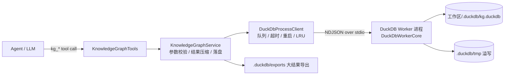

# DuckDB 知识图谱（Gateway 规范）

> 适用版本：DuckDB `2.0.1`（`@duckdb/node-api`）、Node 20+ / Electron 33。
> 代码位置：[server/src/duckdb/](../server/src/duckdb)、[KnowledgeGraphService.ts](../server/src/services/KnowledgeGraphService.ts)、[KnowledgeGraphTools.ts](../server/src/tools/KnowledgeGraphTools.ts)。

## 1. 目标与硬性边界

为 Agent 提供**百万级实体关系图**的建模、写入、遍历、路径与分析能力，并且：

| 约束 | 落地方式 |
| --- | --- |
| 只用 DuckDB，轻量、无独立服务 | 嵌入式 DuckDB 文件库 + 单进程 Worker |
| 数据文件固定在工作区 `.duckdb/` | Worker `open` 时强制校验目录与扩展名 |
| Agent 只能通过 tool 交互 | 只注册 `kg_*` 工具；工具内不暴露连接 |
| 禁止直接操作数据文件 | 工具层拒绝 `.duckdb` / `.wal` 路径；SQL 层拦截 `ATTACH/COPY/read_*` |
| 只允许 Node 生态库 | 唯一新增依赖 `@duckdb/node-api` |
| DuckDB 单独进程 + IPC | `child_process.spawn` + NDJSON over stdio |
| 百万级复杂分析 | 列式聚合 + 递归 CTE + 迭代算法（实测见 §7） |

**禁止事项（P0）**

1. 禁止用 `read_file` / `file_write` / `file_replace` / `run_powershell_command` 等工具读写 `.duckdb/*.duckdb`、`*.wal`、`*.tmp`。
2. 禁止在 `kg_query` 里执行写语句、`PRAGMA`、`ATTACH`、`COPY`、`read_csv/read_json/read_parquet`、`glob` 等文件访问。
3. 禁止把数据库文件复制到工作区外、提交到 Git 或上传。
4. 禁止绕过 `kg_import` 直接把百万行数据塞进一次 `kg_upsert`（单次上限 5000）。

**允许的核验方式**：`kg_admin validate`（完整性）、`kg_admin status`（容量/配置）、`kg_query`（只读核对）、`kg_admin schema`。

## 2. 架构



- **一个工作区一个 Worker 进程**：DuckDB 单文件单写者，串行执行所有请求。
- **进程隔离**：原生 `duckdb.node` 只在 Worker 内加载，主进程不加载原生模块；Worker 崩溃不影响 IDE。
- **内存隔离**：`memory_limit`（默认 2048MB）与 V8 堆上限（默认 2048MB）独立配置，超限溢写到 `.duckdb/tmp`。
- **生命周期**：首次调用拉起；空闲 5 分钟回收；最多同时 3 个工作区实例（LRU 淘汰空闲）；60 秒内崩溃 5 次熔断并提示查 stderr。
- **协议**：请求 `{id, op, payload, timeoutMs}`，响应 `{id, ok, result|error}`；`ready` 握手校验协议版本；`cancel` 触发 `connection.interrupt()`。

### 2.1 目录布局

```text
<workspace>/.duckdb/
├── kg.duckdb          # 唯一数据库文件（禁止直接读写）
├── kg.duckdb.wal      # WAL（禁止直接读写）
├── tmp/               # DuckDB 溢写目录
└── exports/           # kg_query/kg_import 的大结果导出（可读）
```

## 3. 数据模型

```sql
kg_nodes(
  id VARCHAR PRIMARY KEY,
  type VARCHAR NOT NULL,
  name VARCHAR,
  props JSON,
  created_at TIMESTAMP, updated_at TIMESTAMP
)

kg_edges(
  src VARCHAR NOT NULL,
  dst VARCHAR NOT NULL,
  type VARCHAR NOT NULL,
  weight DOUBLE NOT NULL DEFAULT 1.0,
  props JSON,
  created_at TIMESTAMP, updated_at TIMESTAMP,
  PRIMARY KEY (src, dst, type)
)

kg_metrics(node_id, metric, value DOUBLE, label VARCHAR, updated_at)  -- 分析结果
kg_meta(key, value)                                                   -- schema_version 等
```

索引：`kg_edges(src)`、`kg_edges(dst)`、`kg_edges(type)`、`kg_nodes(type)`、`kg_metrics(metric)`。

**语义约定**

- 节点按 `id` UPSERT；边按 `(src, dst, type)` UPSERT（同一对节点可有多种关系）。
- `props` 支持任意 JSON；未传时保留旧值，传 `{}` 可覆盖为空对象。
- 删除节点默认级联删除其关联边（`cascade` 默认 `true`）。
- `props` 查询示例：`WHERE props->>'risk' = 'high'`，或 `json_extract_string(props, '$.risk')`。

## 4. 工具契约

| 工具 | 用途 | 关键参数 |
| --- | --- | --- |
| `kg_admin` | 运维与核验 | `action`: `status` / `schema` / `optimize` / `validate` |
| `kg_query` | 只读 SQL | `sql`, `params`, `maxRows`(≤2000), `outputPath`, `format` |
| `kg_upsert` | 幂等写节点/边 | `nodes[]`, `edges[]`（单次 ≤5000） |
| `kg_delete` | 删节点/边 | `nodeIds`/`nodeTypes`/`edgeTypes`/`edgeKeys`/`all`+`confirm` |
| `kg_traverse` | N 跳邻域 | `startIds`, `depth`(≤10), `direction`, `edgeTypes`, `nodeTypes` |
| `kg_path` | 最短路径（BFS） | `from`, `to`, `maxDepth`(≤10), `direction`, `maxPaths` |
| `kg_analyze` | 图算法 | `algorithm`, `topN`, `iterations`, `persist` |
| `kg_import` | 文件批量导入 | `target`, `path`, `format`, `columnMap`, `mode` |

### 4.1 写入

```text
kg_upsert {
  nodes: [{ id: "p1", type: "person", name: "张三", props: { dept: "风控" } }],
  edges: [{ src: "p1", dst: "c1", type: "works_at", weight: 1 }]
}
```

- 单次最多 5000 个节点/边；服务层自动按 2000 分片顺序提交。
- 单条消息内的 `props` ≤ 64KB。
- 大批量（≥1 万行）**必须**走 `kg_import`：NDJSON / JSON / CSV / Parquet。

### 4.2 查询

```text
kg_query { sql: "SELECT type, count(*) c FROM kg_nodes GROUP BY type ORDER BY c DESC LIMIT 20" }
kg_query { sql: "SELECT * FROM kg_edges WHERE type = ? LIMIT 100", params: ["works_at"] }
kg_query { sql: "SELECT * FROM kg_nodes WHERE type = 'person'", outputPath: ".duckdb/exports/persons.parquet" }
```

- 仅单条 `SELECT/WITH/DESCRIBE/SUMMARIZE/EXPLAIN`。
- `params` 只支持标量数组；列表过滤请传 JSON 字符串再用 `?::JSON` / `json_each`。
- 默认 200 行、上限 2000 行；超出用 `WHERE`/`LIMIT` 或 `outputPath` 导出。
- 文本结果 ≤48KB 直接返回；超限自动写入 `.duckdb/exports/<tool>-<时间>.json` 并返回预览与路径。

### 4.3 遍历与路径

```text
kg_traverse { startIds: ["p1"], depth: 2, direction: "both", edgeTypes: ["works_at"] }
kg_path     { from: "p1", to: "p9", maxDepth: 4, direction: "out" }
```

- `direction=both` 使用 LATERAL 双分支，得到真正的无向可达性（不是"只出"或"只入"）。
- 节点上限默认 200 / 边上限 500，按 `depth` 升序返回；`nodeTypes` 只过滤返回节点。
- `kg_traverse` 上限 10 跳：百万级稠密图（100 万边 / 5 万节点）10 跳实测 ≈0.46s 可覆盖全图；日常建议 `depth ≤ 3`，输出仍受 `maxNodes`/`maxEdges` 限制。
- `kg_path` 采用逐层 BFS + visited 去重，工作量 O(V+E)，上限 10 跳；稠密图建议 `maxDepth ≤ 6`，避免一次搜索覆盖全图。旧版递归 CTE 按路径枚举，稠密图 6 跳即指数爆炸，已废弃。

### 4.4 分析

| algorithm | 说明 | 规模建议 |
| --- | --- | --- |
| `summary` | 节点/边/类型分布/孤立节点/平均度 | 任意 |
| `degree` | 入度/出度/总度 Top N，可持久化 | 任意 |
| `pagerank` | 迭代 PageRank，支持 dangling 节点 | ≤1000 万边，迭代 20 |
| `components` | 弱连通分量（min-label 传播） | ≤1000 万边 |
| `communities` | 标签传播社区（近似） | ≤1000 万边 |

`persist: true` 会把结果写入 `kg_metrics`，后续可直接用 `kg_query` 复用：

```sql
SELECT m.node_id, m.value FROM kg_metrics m
WHERE m.metric = 'pagerank' ORDER BY m.value DESC LIMIT 20
```

### 4.5 导入

```text
kg_import { target: "nodes", path: "data/nodes.ndjson" }
kg_import { target: "edges", path: "data/edges.csv",
            columnMap: { src: "from_id", dst: "to_id", type: "rel" } }
kg_import { target: "nodes", path: "data/nodes.parquet", mode: "replace", confirm: true }
```

- `format` 缺省按扩展名推断：`.json/.ndjson/.jsonl`、`.csv/.tsv`、`.parquet`。
- NDJSON 每行一个对象；`props` 可以是对象或 JSON 字符串。
- `columnMap` 的键只允许 `id/type/name/props/src/dst/weight`，值必须是合法列名。
- `mode=replace` 先清空目标表，必须 `confirm: true`。

## 5. 使用规范（Agent 行为准则）

1. **先建模后写入**：先 `kg_admin schema` 或阅读本文档确认字段；节点类型/关系类型用稳定英文标识（`person`、`works_at`），展示名放 `name`。
2. **幂等优先**：重复导入/重跑用 `kg_upsert` 或 `kg_import`（merge），不要 `replace`。
3. **控制上下文**：任何可能超过 200 行的查询都显式 `LIMIT`；需要全量结果时用 `outputPath`。
4. **先聚合后明细**：百万级图先用 `kg_analyze summary` / `degree` 定位热点，再 `kg_traverse` 取子图。
5. **不猜 ID**：用 `kg_query` 先按 `name`/`props` 查 ID，再做遍历。
6. **一次一件事**：`kg_query` 只允许单条 SQL；多步分析拆成多次调用。
7. **失败即降规模**：超时/内存错误时降低 `depth`、加 `edgeTypes` 过滤、提高 `iterations` 前先确认数据量。
8. **核验用工具**：`kg_admin validate` 检查孤儿边、空 ID、孤立节点；禁止绕过工具读文件。

## 6. 安全与隔离

- **路径白名单**：`kg_import` / `outputPath` 必须是工作区内路径；`.duckdb`/`.wal` 直接拒绝。
- **SQL 白名单**：只读前缀 + 禁止关键字/函数 + 禁止 `FROM 'file'`；写操作只能经结构化工具。
- **标识符校验**：`columnMap` 只允许 `[A-Za-z_][A-Za-z0-9_$]*`，杜绝列名注入。
- **参数化**：所有值走 `?` 绑定；列表走 JSON 参数 + `json_each`。
- **进程隔离**：Worker 只继承必要环境变量；stdout 仅协议，日志走 stderr。

## 7. 百万级性能指南

本机（Windows / Node 24 / DuckDB 2.0.1 / 4 threads / 4GB）实测：

| 场景 | 数据量 | 耗时 |
| --- | --- | --- |
| 建表 + 装载 | 30 万节点 + 100 万边 | ≈2.3s |
| 建 4 个索引 | 100 万边 | ≈0.6s |
| 双向邻域 depth=2 | 100 万边 | ≈93ms |
| 双向邻域 depth=6 | 100 万边 / 5 万节点稠密图 | ≈0.29s |
| 双向邻域 depth=10 | 100 万边 / 5 万节点稠密图 | ≈0.46s |
| BFS 最短路径 depth≤10 | 100 万边 / 5 万节点稠密图 | ≈0.62s |
| PageRank × 20 迭代 | 100 万边 | ≈2.8s |
| 连通分量 × 5 迭代 | 20 万边 | ≈0.4s |

实践建议：

- **导入**：优先 Parquet/NDJSON（`kg_import`），比逐条 `kg_upsert` 快一个数量级。
- **内存**：`DUCKDB_MEMORY_LIMIT_MB` 默认 2048；百万级建议 2048–4096，超过部分溢写到 `.duckdb/tmp`。
- **线程**：`DUCKDB_THREADS` 默认 `min(4, CPU-1)`；分析与导入可临时调高。
- **过滤前置**：遍历时用 `edgeTypes`/`nodeTypes` 缩小搜索空间；查询时用 `type`、`props->>` + `LIMIT`。
- **避免**：`LIKE '%x%'` 全表扫描、无过滤的多跳遍历、一次返回全量边。
- **规模上限**：单库建议 ≤1000 万边；更大规模按业务域拆分为多个工作区/库，或用 `kg_query` 导出后离线分析。
- **写放大**：频繁小批量写入会产生大量 WAL；导入完成后执行 `kg_admin optimize`（CHECKPOINT）。

## 8. 环境变量

| 变量 | 默认 | 说明 |
| --- | --- | --- |
| `DUCKDB_WORKER_ENTRY` | 自动探测 | Worker bundle 绝对路径 |
| `DUCKDB_NODE_PATH` | `process.execPath` | Node/Electron 可执行文件 |
| `DUCKDB_MEMORY_LIMIT_MB` | 2048 | DuckDB `memory_limit` |
| `DUCKDB_THREADS` | `min(4, CPU-1)` | DuckDB `threads` |
| `DUCKDB_QUERY_TIMEOUT_MS` | 120000 | 单请求超时（上限 600000） |
| `DUCKDB_IDLE_TIMEOUT_MS` | 300000 | 空闲回收 |
| `DUCKDB_MAX_WORKERS` | 3 | 同时存活的工作区 Worker 数 |
| `DUCKDB_WORKER_HEAP_MB` | 2048 | Worker V8 堆上限 |
| `DUCKDB_DISABLED` | — | `1` 时关闭知识图谱能力 |

## 9. 构建与打包

```bash
# 仅构建 DuckDB Worker
pnpm --filter deepseek-ide-agent-electron run build:duckdb-worker

# 完整构建（dev.mjs / electron:build 会自动包含）
pnpm run electron:build
```

- Worker bundle：`electron/dist/workers/duckdbWorker.cjs`（CJS，`@duckdb/*` external）。
- 打包：`electron-builder.yml` 已配置 `asarUnpack: node_modules/@duckdb/**`，原生 `.node/.dll` 不在 asar 内。
- 运行时：Electron 通过 `ELECTRON_RUN_AS_NODE=1` 拉起 Worker；`NODE_PATH` 兜底 `app.asar.unpacked/node_modules`。
- 入口探测顺序：`DUCKDB_WORKER_ENTRY` → `resources/app.asar/dist/workers` → `resources/workers` → 开发目录 `electron/dist/workers`。

## 10. 故障排查

| 现象 | 原因 | 处理 |
| --- | --- | --- |
| `WORKER_UNAVAILABLE` / 找不到入口 | 未构建 Worker | `pnpm --filter deepseek-ide-agent-electron run build:duckdb-worker` |
| `Cannot find module '@duckdb/node-bindings-*'` | 平台包缺失或 asar 未解包 | 确认 `pnpm install` 完成；检查 `asarUnpack` |
| `Could not set lock on file` | 另一个进程已打开同一 DB | 关闭其它 DuckDB 客户端；仅保留 Worker |
| `WORKER_TIMEOUT` | 查询/算法过大 | 降低 `depth`/`iterations`、加过滤、缩小时间范围 |
| `SQL_REJECTED` | 写了非只读 SQL 或文件函数 | 改用 `kg_upsert`/`kg_import`/`kg_query` 只读 |
| `PATH_REJECTED` | 路径越界或指向 `.duckdb` 文件 | 使用工作区相对路径；数据库只用工具访问 |
| Worker 反复崩溃 | 内存不足/数据损坏 | 查看 stderr 尾部提示；`kg_admin validate`；必要时导出重建 |

## 11. 推荐工作流

```text
1. kg_admin status                       # 确认库状态
2. kg_import  (nodes/edges, parquet)     # 百万级批量入库
3. kg_analyze summary                    # 规模/类型分布抽查
4. kg_analyze degree topN=20             # 找热点
5. kg_traverse startIds=[...] depth=2    # 取子图
6. kg_path from=... to=...               # 关系链
7. kg_analyze pagerank/communities persist=true
8. kg_query 读 kg_metrics                # 复用分析结果
9. kg_admin optimize                     # CHECKPOINT 收敛 WAL
```
