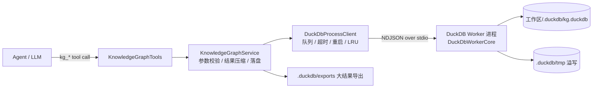

# DuckDB 知识图谱（Gateway 规范）

> 适用版本：DuckDB `2.0.1`（`@duckdb/node-api`）、Node 20+ / Electron 33。
> 代码位置：[server/src/duckdb/](../server/src/duckdb)、[KnowledgeGraphService.ts](../server/src/services/KnowledgeGraphService.ts)、[KnowledgeGraphTools.ts](../server/src/tools/KnowledgeGraphTools.ts)。

## 1. 目标与硬性边界

为 Agent 提供**百万级实体关系图**的建模、写入、遍历、路径与分析能力，并且：

| 约束 | 落地方式 |
| --- | --- |
| 只用 DuckDB，轻量、无独立服务 | 嵌入式 DuckDB 文件库 + 单进程 Worker |
| 数据文件固定在工作区 `.duckdb/` | Worker `open` 时强制校验目录与扩展名 |
| Agent 只能通过 tool 交互 | 只注册 `kg_*` 工具；工具内不暴露连接 |
| 禁止直接操作数据文件 | 工具层拒绝 `.duckdb` / `.wal` 路径；SQL 层拦截 `ATTACH/COPY/read_*` |
| 属性先声明后使用 | `kg_attr_define` 声明类型/必填/枚举/索引；写入强校验；`kg_lint` 核验 |
| 语义唯一性可强约束 | `kg_vocab` + `kg_attr_define(unique/identity)` 写入即拒绝冲突；`kg_lint` 编译式复检 |
| 只允许 Node 生态库 | 唯一新增依赖 `@duckdb/node-api` |
| DuckDB 单独进程 + IPC | `child_process.spawn` + NDJSON over stdio |
| 百万级复杂分析 | 列式聚合 + 递归 CTE + BFS + 迭代算法（实测见 §7） |

**禁止事项（P0）**

1. 禁止用 `read_file` / `file_write` / `file_replace` / `run_powershell_command` 等工具读写 `.duckdb/*.duckdb`、`*.wal`、`*.tmp`。
2. 禁止在 `kg_query` 里执行写语句、`PRAGMA`、`ATTACH`、`COPY`、`read_csv/read_json/read_parquet`、`glob` 等文件访问。
3. 禁止把数据库文件复制到工作区外、提交到 Git 或上传。
4. 禁止绕过 `kg_import` 直接把百万行数据塞进一次 `kg_upsert`（单次上限 5000）。
5. 禁止写入数组/标量形式的 `props`（必须是 JSON 对象）；禁止对 `json` 类型属性建索引（工具会拒绝）。

**允许的核验方式**：`kg_lint`（语义编译 + 完整性）、`kg_admin validate`（完整性）、`kg_admin status`（容量/配置）、`kg_query`（只读核对）、`kg_admin schema`。

## 2. 架构



- **一个工作区一个 Worker 进程**：DuckDB 单文件单写者，串行执行所有请求。
- **进程隔离**：原生 `duckdb.node` 只在 Worker 内加载，主进程不加载原生模块；Worker 崩溃不影响 IDE。
- **内存隔离**：`memory_limit`（默认 2048MB）与 V8 堆上限（默认 2048MB）独立配置，超限溢写到 `.duckdb/tmp`。
- **生命周期**：首次调用拉起；空闲 5 分钟回收；最多同时 3 个工作区实例（LRU 淘汰空闲）；60 秒内崩溃 5 次熔断并提示查 stderr。
- **协议**：请求 `{id, op, payload, timeoutMs}`，响应 `{id, ok, result|error}`；`ready` 握手校验协议版本；`cancel` 触发 `connection.interrupt()`。

### 2.1 目录布局

```text
<workspace>/.duckdb/
├── kg.duckdb          # 唯一数据库文件（禁止直接读写）
├── kg.duckdb.wal      # WAL（禁止直接读写）
├── tmp/               # DuckDB 溢写目录
└── exports/           # kg_query/kg_import 的大结果导出（可读）
```

## 3. 数据模型

```sql
kg_nodes(
  id VARCHAR PRIMARY KEY,
  type VARCHAR NOT NULL,
  name VARCHAR,
  props JSON,                             -- 属性对象（key-value，非数组/标量）
  created_at TIMESTAMP, updated_at TIMESTAMP
)

kg_edges(
  src VARCHAR NOT NULL,
  dst VARCHAR NOT NULL,
  type VARCHAR NOT NULL,
  weight DOUBLE NOT NULL DEFAULT 1.0,
  props JSON,                             -- 边属性对象
  created_at TIMESTAMP, updated_at TIMESTAMP,
  PRIMARY KEY (src, dst, type)
)

kg_metrics(node_id, metric, value DOUBLE, label VARCHAR, updated_at)  -- 分析结果
kg_meta(key, value)                                                   -- schema_version 等

-- 属性治理
kg_attr_defs(scope, key, value_type, description,
             required, indexed, enum_values,
             domain JSON,                 -- rdfs:domain（允许的实体类型）
             unique_value BOOLEAN,        -- owl:InverseFunctionalProperty
             identity BOOLEAN,            -- 组成实体自然键
             created_at, updated_at)
kg_node_props(node_id, key, val_text, val_num)                         -- 索引属性（可选）
kg_edge_props(src, dst, type, key, val_text, val_num)                  -- 索引属性（可选）

-- 语义层（schema v3）
kg_vocab_defs(kind, name, parent, domain_types JSON, range_types JSON,
              is_symmetric, is_transitive, description)                -- class / property 词表
kg_identity(key_hash VARCHAR PRIMARY KEY, node_id, keys_json, updated_at)  -- 身份键（md5）
```

索引：`kg_edges(src)`、`kg_edges(dst)`、`kg_edges(type)`、`kg_nodes(type)`、`kg_metrics(metric)`；
属性索引：`kg_node_props(key,val_text)`、`kg_node_props(key,val_num)`、`kg_edge_props(key,val_text)`、`kg_edge_props(key,val_num)`；
语义索引：`kg_identity(node_id)`、`kg_vocab_defs(kind,parent)`。

**语义约定**

- 节点按 `id` UPSERT；边按 `(src, dst, type)` UPSERT（同一对节点可有多种关系）。
- `props` 必须是 JSON **对象**（key-value），不支持数组/标量；未传时保留旧值，传 `{}` 可覆盖为空对象。
- 删除节点默认级联删除其关联边（`cascade` 默认 `true`）。
- `props` 查询示例：`WHERE props->>'risk' = 'high'`，或 `json_extract_string(props, '$.risk')`。

### 3.1 属性模型与治理规范

**属性命名与类型**

| 规则 | 说明 |
| --- | --- |
| key 格式 | `[A-Za-z_][A-Za-z0-9_]{0,63}`；只支持扁平 key，不含点/引号/空格 |
| value_type | `string` / `number` / `boolean` / `date`（ISO 时间字符串）/ `json` |
| 单实体大小 | `props` ≤ 64KB |
| 索引 | 仅 `string/number/boolean/date` 可 `indexed:true`；`json` 不可索引 |

**治理流程**

1. **先声明**：写入前用 `kg_attr_define` 声明属性（类型、是否必填、枚举、是否索引）。
2. **写入即校验**：`kg_upsert` 会按规范校验已声明属性（必填/类型/枚举）；未声明属性默认返回 warning，`strictProps:true` 时直接拒绝。
3. **索引维护**：`indexed:true` 会写入 `kg_node_props` / `kg_edge_props` 实体化索引；upsert/delete/import 自动增量维护。
4. **批量导入后核验**：`kg_import` 结束会重建该 scope 的索引；随后执行 `kg_admin validate` 检查必填/类型/枚举/索引漂移。
5. **重建索引**：索引异常或历史数据变更后执行 `kg_admin reindex`。
6. **删除规范**：`kg_attr_delete` 只删规范与索引，**不删除** props 历史值。

**规范 → 工具映射（每条规范都有可执行工具）**

| 规范 | 落地工具 |
| --- | --- |
| 属性先声明后使用 | `kg_attr_define` |
| 必填 / 类型 / 枚举校验 | `kg_upsert`（写入时强校验）、`kg_admin validate`（存量核验） |
| 未声明属性治理 | `kg_upsert`（`strictProps`）、`kg_admin validate`（`*_undeclared_attrs`） |
| 属性可检索 / 索引一致性 | `kg_attr_define(indexed:true)`、`kg_admin reindex`、`kg_admin validate(*_index_drift)` |
| 属性统计与取值分布 | `kg_attr_list(includeStats,topValues)` |
| 删除属性规范/索引 | `kg_attr_delete` |
| 结构化属性检索 | `kg_find` |
| 检索即发现未声明属性 | `kg_find`（返回 `undeclaredKeys` 并提示不走索引） |
| 合规结论（合规/违规清单） | `kg_admin validate`（`✅ 合规` / `❌ N 项违规`，含 `severity`） |
| 多跳属性约束 | `kg_traverse` / `kg_path`（`nodeFilter`/`edgeFilter`/`hopFilters`） |
| 节点/边唯一性 | `kg_upsert`（主键 UPSERT） |
| 类型词表 / 子类层级 | `kg_vocab(define kind:"class"/"property", parent)` |
| 关系 domain/range | `kg_vocab(domain, range)` + `kg_upsert` 写入校验 + `kg_lint` 存量校验 |
| 属性取值唯一（IFP） | `kg_attr_define(unique:true)` + `kg_upsert` 冲突拒绝 + `kg_lint(attr_unique_duplicate)` |
| 实体同一性（自然键） | `kg_attr_define(identity:true)` + `kg_identity` 索引 + `kg_lint(identity_*)` |
| 重复实体归一（sameAs） | `kg_merge(confirm:true)` |
| 对称 / 传递一致性 | `kg_vocab(symmetric/transitive)` + `kg_lint`（`symmetric_missing_inverse` / `transitive_missing_shortcut`） |
| 编译门禁 | `kg_lint(strict:true)`（error 与 warning 均不通过） |
| 孤儿边治理 | `kg_admin validate`、`kg_delete(cascade:true)` |
| 全量重建 | `kg_import(mode:"replace", confirm:true)` |

### 3.2 多跳属性推理

属性谓词统一为 `{ key, op, value }`，数组表示 AND：

| op | 适用类型 | 示例 |
| --- | --- | --- |
| `eq` / `ne` | string / number / boolean | `{"key":"risk","op":"eq","value":"high"}` |
| `gt` / `gte` / `lt` / `lte` | number / date | `{"key":"amount","op":"gte","value":100000}` |
| `contains` / `starts_with` | string | `{"key":"name","op":"contains","value":"银行"}` |
| `exists` | 任意 | `{"key":"risk","op":"exists"}`（也可带 `"value":null`） |
| `in` | 任意（数组） | `{"key":"risk","op":"in","value":["high","medium"]}` |

- 谓词里出现**未声明**的 key 时不会报错，但会在 `kg_find` 结果里返回 `undeclaredKeys` 并提示「不走索引」；先 `kg_attr_define` 才能建索引。
- 请求返回的 `props` 已解析为 JSON 对象（`{"risk":"high"}`），无需再二次 `JSON.parse`。

**推理模式**

```text
# 1) 用属性找起点（命中的是已声明且 indexed 的属性时走索引）
kg_find { scope:"nodes", types:["company"],
          filter:[{key:"risk",op:"eq",value:"high"}],
          propKeys:["risk","region"], limit:50 }

# 2) 带属性约束的多跳邻域
kg_traverse { startIds:["c1"], depth:3, direction:"both",
              edgeFilter:[{key:"amount",op:"gte",value:100000}],
              nodeFilter:{key:"risk",op:"eq",value:"high"},
              edgePropKeys:["amount","when"], nodePropKeys:["risk"] }

# 3) 逐跳约束的关系链（第 1 项作用于第 1 跳）
kg_path { from:"p1", to:"c9", maxDepth:6, direction:"out",
          hopFilters:[
            { edgeFilter:[{key:"amount",op:"gte",value:100000}] },
            { nodeFilter:{key:"risk",op:"eq",value:"high"} }
          ],
          edgePropKeys:["amount","when"], nodePropKeys:["risk"] }

# 4) 复杂聚合直接写只读 SQL（可 join 属性索引表）
kg_query { sql: "SELECT p.val_text AS risk, count(*) c
                 FROM kg_nodes n JOIN kg_node_props p ON p.node_id = n.id
                 WHERE p.key = 'risk' GROUP BY 1 ORDER BY c DESC" }
```

**语义边界**

- `kg_traverse.edgeFilter` 约束「可走的边」，并同样约束返回的边集合；`nodeFilter` 约束「新到达的节点」（起点是锚点，不受约束）。
- `kg_path.hopFilters[i]` 只作用于第 i+1 跳，与全局 `nodeFilter`/`edgeFilter` 取 AND；`maxDepth` 上限 10。
- `nodeTypes` 只过滤返回节点，不限制遍历；需要限制遍历请用 `nodeFilter`。
- `nodePropKeys` / `edgePropKeys` 只返回指定属性（≤20 个），避免上下文膨胀；不传则不返回 props。

### 3.3 语义唯一性与 RDF 对齐规范

模型不发明新语义，直接对齐 RDF/RDFS/OWL 的可落地子集（不引入三元组存储，仍用属性图落地）。

| RDF/OWL/SHACL 概念 | 本实现 | 落地工具 |
| --- | --- | --- |
| IRI 全局唯一命名 | 类型名/属性 key 统一命名空间校验 `[A-Za-z_][A-Za-z0-9_.:-]{0,127}` | `kg_vocab define`、`kg_attr_define` |
| `rdfs:Class` + `rdfs:subClassOf` | `kind:"class"` + `parent`，domain/range 自动展开子类 | `kg_vocab define kind:"class"` |
| `rdf:Property` + `rdfs:subPropertyOf` | `kind:"property"` + `parent`，子属性继承父属性约束 | `kg_vocab define kind:"property"` |
| `rdfs:domain` / `rdfs:range` | 关系起点/终点类型约束；属性只允许出现在指定类型上 | `kg_vocab define`、`kg_attr_define(domain)` |
| `owl:InverseFunctionalProperty` | 属性值跨实体唯一 | `kg_attr_define(unique:true)` |
| 自然键 / 实体同一性 | 多个 `identity` 属性组成节点身份键（md5 索引） | `kg_attr_define(identity:true)` |
| 三元组唯一性 `(s,p,o)` | 边主键 `(src,dst,type)` | `kg_upsert`（UPSERT） |
| `owl:sameAs` 归一 | 合并重复实体、改接关系、去自环 | `kg_merge` |
| `owl:SymmetricProperty` | 对称关系必须成对出现 | `kg_vocab define symmetric:true` + `kg_lint` |
| `owl:TransitiveProperty` | 传递关系应有闭包捷径边 | `kg_vocab define transitive:true` + `kg_lint deep:true` |
| SHACL 形状校验 | 编译式检查：`code/severity/count/sample/hint` | `kg_lint` |

**语义唯一性三层防线**

| 层 | 机制 | 失败行为 |
| --- | --- | --- |
| 写入时 | `domain`/`range`/属性域校验，`unique`/`identity` 冲突检测 | `kg_upsert` 直接拒绝并指出冲突实体 |
| 编译时 | `kg_lint` 全量体检（含词表、唯一性、身份键、索引漂移、对称/传递） | 返回 `❌ N 类 error`，`strict:true` 时 warning 也不通过 |
| 修复时 | `kg_merge` 归一重复实体、`kg_admin reindex` 重建索引 | 复检 `kg_lint` 直至 `ok:true` |

**关键约定**

1. **声明优于隐含**：词表/属性未声明时写入仍可用（兼容探索期），但只有声明后才会获得强校验；`strictSchema:true` 可强制拒绝未声明类型。
2. **唯一性只能靠声明**：RDF 本身没有全局唯一约束，`unique`/`identity` 就是本实现提供的 `owl:InverseFunctionalProperty` 能力；声明即生效，写入冲突必须先用 `kg_merge` 归一。
3. **身份键是实体同一性的唯一判据**：`identity` 属性组合哈希存于 `kg_identity`，写入即校验；`kg_lint` 会对历史数据报 `identity_duplicate` / `identity_incomplete` / `identity_index_drift`。
4. **词表演进会立刻暴露历史违规**：收紧 `domain/range` 后，旧数据不会自动改写，而是由 `kg_lint` 报 `edge_domain_violation` / `edge_range_violation`，必须先修复再发布。
5. **删除词表不删数据**：`kg_vocab delete` 只移除约束声明，数据保留；重新声明即可恢复校验。


## 4. 工具契约

| 工具 | 用途 | 关键参数 |
| --- | --- | --- |
| `kg_admin` | 运维与核验 | `action`: `status` / `schema` / `optimize` / `validate` / `reindex` |
| `kg_query` | 只读 SQL | `sql`, `params`, `maxRows`(≤2000), `outputPath`, `format` |
| `kg_upsert` | 幂等写节点/边 | `nodes[]`, `edges[]`（单次 ≤5000）, `strictProps`, `strictSchema` |
| `kg_delete` | 删节点/边 | `nodeIds`/`nodeTypes`/`edgeTypes`/`edgeKeys`/`all`+`confirm` |
| `kg_traverse` | N 跳邻域 | `startIds`, `depth`(≤10), `direction`, `nodeFilter`, `edgeFilter`, `nodePropKeys`, `edgePropKeys` |
| `kg_path` | 最短路径（BFS） | `from`, `to`, `maxDepth`(≤10), `hopFilters`, `edgeFilter`, `nodePropKeys`, `edgePropKeys` |
| `kg_analyze` | 图算法 | `algorithm`, `topN`, `iterations`, `persist` |
| `kg_import` | 文件批量导入 | `target`, `path`, `format`, `columnMap`, `mode` |
| `kg_attr_define` | 声明/更新属性规范 | `scope`, `key`, `type`, `required`, `enum`, `indexed`, `unique`, `identity`, `domain` |
| `kg_attr_list` | 属性规范与统计 | `scope`, `includeStats`, `topValues` |
| `kg_attr_delete` | 删除属性规范/索引 | `scope`, `key` |
| `kg_find` | 按属性检索实体/关系 | `scope`, `filter`, `types`, `propKeys`, `limit` |
| `kg_vocab` | 类型词表（RDFS/OWL 子集） | `action`(`define`/`list`/`delete`), `kind`(`class`/`property`), `name`, `parent`, `domain`, `range`, `symmetric`, `transitive` |
| `kg_lint` | 语义编译校验 | `strict`, `deep`, `maxIssues`(≤200), `sampleLimit`, `codes` |
| `kg_merge` | 合并重复实体 | `source`, `target`, `keepProps`(`merge`/`target`/`source`), `confirm` |

### 4.1 写入

```text
kg_upsert {
  nodes: [{ id: "p1", type: "person", name: "张三", props: { dept: "风控" } }],
  edges: [{ src: "p1", dst: "c1", type: "works_at", weight: 1 }]
}
```

- 单次最多 5000 个节点/边；服务层自动按 2000 分片顺序提交。
- 单条消息内的 `props` ≤ 64KB，且必须是 JSON 对象。
- 已声明属性会强校验（必填/类型/枚举）；未声明属性默认返回 warning，`strictProps:true` 时直接拒绝。
- 大批量（≥1 万行）**必须**走 `kg_import`：NDJSON / JSON / CSV / Parquet。

### 4.2 查询

```text
kg_query { sql: "SELECT type, count(*) c FROM kg_nodes GROUP BY type ORDER BY c DESC LIMIT 20" }
kg_query { sql: "SELECT * FROM kg_edges WHERE type = ? LIMIT 100", params: ["works_at"] }
kg_query { sql: "SELECT * FROM kg_nodes WHERE type = 'person'", outputPath: ".duckdb/exports/persons.parquet" }
```

- 仅单条 `SELECT/WITH/DESCRIBE/SUMMARIZE/EXPLAIN`。
- `params` 只支持标量数组；列表过滤请传 JSON 字符串再用 `?::JSON` / `json_each`。
- 默认 200 行、上限 2000 行；超出用 `WHERE`/`LIMIT` 或 `outputPath` 导出。
- 文本结果 ≤48KB 直接返回；超限自动写入 `.duckdb/exports/<tool>-<时间>.json` 并返回预览与路径。

### 4.3 遍历与路径

```text
kg_traverse { startIds: ["p1"], depth: 2, direction: "both", edgeTypes: ["works_at"] }
kg_path     { from: "p1", to: "p9", maxDepth: 4, direction: "out" }
```

- `direction=both` 使用 LATERAL 双分支，得到真正的无向可达性（不是"只出"或"只入"）。
- `edgeFilter` 约束可走的边（并约束返回边集合）；`nodeFilter` 约束新到达的节点；`nodeTypes` 只过滤返回节点。
- `nodePropKeys` / `edgePropKeys` 只返回指定属性（≤20 个）；不传则不返回 props。
- 节点上限默认 200 / 边上限 500，按 `depth` 升序返回；`nodeTypes` 只过滤返回节点。
- `kg_traverse` 上限 10 跳：百万级稠密图（100 万边 / 5 万节点）10 跳实测 ≈0.46s 可覆盖全图；日常建议 `depth ≤ 3`，输出仍受 `maxNodes`/`maxEdges` 限制。
- `kg_path` 采用逐层 BFS + visited 去重，工作量 O(V+E)，上限 10 跳；`hopFilters[i]` 约束第 i+1 跳，与全局 filter 取 AND；返回每条路径的节点与边（含所选属性）。稠密图建议 `maxDepth ≤ 6`。旧版递归 CTE 按路径枚举，稠密图 6 跳即指数爆炸，已废弃。

### 4.4 分析

| algorithm | 说明 | 规模建议 |
| --- | --- | --- |
| `summary` | 节点/边/类型分布/孤立节点/平均度 | 任意 |
| `degree` | 入度/出度/总度 Top N，可持久化 | 任意 |
| `pagerank` | 迭代 PageRank，支持 dangling 节点 | ≤1000 万边，迭代 20 |
| `components` | 弱连通分量（min-label 传播） | ≤1000 万边 |
| `communities` | 标签传播社区（近似） | ≤1000 万边 |

`persist: true` 会把结果写入 `kg_metrics`，后续可直接用 `kg_query` 复用：

```sql
SELECT m.node_id, m.value FROM kg_metrics m
WHERE m.metric = 'pagerank' ORDER BY m.value DESC LIMIT 20
```

### 4.5 属性管理与检索

```text
kg_attr_define { scope:"node", key:"risk", type:"string",
                 required:true, enum:["high","medium","low"], indexed:true }
kg_attr_list   { scope:"all", includeStats:true, topValues:5 }
kg_attr_delete { scope:"node", key:"risk" }
kg_find        { scope:"nodes", types:["company"],
                 filter:[{key:"risk",op:"eq",value:"high"}],
                 propKeys:["risk","region"], limit:50 }
```

- `kg_attr_define`：`indexed:true` 会立即回填索引；变更已有类型需 `confirm:true`；省略 `indexed/required/enum` 时保留原值。
- `kg_attr_list`：`includeStats` 返回 `presentRows/distinctValues`，`topValues` 返回取值分布；索引属性附带 `indexRows`。
- `kg_attr_delete`：删除规范与索引，保留 props 历史值。
- `kg_find`：`filter` 支持 `eq/ne/gt/gte/lt/lte/contains/starts_with/exists/in`；命中已索引属性时使用属性索引（返回 `usedIndex` 标识）。
- `kg_find` 遇到未声明属性会照常按 props 过滤，但返回 `undeclaredKeys` 并在结果头部告警——这是「该属性没有索引」的提示，不是错误。
- `kg_admin validate` 返回明确结论：`✅ 合规` 或 `❌ N 项违规`，并附 `severity`（`error` 必零 / `info` 仅供参考，如自环、孤立节点、未声明属性）。`error` 类含孤儿边、空 ID、必填缺失、类型/枚举越界、索引漂移、孤儿索引行。

### 4.6 词表与语义编译

```text
# 1) 声明类型层级（rdfs:subClassOf）与关系约束（rdfs:domain/range）
kg_vocab { action:"define", kind:"class", name:"person" }
kg_vocab { action:"define", kind:"class", name:"employee", parent:"person" }
kg_vocab { action:"define", kind:"property", name:"works_at",
           domain:["person"], range:["company"] }
kg_vocab { action:"define", kind:"property", name:"knows", symmetric:true }
kg_vocab { action:"list", kind:"property" }        # 含使用量与生效 domain/range

# 2) 语义唯一性：值唯一（IFP）与实体身份键
kg_attr_define { scope:"node", key:"email", type:"string", unique:true }
kg_attr_define { scope:"node", key:"employee_no", type:"string", identity:true }
kg_attr_define { scope:"node", key:"dept", type:"string", domain:["employee"] }

# 3) 编译式全量校验（发布前门禁）
kg_lint { strict:true, deep:true, maxIssues:50, sampleLimit:3 }

# 4) 归一重复实体（owl:sameAs），改接关系 + 合并属性
kg_merge { source:"p_dup", target:"p1", keepProps:"merge", confirm:true }
```

- `kg_vocab`：`class` 只接受 `parent`；`property` 接受 `parent/domain/range/symmetric/transitive`。父类型不存在时 lint 报 `vocab_unknown_parent`，成环写入即拒绝。
- `kg_vocab list` 返回 `usage`（使用该类型的数据行数）、`effectiveDomain`/`effectiveRange`（含子类展开）与未声明类型清单。
- `kg_lint` 输出 `code/severity/count/message/hint/sample`；`ok = error 为 0`，`strict:true` 时 warning 也必须为 0。`deep:true` 才会做传递闭包检查（较慢）。
- `kg_lint` 诊断码：`vocab_unknown_parent`、`vocab_cycle`、`vocab_undeclared_node_type`、`vocab_undeclared_edge_type`、`edge_domain_violation`、`edge_range_violation`、`attr_domain_violation`、`attr_unique_duplicate`、`identity_duplicate`、`identity_incomplete`、`identity_index_orphans`、`identity_index_drift`、`id_normalized_duplicate`、`symmetric_missing_inverse`、`transitive_missing_shortcut`，以及 `kg_admin validate` 的全部完整性检查项。
- `kg_merge`：`keepProps` 默认 `merge`（target 覆盖同名 key）；源→目标自环会被丢弃并计入 `droppedSelfLoops`；目标已有的同键关系保留（冲突跳过）。合并后自动重建相关属性索引与身份键。
- 写入侧强校验：`kg_upsert` 会拒绝违反 `domain/range`/属性域、`unique` 冲突、`identity` 冲突；`strictSchema:true` 还会拒绝未声明的节点/关系类型。

### 4.7 导入

```text
kg_import { target: "nodes", path: "data/nodes.ndjson" }
kg_import { target: "edges", path: "data/edges.csv",
            columnMap: { src: "from_id", dst: "to_id", type: "rel" } }
kg_import { target: "nodes", path: "data/nodes.parquet", mode: "replace", confirm: true }
```

- `format` 缺省按扩展名推断：`.json/.ndjson/.jsonl`、`.csv/.tsv`、`.parquet`。
- NDJSON 每行一个对象；`props` 可以是对象或 JSON 字符串。
- `columnMap` 的键只允许 `id/type/name/props/src/dst/weight`，值必须是合法列名。
- `mode=replace` 先清空目标表，必须 `confirm: true`。

## 5. 使用规范（Agent 行为准则）

1. **先建模后写入**：先 `kg_admin schema` 或阅读本文档确认字段；节点类型/关系类型用稳定英文标识（`person`、`works_at`），展示名放 `name`。
2. **幂等优先**：重复导入/重跑用 `kg_upsert` 或 `kg_import`（merge），不要 `replace`。
3. **控制上下文**：任何可能超过 200 行的查询都显式 `LIMIT`；需要全量结果时用 `outputPath`。
4. **先聚合后明细**：百万级图先用 `kg_analyze summary` / `degree` 定位热点，再 `kg_traverse` 取子图。
5. **不猜 ID**：用 `kg_find`（属性检索）或 `kg_query` 先查 ID，再做遍历。
6. **属性先声明**：写入新属性前用 `kg_attr_define` 声明类型/必填/枚举；需要 `kg_find` 加速时加 `indexed:true`。
7. **语义唯一性靠声明**：同一实体只能有一个邮箱/工号时，用 `unique:true`（值唯一）或 `identity:true`（组合键）表达；写冲突先 `kg_merge` 再重写。
8. **类型约束用词表**：关系先用 `kg_vocab` 声明 `domain/range`，子类通过 `parent` 表达，domain/range 会自动展开子类。
9. **发布前跑编译校验**：改动词表/属性或批量导入后执行 `kg_lint {strict:true}`，`ok:true` 才算通过；`kg_admin validate` 只看数据完整性。
10. **属性约束推理**：多跳推理优先用 `kg_traverse.nodeFilter/edgeFilter` 与 `kg_path.hopFilters`，只在聚合/自定义 join 时写 SQL。
11. **一次一件事**：`kg_query` 只允许单条 SQL；多步分析拆成多次调用。
12. **失败即降规模**：超时/内存错误时降低 `depth`、加 `edgeTypes`/属性过滤、减少 `iterations`。
13. **核验用工具**：`kg_admin validate` 检查孤儿边、空 ID、必填/类型/枚举、索引漂移；`kg_lint` 额外检查词表/唯一性/身份键/对称传递；禁止绕过工具读文件。

## 6. 安全与隔离

- **路径白名单**：`kg_import` / `outputPath` 必须是工作区内路径；`.duckdb`/`.wal` 直接拒绝。
- **SQL 白名单**：只读前缀 + 禁止关键字/函数 + 禁止 `FROM 'file'`；写操作只能经结构化工具。
- **标识符校验**：`columnMap` 只允许 `[A-Za-z_][A-Za-z0-9_$]*`，杜绝列名注入。
- **参数化**：所有值走 `?` 绑定；列表走 JSON 参数 + `json_each`。
- **进程隔离**：Worker 只继承必要环境变量；stdout 仅协议，日志走 stderr。

## 7. 百万级性能指南

本机（Windows / Node 24 / DuckDB 2.0.1 / 4 threads / 4GB）实测：

| 场景 | 数据量 | 耗时 |
| --- | --- | --- |
| 建表 + 装载 | 30 万节点 + 100 万边 | ≈2.3s |
| 建 4 个索引 | 100 万边 | ≈0.6s |
| 双向邻域 depth=2 | 100 万边 | ≈93ms |
| 双向邻域 depth=6 | 100 万边 / 5 万节点稠密图 | ≈0.29s |
| 双向邻域 depth=10 | 100 万边 / 5 万节点稠密图 | ≈0.46s |
| BFS 最短路径 depth≤10 | 100 万边 / 5 万节点稠密图 | ≈0.62s |
| PageRank × 20 迭代 | 100 万边 | ≈2.8s |
| 连通分量 × 5 迭代 | 20 万边 | ≈0.4s |
| 属性索引回填（3 个属性） | 5 万节点 + 100 万边 | ≈5.9s（一次性，旧实现） |
| `kg_admin reindex`（整表重建，6 属性） | 20 万节点 / 60 万边（120 万索引行） | ≈11.3s |
| `kg_admin reindex` 单 scope（3 属性） | 60 万索引行 | ≈4.4s |
| `kg_lint`（含词表/唯一性/身份/完整性） | 20 万节点 / 60 万边 | ≈1.8s |
| `kg_lint deep:true`（传递闭包） | 同上 | 额外 O(边数×平均出度)，按需开启 |
| `kg_find` 属性等值/范围 | 5 万节点 | ≈10–12ms |
| 属性过滤遍历 depth=3 | 100 万边 | ≈129ms（无过滤 ≈92ms） |

> 索引重建已改为「整表重建（DROP→CREATE→单次批量 INSERT）」：逐 key `DELETE+INSERT` 在带主键的表上会产生行级墓碑并触发全库 checkpoint（百万级单属性实测 20s+），现降为秒级。

实践建议：

- **导入**：优先 Parquet/NDJSON（`kg_import`），比逐条 `kg_upsert` 快一个数量级。
- **内存**：`DUCKDB_MEMORY_LIMIT_MB` 默认 2048；百万级建议 2048–4096，超过部分溢写到 `.duckdb/tmp`。
- **线程**：`DUCKDB_THREADS` 默认 `min(4, CPU-1)`；分析与导入可临时调高。
- **过滤前置**：遍历时用 `edgeTypes`/`edgeFilter` 缩小搜索空间；查询/检索时用 `type`、`kg_find`、`LIMIT`。
- **属性索引**：DuckDB 列式扫描在百万级已很快；`indexed` 主要服务高频/千万级属性检索。索引回填是一次性成本，`kg_import` 会重建索引，导入后可用 `kg_admin optimize` 收敛 WAL。
- **避免**：`LIKE '%x%'` 全表扫描、无过滤的多跳遍历、一次返回全量边、对 `json` 类型属性建索引。
- **规模上限**：单库建议 ≤1000 万边；更大规模按业务域拆分为多个工作区/库，或用 `kg_query` 导出后离线分析。
- **写放大**：频繁小批量写入会产生大量 WAL；导入完成后执行 `kg_admin optimize`（CHECKPOINT）。

## 8. 环境变量

| 变量 | 默认 | 说明 |
| --- | --- | --- |
| `DUCKDB_WORKER_ENTRY` | 自动探测 | Worker bundle 绝对路径 |
| `DUCKDB_NODE_PATH` | `process.execPath` | Node/Electron 可执行文件 |
| `DUCKDB_MEMORY_LIMIT_MB` | 2048 | DuckDB `memory_limit` |
| `DUCKDB_THREADS` | `min(4, CPU-1)` | DuckDB `threads` |
| `DUCKDB_QUERY_TIMEOUT_MS` | 120000 | 单请求超时（上限 600000） |
| `DUCKDB_IDLE_TIMEOUT_MS` | 300000 | 空闲回收 |
| `DUCKDB_MAX_WORKERS` | 3 | 同时存活的工作区 Worker 数 |
| `DUCKDB_WORKER_HEAP_MB` | 2048 | Worker V8 堆上限 |
| `DUCKDB_DISABLED` | — | `1` 时关闭知识图谱能力 |

## 9. 构建与打包

```bash
# 仅构建 DuckDB Worker
pnpm --filter deepseek-ide-agent-electron run build:duckdb-worker

# 完整构建（dev.mjs / electron:build 会自动包含）
pnpm run electron:build
```

- Worker bundle：`electron/dist/workers/duckdbWorker.cjs`（CJS，`@duckdb/*` external）。
- 打包：`electron-builder.yml` 已配置 `asarUnpack: node_modules/@duckdb/**`，原生 `.node/.dll` 不在 asar 内。
- 运行时：Electron 通过 `ELECTRON_RUN_AS_NODE=1` 拉起 Worker；`NODE_PATH` 兜底 `app.asar.unpacked/node_modules`。
- 入口探测顺序：`DUCKDB_WORKER_ENTRY` → `resources/app.asar/dist/workers` → `resources/workers` → 开发目录 `electron/dist/workers`。

## 10. 故障排查

| 现象 | 原因 | 处理 |
| --- | --- | --- |
| `WORKER_UNAVAILABLE` / 找不到入口 | 未构建 Worker | `pnpm --filter deepseek-ide-agent-electron run build:duckdb-worker` |
| `Cannot find module '@duckdb/node-bindings-*'` | 平台包缺失或 asar 未解包 | 确认 `pnpm install` 完成；检查 `asarUnpack` |
| `Could not set lock on file` | 另一个进程已打开同一 DB | 关闭其它 DuckDB 客户端；仅保留 Worker |
| `WORKER_TIMEOUT` | 查询/算法过大 | 降低 `depth`/`iterations`、加过滤、缩小时间范围 |
| `SQL_REJECTED` | 写了非只读 SQL 或文件函数 | 改用 `kg_upsert`/`kg_import`/`kg_query` 只读 |
| `PATH_REJECTED` | 路径越界或指向 `.duckdb` 文件 | 使用工作区相对路径；数据库只用工具访问 |
| Worker 反复崩溃 | 内存不足/数据损坏 | 查看 stderr 尾部提示；`kg_admin validate`；必要时导出重建 |

## 11. 推荐工作流

```text
0. kg_vocab define (class/parent, property/domain/range)   # 先建词表
1. kg_attr_define (risk/amount/..., unique/identity/domain) # 再声明属性语义
2. kg_admin status                         # 确认库状态
3. kg_import  (nodes/edges, parquet)       # 百万级批量入库（自动重建属性索引）
4. kg_attr_list includeStats=true          # 覆盖率/去重数/Top 值抽查
5. kg_lint {strict:true}                   # 语义编译门禁：词表/唯一性/身份/完整性
6. kg_admin validate                       # 数据完整性单项核验（lint 的子集）
7. kg_find filter=[{risk,eq,high}]         # 用属性找起点（indexed 时走索引）
8. kg_analyze summary / degree             # 规模/类型分布/热点
9. kg_traverse startIds=[...] depth=3 edgeFilter=[...] nodePropKeys=[...]
10. kg_path from=... to=... hopFilters=[...] # 逐跳属性约束的关系链
11. kg_merge source=重复ID target=保留ID confirm=true   # 发现重复实体时归一
12. kg_analyze pagerank/communities persist=true
13. kg_query 读 kg_metrics                 # 复用分析结果
14. kg_admin optimize                      # CHECKPOINT 收敛 WAL
```

**发布前检查清单（语义一致性）**

1. `kg_vocab list` 确认所有节点/关系类型已声明，`domain/range` 符合业务语义。
2. `kg_attr_list` 确认 `unique_value`/`identity` 覆盖了所有「业务上不允许重复」的属性。
3. `kg_lint {strict:true}` 返回 `ok:true`；`❌` 时按 `code` 修复（`kg_merge` 归一、补边、补身份键）。
4. 若调整过词表/属性，重跑 `kg_lint`；索引类问题用 `kg_admin reindex`。
5. 只有 `kg_lint` 通过后才对外发布图谱或据此做业务决策。
