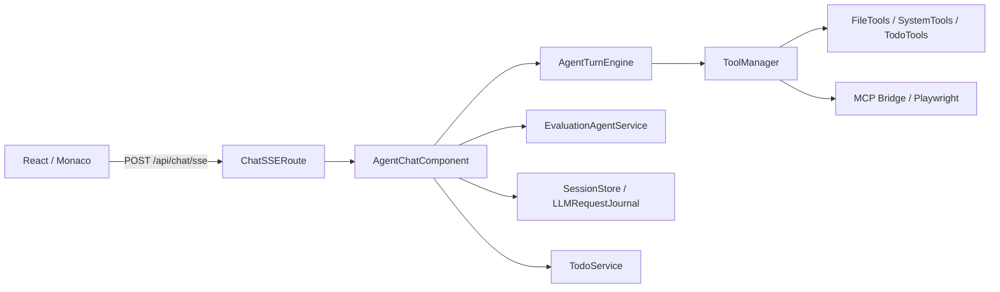
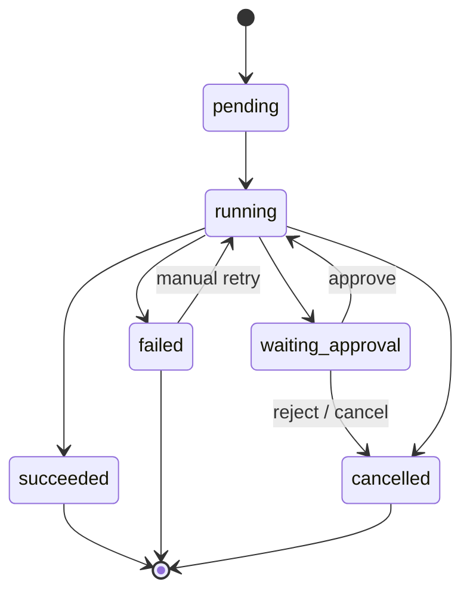
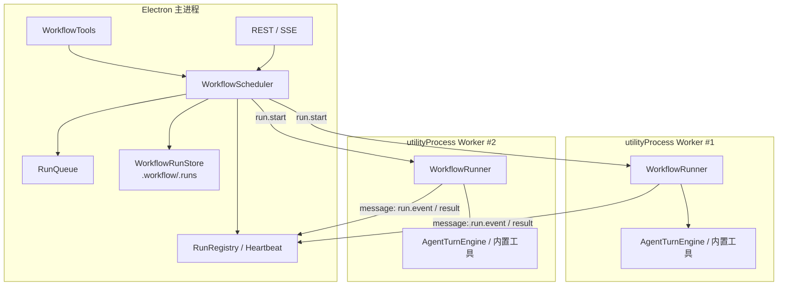
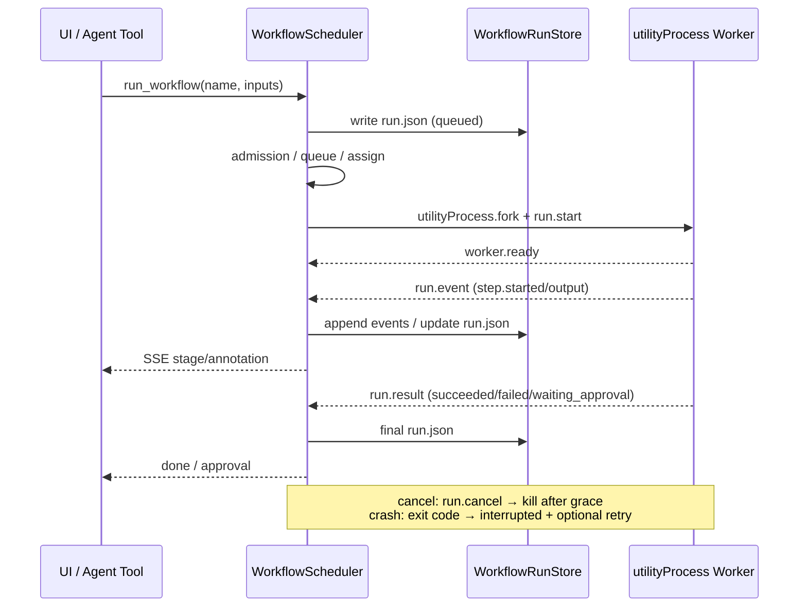
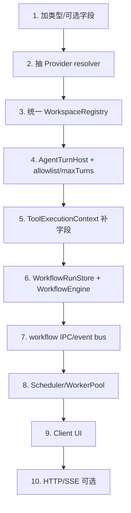

# Workflow 声明式编排集成调研报告

> **调研日期**：2026-11-09  
> **本次更新**：新增“主进程调度 + `utilityProcess` 多 Worker 并行”与“现有接口全面核查 / workflow 友好度改造”（见 0.5/0.6、3.6.1、4.6、5.11、6.11、9.4）  
> **适用项目**：DeepSeek IDE Agent（Electron + Fastify + React + TypeScript）  
> **调研范围**：仅做框架调研、方案设计与可行性验证，**不修改业务代码**  
> **一句话结论**：当前项目最适合走「**Open Workflow DSL 1.0 子集 + 轻量自研执行器 + 复用现有 ToolManager / AgentTurnEngine**」的路线；不建议在 v1 直接嵌入 Mastra、LangGraph、Inngest、Temporal 等重型框架。

---

## 0. 结论摘要

### 0.1 推荐方案

| 项目 | 建议 |
|---|---|
| 编排文件 | `<workspace>/.workflow/*.workflow.yaml` |
| 编排语言 | Open Workflow Specification（原 Serverless Workflow）1.0.0 的**子集** |
| 解析/校验/图 | `@serverlessworkflow/sdk@1.0.1`（Apache-2.0，Node ≥20，9 个包，含自身） |
| 执行器 | 自研轻量执行器（单进程 P1 约 1,200–1,800 行；含 Worker 模式的完整 P2 约 2,700–3,400 行） |
| 执行模型 | 主进程 `WorkflowScheduler` 调度 `utilityProcess` Worker 池；默认 **worker-per-run**，多个 workflow run 可并行 |
| Worker 隔离 | Electron `utilityProcess`（Node 20.18.3、独立进程/堆；`serviceName` 可在 `app.getAppMetrics()` 观测） |
| Agent 步骤 | 复用 `AgentTurnEngine.runTurns` + 工具白名单 |
| 工具步骤 | 直接走现有 `ToolManager.executeTool` |
| 命令步骤 | 走现有 `SystemTools` / `ProcessSafetyGuard` |
| 评估步骤 | 可选复用 `EvaluationAgentService.runEvaluation` |
| 运行状态 | 工作区文件 `.workflow/.runs/<runId>/run.json + events.jsonl` |
| Agent 入口 | 新增 `list_workflows` / `get_workflow` / `run_workflow` / `get_workflow_run` 等工具 |
| 提示词 | 新增 `WorkflowIndexSection`（只注入索引，不注入完整 YAML） |
| 现有代码改动 | 单进程：2 个必须 + 1–4 个建议/可选（约 30–60 行）；Worker 模式：再加 3–4 处 Electron 构建/生命周期 + Telemetry 小改（约 40–70 行） |

### 0.2 推荐 / 不推荐

**推荐**

- 用标准 DSL 做“声明式编排层”，把 `.workflow` 文件做成可版本化、可校验、可生成 Mermaid 图的资产。
- 用自研薄执行器做“运行时层”，只实现项目真正需要的任务类型，避免把整个 BPM/工作流平台搬进桌面应用。
- 用现有 `ToolManager`、`AgentTurnEngine`、`ProcessSafetyGuard`、`EvaluationAgentService` 做“能力层”，不重复实现 Agent 循环、工具注册、命令安全、评估逻辑。
- 用主进程 `WorkflowScheduler` + `utilityProcess` Worker 池做“执行层”：一个 Worker 执行一个 run，多个 run 并行；主进程集中管理队列、状态、心跳、SSE。
- 用 `WorkflowEngine` 端口隔离执行器，未来若需要跨重启/分布式持久化，可替换为 Temporal/Restate/Inngest 适配器，而不改 `.workflow` 文件和工具面。

**不推荐（v1）**

- **Mastra**：代码优先，不是 YAML 运行时；最新版 `@mastra/core@1.82.0` 要求 **Node ≥22.13.0**，而 Electron 33 打包的是 **Node 20.18.3**，直接冲突；146 个传递依赖，且会重复现有 Agent/Tool/Model 抽象。
- **LangGraph.js**：图能力很强，但图是代码定义的（`StateGraph`），没有 YAML 运行时；要额外写 YAML→Graph 编译器；22 个传递依赖，仍会重复现有 Agent 循环。
- **Inngest / Temporal / Restate / DBOS / Hatchet / Trigger.dev**：都需要外部服务/数据库/消息队列，违背当前“无外部服务/数据库、本地优先”的桌面架构；且都是代码优先。
- **Dagu**：唯一真正“零代码 YAML”的外部引擎，但 GPL-3.0 对分发不友好，且需要额外守护进程；可作为高级用户的可选后端，不作为默认。
- **bpmn-engine / Camunda / Zeebe**：BPMN 标准很完整，但 XML 冗长、Agent 原生能力为零，属于过度设计。
- **用 `worker_threads` 跑 Agent/LLM workflow**：Node 官方说它适合 CPU 密集、不适合 I/O 密集；原生模块（`node-pty`/Playwright）在线程中不安全；保留给 `SyntaxCheckService` 等 CPU 子任务。
- **Dify / n8n / Kestra / Windmill / Langflow / Flowise**：平台级产品，需要独立服务/数据库/UI，接入后产品形态会被反向定义。

### 0.3 关键证据

1. **主进程承载 UI + Fastify，默认不启动独立后端服务**：`electron/src/main/index.ts` 注释明确“将原来的三进程架构合并为单进程 Electron 应用”；`electron/package.json` 的 `build:main` 使用 `esbuild --target=node20`。新增的 workflow worker 是主进程管理的 `utilityProcess` 子进程，不是用户需安装的独立服务。
2. **运行时是 Node 20.18.3**：Electron 33.4.11 官方 release 数据为 `node: 20.18.3`；Mastra 1.82.0 的 `engines.node` 为 `>=22.13.0`。
3. **没有数据库/消息队列**：`server/package.json` 只有 Fastify、WebSocket、OpenAI、MCP、js-yaml、mathjs、simple-git 等依赖，没有 ORM/Redis/Postgres/RabbitMQ。
4. **工具与提示词都有插件化扩展点**：`ToolManager.registerTool`、`AgentService.initializeTools`、`PromptSectionFactory.createStandardBuilder`、`IPromptSection`。
5. **工作区已有成熟的“目录约定”模式**：`.skills`、`.rules`、`.lingma/rules`、`.mcp`、`.evaluate`；`.workflow` 可以复用同样的发现/缓存/校验思路。
6. **POC 已验证**：`@serverlessworkflow/sdk@1.0.1` 能解析/校验自定义 `call: agent`、`call: evaluator`，并生成 Mermaid 图；复杂 `fork/switch/for/try` 样例也通过校验（详见附录 9.3）。
7. **进程 Worker POC 已验证**：Electron 33.4.11 的 `utilityProcess.fork` 可并行启动 2 个 Worker（PID 不同，spawn 18–37ms，ping 113–135ms）；`app.getAppMetrics()` 能看到 `type: Utility`、`name` 取自 `serviceName`、最小脚本空闲内存约 105MB；worker 未捕获异常以 exit code 1 退出；`execArgv: ['--js-flags=--max-old-space-size=256']` 可将堆上限降到约 280MB（详见附录 9.4）。

### 0.4 最小落地路径

| 阶段 | 交付 | 预计 |
|---|---|---|
| Phase 0 | `.workflow` 目录约定 + JSON Schema/DSL 校验 + Mermaid 预览 + 只读索引 | 2–3 人日 |
| Phase 0.5 | 接口 P0 改造：`AgentTurnHost`/`ToolExecutionContext`/Provider resolver/WorkspaceRegistry/评估 flags/config | 2–3 人日 |
| Phase 1 | 顺序执行 + `agent/tool/shell` 步骤 + 运行日志 + 核心 4 个 Agent 工具 | 5–7 人日 |
| Phase 1.5 | 进程 Worker 模式：主进程调度器 + `utilityProcess` 池 + 队列/心跳/崩溃恢复 | 5–8 人日 |
| Phase 2 | 多 Worker 并发 + `fork/switch/for/try` + 审批/恢复/取消 + REST/SSE | 7–10 人日 |
| Phase 3 | 可视化 UI + 触发器 + 可选持久化后端 | 10–15 人日 |

> 以上为一名熟悉本项目的资深 TypeScript 工程师的粗略估算，不含产品/设计评审时间；建议预留 30% 风险缓冲。

### 0.5 执行模型结论

| 模型 | 结论 | 说明 |
|---|---|---|
| **单进程内执行** | 先做（Phase 1） | 最容易验证 DSL/工具/日志；作为 `InProcessWorkflowEngine` |
| **主进程 + `utilityProcess` Worker 池** | **推荐的生产执行模型（Phase 1.5/2）** | 多 run 并行、崩溃隔离、原生模块安全、可用 `app.getAppMetrics()` 观测 |
| **`worker_threads` 池（Piscina/Tinypool）** | 仅用于 CPU 密集子任务 | Node 官方：适合 CPU 密集，不适合 I/O 密集；原生模块不安全；保留给语法检查/解析等 |
| **外部队列/引擎（BullMQ/Temporal/...）** | 不推荐 v1 | 需要 Redis/Postgres/Server；本地桌面过重，且代码优先 |

> **关键判断**：LLM/Agent 步骤是 I/O 密集，多个 Worker 不会线性提升模型吞吐（瓶颈通常是 API 速率与上下文处理）；Worker 的核心价值是**故障隔离、独立堆、CPU 密集步骤不阻塞主进程**，以及让多个 workflow run 互不干扰。不要在报告/产品文案里承诺“Worker 越多越快”。

### 0.6 接口改造结论（本次新增）

> **落地状态**：P0 已实现（`AgentTurnHost`、`ToolExecutionContext`、Provider resolver、`WorkspaceRegistry`、评估 Agent 开关、`config.workflow`、`workflow:*` IPC/事件总线），详见 6.11.8。`workflow:run` 在未注入 `WorkflowEngine` 前返回 `WORKFLOW_ENGINE_UNAVAILABLE`，属预期行为。

**结论：需要升级，但以“新增可选字段 + 端口抽象 + 新 IPC 通道”为主，不需要重写现有聊天/文件/工具接口。**

| 接口域 | 现状 | 是否改造 | 优先级 | 最小动作 |
|---|---|---|---|---|
| `AgentTurnEngine` | 绑定具体 `AgentService`；无 `maxTurns`/工具白名单/跳过 Telemetry | **是** | P0 | 抽 `AgentTurnHost` 接口；加 `allowedToolNames`/`maxTurns`/`skipTelemetry`/`agentStage:'工作流步骤'` |
| 工具执行上下文 | `ToolDefinition.execute(params, context?: any)`；实际只约定 `workspaceRoot`/`userId`/`traceId` | **是** | P0 | 定义 `ToolExecutionContext`；补 `abortSignal`/`emit`/`runId`/`stepPath`/`allowedToolNames` |
| Workflow 运行 API | 不存在 | **是（新增）** | P0 | **IPC 优先**：`workflow:*` + `workflow:event`；HTTP/SSE 仅 standalone 可选 |
| Provider 解析 | 逻辑埋在 `electron/src/main/ipc/agent-handlers.ts` 的 `resolveProviderConfig` | **是** | P0 | 抽 `ProviderConfigResolver`/`SettingsService.resolveForUser`，主进程与 Worker 共用 |
| 评估 Agent | 总是写 `.evaluate/evl_result.md`；无工具白名单 | **是** | P0 | 加 `persistReport?: boolean` + `allowedToolNames` |
| 工作区状态 | `app-handlers` 与 `AgentService` 两套 `userWorkspaces`；`workspace:reset` 不取消运行 | **是** | P0 | 统一 WorkspaceRegistry；reset/switch 时取消/暂停 workflow run |
| `ToolManager` | 全局单例；无 scoped/`unregister`/按名过滤 | 是 | P1 | `createScoped(names)` / `getToolsMetadata(names)` / `unregisterTool` |
| `ToolLogger` / `Logger` | 全局文件写；无 `runId`/`workerId` 上下文；多 Worker 可能竞争 | 是 | P1 | 加日志上下文/命名空间；Worker 日志回传主进程 |
| `TelemetryService` | 静态计数 + DAU 写盘；多 Worker 并发写 | 是 | P1 | `skipTelemetry`/usage sink；主进程统一记录 |
| 事件契约 | `AgentSSEPayload`、`AgentEvent`、client types 多处重复；IPC 字段白名单 | 是 | P1 | 共享 `AgentEvent`/`WorkflowEvent` 契约；`workflow:event` 独立通道 |
| 客户端 IPC/类型 | `electronAPI` 无 workflow 方法 | 是（新增） | P1 | preload/bridge/types + `WorkflowRunsPanel` |
| SSE/WS | chat 专用；`EventDistributor` 在 Electron 主进程未初始化 | 可选 | P2 | 独立 `/api/workflows/.../events`；仅 standalone HTTP 使用 |
| `FileIO`/`PathUtils` | 路径校验完善；无原子写/append/artifact helper | 部分 | P1 | run store 内部原子写；新增 `resolveRunArtifactPath` |
| `SkillService`/`RuleService`/`ProcessSafetyGuard` | 可复用 | 否 | — | 仅补 `workspaceRoot` / childPid 传递 |
| `ChatSSERoute`/`AgentChatComponent` | chat 专用 | 否 | — | 保持现状；workflow 不复用 `handleChat` |

> **最重要的一条**：桌面端 `electronBridge` 已移除 HTTP/SSE/WS 回退，只保留 IPC；`EventDistributor` 只在 `server/src/index.ts` 的 Fastify 路径初始化。因此 **workflow 的桌面接口必须 IPC-first**，不能照搬 chat 的 `/api/chat/sse` 设计。

> **最关键三件事**：① `AgentTurnEngine` 抽 `AgentTurnHost` + `allowedToolNames`/`maxTurns`；② `ToolExecutionContext` 补 `abortSignal`/`emit`/`runId`/`stepPath`；③ `workflow:*` IPC + `workflow:event`。这三件不做，workflow 会在“工具越权、无法取消、Worker 无法复用、事件丢失”上反复打补丁。

---

## 1. 背景、目标与边界

### 1.1 需求

用户希望在**工作目录的 `.workflow` 目录**中，用声明式文件编排多步骤任务，并让 IDE 中的 Agent 按编排执行。典型诉求：

- 把“需求分析 → 计划 → 实现 → 测试 → 评估 → 人工确认”这类固定流程固化下来，避免每次靠 LLM 自由发挥。
- 流程文件可读、可版本化、可 review、可复用、可审计。
- 关键步骤可人工审批；失败可重试/恢复；运行过程可观察。
- 与现有 Agent 对话、工具、技能、规则、评估体系协同，而不是另起一套 Agent 平台。
- 尽量少改现有代码、少加依赖、不引入外部服务。

### 1.2 设计原则

1. **声明式优先**：流程结构放在 YAML 中，执行逻辑放在代码中；不要让用户在 YAML 里写任意 JavaScript。
2. **最小入侵**：优先复用现有工具/Agent/评估/安全能力；新增模块通过接口隔离，可 feature flag 关闭。
3. **标准对齐**：不发明一套私有 DSL；采用已有标准的一个可验证子集，保留未来迁移空间。
4. **本地优先**：主进程 + Electron 管理的子进程、文件持久化、离线可用；不强制数据库/消息队列/云服务。
5. **安全默认**：工作区隔离、工具白名单、命令安全检查、审批门、运行预算、日志脱敏。
6. **可替换**：执行器藏在 `WorkflowEngine` 端口后；未来可换 Mastra/LangGraph/Temporal，而不改用户资产。

### 1.3 术语边界

| 概念 | 作用 | 当前实现 |
|---|---|---|
| **Skill** | 领域知识与 SOP（“怎么做”） | `SkillService` 从 `.claude/skills`、`.github/skills`、`.agents/skills`、`.skills` 加载 |
| **Rule** | 工程约束（“不能怎么做”） | `RuleService` 从 `.rules/rule.md`、`.lingma/rules/project_rule.md` 加载 |
| **TODO** | Agent 动态任务追踪（“现在做到哪”） | `TodoService`，LLM 自主增删改，文件 `todo.json` |
| **Workflow** | 确定性编排（“谁在什么条件下做什么、顺序/并行/审批”） | 本报告建议新增 |
| **Agent loop** | LLM 自主决策 + 工具调用 | `AgentTurnEngine.runTurns` |
| **Evaluator** | 对产出做独立核验 | `EvaluationAgentService.runEvaluation` |

**关键边界**：Workflow 不替代 Agent loop。Workflow 负责“已经确定的流程”，Agent loop 负责“需要探索/决策的步骤”。二者是编排与被编排的关系，不是竞争关系。

---

## 2. 当前项目架构事实

### 2.1 运行时与部署

| 事实 | 证据 | 对 Workflow 的约束 |
|---|---|---|
| 主进程 Electron 应用 | `electron/src/main/index.ts` 顶部注释：三进程合并为单进程 | 不能假设有独立后端服务/守护进程；worker 由主进程通过 `utilityProcess` 管理 |
| Electron 33.4.11 | `electron/package.json` `"electron": "^33.4.11"` | 运行时 Node 20.18.3 |
| 主进程构建目标 node20 | `electron/package.json` `build:main` 的 `--target=node20` | 不能引入要求 Node 22+ 的库 |
| ESM + NodeNext | `server/package.json` `"type": "module"`；`server/tsconfig.json` `module: NodeNext` | 新库需兼容 ESM；CJS 库需 default import |
| 无数据库/消息队列 | `server/package.json` 依赖清单 | 运行状态必须文件化或内存化 |
| Windows 优先 | README 环境要求；`ProcessSafetyGuard` 有 Windows 实现 | 命令步骤必须走现有跨平台工具，不能假设 bash |
| 已有 `worker_threads` 先例 | `SyntaxCheckService` 用 `new Worker(...)` 跑 TypeScript 项目级检查 | 团队已接受 worker 模式；但 workflow 需要进程隔离 |
| Electron `utilityProcess` 可用 | Electron 33 API：`utilityProcess.fork`，支持 Node + MessagePort、`serviceName`、`stdio` | 作为 workflow worker 的首选进程隔离方案 |
| 打包体积敏感 | Electron + Playwright + Monaco 已经较大 | 新依赖的传递包数量要控制 |

> Electron 33.4.11 的官方 release 数据：`node 20.18.3`、`chrome 130.0.6723.191`。这意味着**开发机上用 Node 24 跑通，不代表打包后能跑**；任何新依赖都必须在 Electron 33 主进程里做冒烟测试。

### 2.2 Agent 执行链



关键代码路径：

- `AgentChatComponent.handleChat`（[`server/src/services/AgentChatComponent.ts:64`](../server/src/services/AgentChatComponent.ts#L64)）负责一次对话的外层编排：初始化 MCP、构建提示词、调用 `runTurns`、评估、持久化。
- `AgentTurnEngine.runTurns`（[`server/src/services/AgentTurnEngine.ts:288`](../server/src/services/AgentTurnEngine.ts#L288)）负责内层循环：流式模型调用 → 收集 `tool_calls` → 执行工具 → 继续，直到模型不再调用工具。
- `ToolManager.executeTool`（[`server/src/services/ToolManager.ts:215`](../server/src/services/ToolManager.ts#L215)）负责参数强制转换、JSON Schema 校验、执行和错误包装。
- `AgentService.initializeTools`（[`server/src/services/AgentService.ts:101`](../server/src/services/AgentService.ts#L101)）注册内置工具；MCP 工具按 workspace 动态注册（[`server/src/services/AgentService.ts:610`](../server/src/services/AgentService.ts#L610)）。

**结论**：Workflow 最自然的接入点是“**新增一组工具**”，而不是修改或复制 `AgentTurnEngine`。工作流步骤内部需要 LLM 时，再调用 `runTurns`，并传入受限工具集。

### 2.3 工具与提示词扩展点

| 扩展点 | 位置 | 扩展方式 | 侵入性 |
|---|---|---|---|
| 工具注册 | `ToolManager.registerTool` | 新增 `ToolDefinition` | 低 |
| 工具初始化 | `AgentService.initializeTools` | 新增 1 段注册代码 | 低 |
| 提示词片段 | `PromptSectionFactory.createStandardBuilder` | 注册新的 `IPromptSection` | 低 |
| 提示词上下文 | `types/prompt.ts` `PromptBuildContext` | 可按需扩展字段 | 低 |
| 工作区约定 | `WorkspaceSkillPaths.ts` / `RuleService` | 新增 `.workflow` 目录发现 | 低 |
| SSE 事件 | `ChatSSERoute` 的 `stage/text/annotation/progress/usage/done` | 复用 `annotation` 或新增事件类型 | 低 |
| 评估 | `EvaluationAgentService.runEvaluation` | 作为 `evaluator` 步骤调用 | 低 |

### 2.4 工作区约定

现有工作区已经有一套“约定目录”模式：

| 目录 | 用途 | 加载服务 | 缓存 |
|---|---|---|---|
| `.claude/skills`、`.github/skills`、`.agents/skills`、`.skills` | 技能 | `SkillService` | 10 秒 |
| `.rules/rule.md` | 主工程规范 | `RuleService` | 10 秒 |
| `.lingma/rules/project_rule.md` | 兼容 Lingma 规范 | `RuleService` | 10 秒 |
| `.mcp/` | MCP 服务器配置 | `McpService` | 按 workspace |
| `.evaluate/evl_result.md` | 最近一次评估报告 | `EvaluationAgentService` | 覆盖写入 |
| 用户数据目录 `todo.json` | TODO SSOT | `TodoService` | 文件读写 |

**结论**：`.workflow/` 完全可以复用同样的模式：工作区相对路径、递归发现、10 秒缓存、失败隔离（单个文件坏了不影响其他文件）。

### 2.5 现状缺口

- 没有 workflow 注册表、执行器、运行状态存储。
- 没有 DAG/任务树、重试、超时、审批、恢复、取消。
- 没有进程 Worker 池/调度器/worker 协议；现有 `worker_threads` 只用于 `SyntaxCheckService` 的单例语法检查，不是通用执行器。
- 没有“子代理”运行时；`AgentService` 中虽然提到“子代理不得直接操作全局任务清单”，但当前没有独立子代理执行器。
- 没有 YAML Schema 校验；`js-yaml` 只用于 skills/rules/MCP 的简单解析。
- 没有 workflow UI；前端只有文件树、编辑器、聊天、TODO、Diff、Markdown/Mermaid/PDF 预览。
- 没有外部数据库/队列；所有状态都在文件或内存。

### 2.6 对 Workflow 的硬约束

| 约束 | 说明 |
|---|---|
| **Node 20.18.3** | 依赖的 `engines.node` 必须兼容 Node 20.18.3；不能要求 Node 22+ |
| **主进程 + Electron 子进程** | 允许主进程通过 `utilityProcess` 管理 Worker；不能要求用户额外安装/运行独立 daemon/server |
| **无数据库** | 不能要求 Postgres/Redis/RabbitMQ |
| **工作区隔离** | 所有文件读写必须在 `workspaceRoot` 内，走 `PathUtils.resolveReadPath/resolveWritePath` |
| **MIT 兼容** | 不能引入 GPL/AGPL/SSPL/BSL 的运行时组件（除非只作为可选外部工具） |
| **可打包** | 传递依赖数量、包体积、CJS/ESM 兼容性都要可控 |
| **可测试** | 必须能用现有 `vitest` 做单元/集成测试 |

---

## 3. `.workflow` 需求模型与 DSL 设计

### 3.1 能力分级

| 级别 | 能力 | 说明 |
|---|---|---|
| **P0（MVP）** | 顺序任务、变量/输出传递、条件分支、工具步骤、Agent 步骤、命令步骤、重试、超时、运行日志、列表/运行/查询工具 | 足够覆盖“固定流程固化” |
| **P1** | 并行 `fork`、循环 `for`、子工作流、人工审批、暂停/恢复、取消、REST/SSE | 覆盖“半自动 + 人工介入” |
| **P2** | 定时/文件/事件触发、可视化图编辑、分布式 worker、跨重启持久化、密钥/策略中心 | 视产品需求再做 |
| **非目标（v1）** | BPMN 全规范、多租户调度、任意 JS 执行、容器编排、跨机器分布式 | 避免过度设计 |

### 3.2 文件布局

```text
<workspace>/
  .workflow/
    release.workflow.yaml          # 发布检查流程
    feature-delivery.workflow.yaml # 需求 → 实现 → 测试 → 评估
    examples/
      hello.workflow.yaml
    .runs/                         # 系统生成，建议加入 .gitignore
      queue.json                   # 可选：待调度队列/租约（主进程写）
      <runId>/
        run.json                   # 运行快照（状态、步骤、worker、checkpoint、用量）
        events.jsonl               # 追加式事件日志
        artifacts/                # Worker 写入的大产物（日志/中间文件）
```

约定：

- 只发现 `*.workflow.yaml`（或 `*.workflow.yml`），避免误把普通 YAML 当工作流。
- 递归深度最多 3 层；忽略 `.runs`、`node_modules`、隐藏目录。
- 单文件大小上限建议 256 KB；单工作区最多 50 个 workflow（与 `SkillService` 的 50 上限一致）。
- `.workflow/.runs/` 由系统管理，Agent 只读；workflow 定义文件由用户/Agent 正常编辑。
- 运行 ID 使用 `crypto.randomUUID()`；目录名可用 `wf-<timestamp>-<shortId>`。

### 3.3 为什么选 Open Workflow DSL

**Open Workflow Specification**（CNCF 生态项目，2020 年进入 Sandbox；原 Serverless Workflow）是一个厂商中立的声明式工作流 DSL：

- YAML/JSON 原生，适合放进 `.workflow`。
- 任务类型覆盖本项目需求：`call`（调用函数/服务）、`do`（顺序）、`fork`（并行）、`switch`（分支）、`for`（循环）、`try`（错误处理/重试）、`run`（shell/script/container/workflow）、`set`、`wait`、`raise`、`emit`、`listen`。
- 支持运行时表达式 `${ ... }`、输入/输出/上下文映射、超时、重试、错误过滤、密钥/认证、调度。
- Apache-2.0，CNCF 项目，规范与 SDK 都有公开仓库。
- TypeScript SDK 提供解析、校验、序列化、图构建、Mermaid 生成。

**关键设计**：我们不需要实现完整规范，只需要实现一个**项目子集**：

| 规范能力 | v1 是否实现 | 说明 |
|---|---|---|
| `do` / `set` / `switch` / `for` / `fork` / `try` / `wait` | ✅ | 核心编排 |
| `call` 自定义函数 | ✅ | `agent` / `tool` / `evaluator` / `approval` / `shell` / `http` |
| `run.shell` | ✅ | 走 `ProcessSafetyGuard`，默认 cwd = workspaceRoot |
| `run.workflow` | ✅（P1） | 子工作流 |
| `run.script` / `run.container` | ❌ | 安全/环境成本高，暂不支持 |
| `emit` / `listen` / 事件驱动 | ⚠️（P2） | 桌面端事件源有限，先保留语法 |
| `schedule` | ❌（P2） | 需要常驻调度器，v1 不做 |
| 认证/密钥/OpenAPI/gRPC/AsyncAPI | ❌ | 与 IDE 场景弱相关，避免攻击面 |
| 完整 CTK 一致性 | ❌ | 只保证本项目子集的语义 |

**版本注意**：`@serverlessworkflow/sdk@1.0.1` 支持 DSL `1.0.0`；规范 1.0.3/1.0.4 对应的新 SDK 已迁移到 `@openworkflowspec/sdk`，但其 `latest` 仍指向 `0.0.1`，另有 `1.0.3-alpha*` 版本，且 `engines.node >=22`。因此 v1 建议**锁定 `@serverlessworkflow/sdk@1.0.1` + `dsl: 1.0.0`**，并在 `WorkflowDefinitionAdapter` 中隔离 SDK，未来可替换。

### 3.4 已验证的示例

以下样例已用 `@serverlessworkflow/sdk@1.0.1` 的 `Classes.Workflow.deserialize` **实际校验通过**（DSL `1.0.0`）：

```yaml
document:
  dsl: 1.0.0
  namespace: deepseek-ide
  name: feature-delivery
  version: 1.0.0
  title: 需求实现与评估
do:
  - plan:
      call: agent
      with:
        prompt: |
          你是实现规划者。请阅读需求并输出计划。
          需求：${ .inputs.requirement }
        tools: [read_file, list_files]
        model: deepseek-chat
        maxTurns: 6
      output:
        as: ${ . }
        schema:
          format: json
          document:
            type: object
            required: [files, steps]
            properties:
              files:
                type: array
                items: { type: string }
              steps:
                type: array
                items: { type: string }

  - implement:
      try:
        - doImplement:
            call: agent
            with:
              prompt: |
                按以下计划实现，完成后列出变更文件。
                计划：${ .steps.plan.output }
              tools: [read_file, file_write, file_replace, file_insert, run_powershell_command]
              maxTurns: 20
            timeout:
              after:
                minutes: 30
      catch:
        errors:
          with:
            type: https://open-workflow-specification.org/spec/1.0.0/errors/timeout
        retry:
          delay:
            seconds: 10
          backoff:
            exponential: {}
          limit:
            attempt:
              count: 2

  - test:
      run:
        shell:
          command: pnpm test
      timeout:
        after:
          minutes: 10

  - review:
      call: evaluator
      with:
        target: ${ .steps.implement.output }
        criteria: 代码可运行、测试通过、无越界修改

  - approve:
      call: approval
      with:
        message: 是否接受本次变更？
        risk: medium
```

设计说明：

- `agent`、`evaluator`、`approval` 都是**自定义函数**，通过 `call: <name>` + `with:` 传参；SDK 会接受任意函数名，不会把它们误判为标准函数。
- `catch` 在 DSL 1.0.0 中只能挂在 `try` 任务下，不能直接挂在 `call` 任务下；所以重试要写成 `try → doImplement → catch`。
- `run.shell` 在 SDK 1.0.0 中只接受 `command`、`environment` 等字段；`arguments`、`directory`、`stdin` 在 1.0.0 的 Schema 中不被接受。执行器应统一把 cwd 设为 `workspaceRoot`，参数直接写进 `command` 字符串，避免跨平台参数解析差异。
- `output.as: ${ . }` 表示保留任务原始输出；`output.schema` 用于运行后校验。SDK 只校验 Schema 的结构，不执行校验；运行后由执行器用 AJV 校验。
- `timeout.after` 使用 duration 对象（`minutes`/`seconds`）比 ISO 字符串更稳。

### 3.5 上下文与数据流

为了让 workflow 作者可预期，建议在标准 DSL 之上定义一个**项目上下文 profile**。其中 `.inputs` 由执行器从 `run_workflow` 的 `inputs` 参数注入，不是 DSL 的保留字段；其余为运行时约定：

| 表达式 | 含义 |
|---|---|
| `${ .inputs.<name> }` | 工作流输入 |
| `${ .env.<NAME> }` | 环境变量（只读，敏感值需脱敏） |
| `${ .workspace }` | 当前工作区绝对路径 |
| `${ .run.id }` | 运行 ID |
| `${ .run.traceId }` | 追踪 ID |
| `${ .steps.<id>.status }` | 步骤状态 |
| `${ .steps.<id>.output }` | 步骤输出 |
| `${ .steps.<id>.error }` | 步骤错误（失败时） |
| `${ .context.<key> }` | 通过 `set` / `export` 写入的上下文 |

表达式求值必须**安全**：

- 只支持路径访问、字面量、有限运算符（`==`、`!=`、`>`、`<`、`>=`、`<=`、`&&`、`||`、`!`）、有限过滤器（`default`、`json`、`join`、`upper`、`lower`、`length`）。
- **禁止 `eval` / `new Function` / 任意 JS 执行**。
- 复杂条件建议用 JSONLogic 或结构化条件；如果实现自定义表达式解析器，必须做白名单和长度限制。
- 所有插值结果都要限制大小（例如单值 256 KB），避免把超大文件内容塞进上下文。

### 3.6 执行语义

**运行状态机**：



**任务状态**：`pending | running | succeeded | failed | skipped | waiting_approval | cancelled`。

**执行规则**：

1. `do` 按声明顺序执行；`then` 可跳转到同作用域的任务；`then: exit` 结束工作流。
2. `fork` 的 `branches` 并行执行；默认 `Promise.allSettled`，任一分支失败则整体失败；`compete: true` 时取最先完成的分支并取消其他分支（可选）。
3. `switch` 按顺序评估 `when`，命中第一个为真的 case；`default` 兜底。
4. `for` 对集合迭代；`each`/`at` 定义元素/索引变量；`while` 为可选继续条件。
5. `try` 执行子任务；`catch` 捕获匹配的错误，可按 `retry` 重试，或执行 `do` 补偿。
6. `wait` 暂停指定时长；`set` 写入上下文；`raise` 抛出错误；`emit`/`listen` 在 v1 可先不支持或降级为 no-op + 警告。
7. 每个任务执行前后写 `events.jsonl`；每次状态变更原子更新 `run.json`。
8. 取消通过 `AbortController` 传播到 Agent 调用、工具调用和 shell 子进程。
9. 默认只重试**幂等**步骤；写文件/执行命令的步骤需要显式 `retryable: true` 或人工审批。
10. 运行级预算：`maxSteps`、`maxTokens`、`maxWallClock`、`maxParallel`；超限即失败并写事件。

#### 3.6.1 Worker 执行模型（本次新增）

| 决策 | 建议 | 理由 |
|---|---|---|
| Worker 粒度 | **worker-per-run**：一个 workflow run 由一个 `utilityProcess` Worker 独占执行 | 运行上下文/步骤输出/错误状态都在一个进程内，恢复简单；避免每步 IPC/序列化开销 |
| 并行来源 | **多个 run 并行**：调度器把不同 run 分给不同 Worker | 满足“多个 Worker 并行执行 workflow”；互相隔离 |
| 单个 run 内的并行 | `fork` 分支在 Worker 内用 `Promise.allSettled` 并发 | 不把一个 run 拆到多个进程，避免跨进程状态同步 |
| Worker-per-task / 分布式 DAG | **不在 v1** | 需要共享状态、任务租约、跨进程数据流；复杂度高，收益主要是横向扩展，不适合当前单机桌面 |
| 状态归属 | **主进程拥有 `run.json`/`events.jsonl`**；Worker 只发事件/结果，大产物写 run artifacts | 单写者、易恢复、调度器可随时标记 interrupted/queued |
| 审批/长等待 | Worker 发 `waiting_approval` 后**退出释放槽位**；恢复时新 Worker 从 checkpoint 继续 | 不长期占用 Worker；避免“等待审批把池占满” |
| 写冲突 | 同一 workspace 的写型 workflow 用 concurrency group 串行化；默认 `maxConcurrentRunsPerWorkflow=1` | 多 Worker 并行写同一文件会冲突；串行化比文件锁简单可靠 |
| 资源上限 | 默认 `maxWorkers = min(4, max(1, cpus-1))`；Worker 堆上限建议 512–1024MB；监控 RSS，超限回收 | POC 最小脚本空闲 ~105MB；加载 Agent 后 4 个 Worker 约 600MB–1GB，需防止内存膨胀 |

> **重要边界**：Worker 是**故障隔离/调度单元**，不是安全沙箱。Worker 与主进程同一 OS 用户、同一文件权限；安全仍依赖工具白名单、路径校验、命令守卫与审批门。

### 3.7 与 GitHub Actions 风格的区别

如果用户预期的是：

```yaml
steps:
  - id: build
    run: pnpm build
  - id: test
    needs: [build]
    run: pnpm test
```

这是**DAG + needs**风格，和 Open Workflow DSL 的**结构化任务树**不同。两者都能表达声明式编排，但：

- GitHub Actions 风格更直观，适合简单 DAG；但循环、子工作流、错误处理、人工审批要自己发明语义。
- Open Workflow DSL 更完整，`fork/switch/for/try/then` 都有标准语义；但嵌套层级更深，作者需要学习。
- 如果团队强烈偏好 `steps/needs`，可以写一个 100–150 行的**编译适配器**，把 `needs` 拓扑排序后生成 `do`/`fork` 结构；但这会增加一层维护成本，不建议 v1 同时支持两套语法。

**建议**：v1 只支持 Open Workflow DSL；在文档中提供“顺序、并行、条件、循环、审批”五个模板，降低学习成本。

---

## 4. 候选框架全景与筛选

### 4.1 硬约束筛选

先按硬约束做“一票否决”：

| 硬约束 | 直接淘汰 |
|---|---|
| Node 20.18.3 可运行 | Mastra（要求 ≥22.13） |
| 无外部服务/数据库 | Inngest、Temporal、Restate、DBOS、Hatchet、Trigger.dev、Kestra、Windmill、Dify、n8n、Langflow、Flowise |
| 非 GPL/AGPL/SSPL/BSL 运行时 | Dagu（GPL-3.0）、Windmill（AGPL/混合）、Inngest Server（SSPL）、Restate Server（BSL） |
| 能消费 `.workflow` YAML | Mastra、LangGraph、ADK、OpenAI Agents、VoltAgent、Genkit（均为代码优先） |
| 不重复现有 Agent/Tool 抽象 | Mastra、LangGraph、ADK、OpenAI Agents、VoltAgent |
| 可打包进 Electron | 平台级产品、需要 JVM/Go 服务的方案 |

> 注意：这里的“淘汰”是针对**默认嵌入 v1**；不代表框架本身不好，也不代表未来不能作为可选后端。

### 4.2 候选分类

| 类别 | 代表 | 与本项目的关系 |
|---|---|---|
| **A. TypeScript Agent/Workflow 框架** | Mastra、LangGraph.js、Google ADK JS、OpenAI Agents SDK、VoltAgent、Genkit | 代码优先，功能强，但需要 YAML 编译器/适配器，且会重复现有 Agent 循环 |
| **B. 持久化执行引擎** | Temporal、Inngest、Restate、DBOS、Hatchet、Trigger.dev | 适合跨重启/分布式，但需要外部服务/DB，桌面端过重 |
| **C. 声明式/标准引擎** | Open Workflow Spec + SDK、Dagu、bpmn-engine、XState、ASL、BPMN/Camunda | 最接近 `.workflow` 诉求；其中只有 Open Workflow Spec 是 YAML + TS 生态 + Apache-2.0 |
| **D. 平台级产品** | Dify、n8n、Kestra、Windmill、Langflow、Flowise | 独立产品，不适合嵌入；会反向定义产品形态 |
| **E. 其他语言/栈** | CrewAI、Agno、Prefect、Airflow、PydanticAI、Haystack、Microsoft Agent Framework、Claude Flow | 栈不匹配或不是声明式编排 |
| **F. 协议** | MCP、A2A | 是工具/Agent 互操作协议，不是工作流引擎 |
| **G. Worker 调度/进程池** | Electron `utilityProcess`、`child_process.fork`、Piscina、Tinypool、workerpool、Bree、BullMQ、pg-boss、Graphile Worker | 解决“主进程如何调度多个 Worker 并行执行”；与 DSL 框架正交 |

### 4.3 评分矩阵

评分维度与权重（针对“v1 嵌入当前桌面项目”）：

| 维度 | 权重 | 说明 |
|---|---:|---|
| 声明式/YAML 适配 | 20% | 能否直接消费 `.workflow` YAML，是否需要写编译器 |
| Agent/LLM 原生能力 | 15% | 是否内建 Agent、工具、HITL、评估 |
| 与现有栈契合/最小侵入 | 20% | 改多少现有文件、是否重复抽象、是否可回滚 |
| 运行/部署足迹 | 10% | 依赖数量、是否需要进程/DB |
| 可靠性与恢复 | 15% | 重试、超时、持久化、恢复、可观测 |
| HITL/审批 | 5% | 暂停/恢复/人工决策 |
| 许可证/分发 | 10% | MIT 项目分发兼容性 |
| 维护/生态 | 5% | 活跃度、文档、社区 |

评分（1–5，主观工程判断，不是绝对能力排名）：

| 方案 | 声明式 | Agent 原生 | 契合/侵入 | 足迹 | 可靠性 | HITL | 许可 | 生态 | **加权** |
|---|---:|---:|---:|---:|---:|---:|---:|---:|---:|
| **自研 + Open Workflow SDK** | 5 | 5 | 5 | 5 | 2 | 3 | 5 | 2 | **4.30** |
| Mastra | 2 | 4 | 3 | 2 | 5 | 5 | 4 | 5 | **3.45** |
| LangGraph.js | 2 | 3 | 3 | 3 | 5 | 5 | 5 | 4 | **3.45** |
| XState | 4 | 1 | 4 | 5 | 2 | 2 | 5 | 4 | **3.35** |
| Dagu | 5 | 2 | 2 | 2 | 5 | 5 | 2 | 3 | **3.25** |
| bpmn-engine | 5 | 1 | 2 | 5 | 3 | 3 | 5 | 1 | **3.20** |
| OpenAI Agents SDK | 1 | 5 | 2 | 3 | 4 | 3 | 5 | 4 | **3.10** |
| Google ADK JS | 1 | 5 | 2 | 2 | 4 | 3 | 5 | 4 | **3.00** |
| VoltAgent | 1 | 5 | 2 | 1 | 4 | 3 | 5 | 4 | **2.90** |
| Inngest | 1 | 3 | 2 | 1 | 5 | 5 | 3 | 5 | **2.70** |
| Temporal | 1 | 2 | 2 | 1 | 5 | 4 | 5 | 5 | **2.70** |
| Genkit | 1 | 4 | 2 | 2 | 3 | 2 | 5 | 4 | **2.65** |
| Restate | 1 | 2 | 2 | 2 | 5 | 4 | 3 | 3 | **2.50** |
| DBOS | 1 | 2 | 1 | 1 | 5 | 3 | 5 | 3 | **2.35** |

**解读**：

- 自研方案在“声明式/侵入/足迹/许可”上得分最高，代价是“可靠性/生态”需要自己补。
- Mastra/LangGraph 在“可靠性/HITL/生态”上更强，但“声明式/足迹/侵入”明显吃亏。
- 如果未来需求变成“复杂多 Agent 协作/状态图”，LangGraph/Mastra 的分数会上升；如果变成“运维脚本 YAML”，Dagu 的分数会上升。

### 4.4 最小入侵指标

| 方案 | 现有文件改动 | 新增 npm 包（含传递） | 新增进程/DB | Node 要求 | 是否重复现有抽象 | 回滚难度 |
|---|---|---:|---|---|---|---|
| **自研 + SDK** | 2–3 个（~30–50 行） | **9** | 0 | ≥20 ✅ | 否 | 低（feature flag） |
| **自研 + SDK + `utilityProcess` 池** | 4–6 个（~200–300 行） | **9** | N 个 Worker（无外部服务） | ≥20 ✅ | 否 | 低（feature flag） |
| Mastra | 3–4 个 + 适配器（~300 行） | **146** | 0 | **≥22.13 ❌** | 是（Agent/Tool/Model） | 中 |
| LangGraph.js | 3–4 个 + 适配器（~250 行） | **22** | 0 | ≥18 ✅ | 部分（Graph/State） | 中 |
| Inngest | 3–4 个 + 适配器 | **308** | 1 个 Server | ≥20 ✅ | 是（step functions） | 高 |
| Temporal | 3–4 个 + Worker | SDK + Server | 1 个 Server + DB | ≥20 | 是 | 高 |
| Restate | 3–4 个 + Service | 1 | 1 个 Server | — | 是 | 高 |
| DBOS | 3–4 个 | 5 | Postgres | — | 是 | 高 |
| Dagu | 0–1 个（MCP） | 0 npm + 二进制 | 1 个 daemon | n/a（Go） | 否（外部引擎） | 低（但 GPL） |
| XState | 2–3 个 + 编译器 | 1 | 0 | any ✅ | 部分（statechart） | 中 |
| bpmn-engine | 2–3 个 + 适配器 | 0 | 0 | — | 是（BPMN） | 中 |

> 依赖数为 2026-11-09 使用 `npm install --dry-run --ignore-scripts --registry=https://registry.npmjs.org` 实测的“新增包总数”（含传递依赖），测量方法见附录 9.2。现有文件改动数为估算，实际取决于适配器实现深度。

### 4.5 淘汰清单与原因

| 方案 | 淘汰原因（针对 v1） |
|---|---|
| **Mastra** | Node 22.13+ 与 Electron 33 冲突；代码优先，无 YAML 运行时；146 个传递依赖；重复 Agent/Tool 抽象 |
| **LangGraph.js** | 代码优先，无 YAML 运行时；需写编译器；重复 Graph/State 抽象；适合复杂状态图，不适合简单声明式流程 |
| **Inngest** | SDK 308 个传递依赖；Server SSPL；需要独立服务；代码优先 |
| **Temporal** | 需要 Server + DB + Worker；运维成本高；代码优先；桌面端过重 |
| **Restate** | Server BSL；需要独立服务；代码优先 |
| **DBOS** | 需要 Postgres；代码优先 |
| **Hatchet / Trigger.dev** | 需要独立引擎/平台；代码优先 |
| **Dagu** | GPL-3.0 分发风险；需要额外 daemon；shell 为中心，Agent 步骤需回调 |
| **bpmn-engine** | BPMN XML 冗长；无 Agent 原生能力；需要 BPMN 建模工具 |
| **XState** | 只是状态机库，不是工作流引擎；无持久化/重试/审批；仍需自研数据流和任务调度 |
| **Dify / n8n / Kestra / Windmill / Langflow / Flowise** | 平台级产品，需要独立服务/DB/UI；接入后产品形态被反向定义；许可证/维护风险 |
| **CrewAI / Agno / Prefect / Airflow / PydanticAI / Haystack** | Python 栈不匹配；需要额外 Python 运行时 |
| **Microsoft Agent Framework / Semantic Kernel** | 官方 SDK 为 .NET/Python/Go（SK 另有 Java/Python），无 TypeScript 优先运行时；栈不匹配 |
| **Claude Flow** | 多 Agent swarm/harness，不是声明式 YAML 工作流；侵入性强 |
| **MCP / A2A** | 是协议，不是编排引擎；可作为工具/Agent 互操作层 |

### 4.6 Worker 调度 / 进程池候选（本次新增）

> 用户明确要求“主进程调度 Worker，多个 Worker 并行执行 workflow”。本节只比较**执行/调度层**，与第 4 章的 DSL 框架选型正交。

| 方案 | 进程隔离 | Electron 集成 | 队列/状态 | 依赖/基础设施 | 结论 |
|---|---|---|---|---|---|
| **Electron `utilityProcess` + 自研 `WorkflowScheduler`** | ✅ 独立进程/堆 | ✅ 原生 API，`serviceName` 可观测 | 文件队列 + `run.json` | **0 npm** | **推荐** |
| `child_process.fork` + 自研调度 | ✅ | ⚠️ 需 `ELECTRON_RUN_AS_NODE=1`，受 `runAsNode` fuse 影响 | 文件 | 0 npm | 仅 fallback |
| `worker_threads` + **Piscina** | ❌ 同进程线程 | ✅ | 自研 | 0 deps，MIT | CPU 子任务 |
| `worker_threads` + **Tinypool** | ❌ 同进程线程 | ✅ | 自研 | 0 deps，MIT，38KB | 轻量 CPU 子任务 |
| **workerpool** | ✅/❌ 可选线程/子进程 | ⚠️ 通用 `child_process`，非 utilityProcess | 自研 | 0 deps，Apache-2.0 | 通用池，不如 utilityProcess |
| **Bree** | ❌ worker_threads | ✅ | 有限（cron/interval，无 workflow 状态） | 8 deps，MIT | 定时任务，不是 workflow 执行器 |
| **BullMQ** | ✅ 可独立 worker 进程 | ✅ | Redis 队列 | 5 deps + **Redis** | 需要外部 Redis，不推荐桌面 |
| **pg-boss** | ⚠️ 库内 worker，需自行分进程 | ✅ | Postgres 队列 | 4 deps + **Postgres** | 需要外部 DB |
| **Graphile Worker** | ⚠️ 库内 worker，需自行分进程 | ✅ | Postgres 队列 | 8 deps + **Postgres** | 需要外部 DB |
| **Temporal Worker** | ✅ | ✅ | Temporal Server | 19 deps + **Server/DB** | 跨重启/分布式才用 |
| **Hatchet / Trigger.dev** | ✅ | ✅ | 引擎/平台 | 重型 | 平台级，不推荐 v1 |
| **`node:cluster`** | ✅ | ✅ | ❌ | 0 | 只适合 HTTP server 扩展 |

**关键结论**：

- **首选 `utilityProcess` + 自研调度器**：0 新增依赖、Electron 原生、独立进程/堆、可用 `app.getAppMetrics()` 观测；POC 已实测（附录 9.4）。
- **`worker_threads`（Piscina/Tinypool）不是 workflow Worker 的首选**：Node 官方明确“适合 CPU 密集，不适合 I/O 密集”；LLM/Agent 步骤是 I/O 密集，线程池的收益主要是 CPU 子任务，且原生模块（`node-pty`、Playwright）在线程中不安全。
- **BullMQ/pg-boss/Graphile Worker/Temporal** 都是“外部队列/引擎”思路；如果未来要求跨重启/多人/分布式，再通过 `WorkflowEngine` 端口接入，而不是在桌面端内嵌 Redis/Postgres。

---

## 5. 重点候选深度对比

### 5.1 自研 + Open Workflow SDK（推荐）

**是什么**：用 `@serverlessworkflow/sdk@1.0.1` 做 YAML 解析/校验/图生成，用自研执行器实现项目需要的任务子集，复用现有工具/Agent/评估/安全能力。

**优点**

- 直接消费 `.workflow` YAML，无需 YAML→代码编译器。
- 9 个包（含自身），Apache-2.0，Node ≥20，和 Electron 33 兼容。
- 只实现需要的语义，代码量可控；不重复 Agent/Tool 抽象。
- 标准 DSL 带来校验、Mermaid 图、未来迁移空间。
- 执行器藏在 `WorkflowEngine` 端口后，未来可替换。

**缺点**

- 执行器（重试/超时/恢复/并发/表达式）要自己实现和测试。
- 需要维护 DSL 子集与 SDK 版本锁定。
- 复杂流程（嵌套 `fork/switch/try`）的执行语义需要仔细设计。
- SDK 包解压后约 16.9 MB；需评估打包体积（可用 esbuild tree-shaking 或后续替换为轻量 Schema）。

**适用**：当前项目 v1；尤其是“想先把能力做出来，又不想引入平台”的场景。

### 5.2 Mastra

**是什么**：TypeScript 原生 Agent/Workflow 框架，`@mastra/core@1.82.0`，Apache-2.0（`ee/` 目录单独许可），约 29.4k stars。

**能力**

- `createStep` / `createWorkflow` / `.then()` / `.parallel()` / `.branch()` / `.dowhile()` / `.foreach()`。
- `suspend()` / `resume()`、snapshot、workflow state、streaming、Studio 图视图、time travel。
- 可独立运行 workflow（`workflow.createRun()`），也可注册到 Mastra 实例获得 storage/observability。

**为什么不推荐 v1**

- **Node 版本硬冲突**：`engines.node >=22.13.0`，Electron 33 是 Node 20.18.3。要使用 Mastra，必须先升级 Electron/Node 基线，这不是“最小入侵”。
- **代码优先**：没有 YAML 运行时；要写 YAML→`createStep/createWorkflow` 编译器，工作量不比自研执行器小。
- **重复抽象**：自带 Agent、Tool、Model、Memory、Storage；与现有 `AgentTurnEngine`/`ToolManager`/`DeepSeek` 客户端重叠。
- **依赖足迹**：146 个传递包；打包体积和供应链风险需要评估。
- **语义差异**：`.branch()` 会执行所有条件为真的分支（不是互斥 switch），需要额外封装才能符合“择一”语义。

**什么时候选它**：团队愿意把 Node 基线升到 22.13+，并且希望“Agent + Workflow + Memory + Observability”一体化；此时 Mastra 是最强的 TS 原生候选。

### 5.3 LangGraph.js

**是什么**：`@langchain/langgraph@1.7.2`，MIT，约 3.4k stars；用 `StateGraph` 构建有状态 Agent 图，支持条件边、checkpointer、interrupt、streaming、time travel。

**优点**

- 图/状态/检查点/HITL 能力成熟；适合复杂、有环、需要恢复的 Agent 图。
- 22 个传递依赖，Node ≥18，比 Mastra 轻。
- MIT，生态成熟。

**为什么不推荐 v1**

- **代码优先**：图是代码定义的；`langgraph.json` 是部署清单，不是运行时图定义。要消费 `.workflow` YAML，仍需写编译器。
- **重复抽象**：LangChain `StateGraph`/`Checkpointer` 与现有 `AgentTurnEngine`/`SessionStore` 重叠；集成时要么把现有工具包成 LangGraph 节点，要么把 LangGraph 当第二套 Agent 运行时。
- **概念重量**：State/Reducer/Channel/Checkpointer 对“简单顺序 + 审批”过重。

**什么时候选它**：工作流本质是“复杂状态图/多 Agent 协作/需要时间旅行和检查点”，而不是简单声明式步骤。

### 5.4 Inngest

**是什么**：`inngest@4.26.2`，SDK Apache-2.0，Server 仓库 SSPL-1.0（附 Apache-2.0 future license），约 6k stars；事件驱动的持久化 step functions。

**优点**

- 持久化执行、自动重试、fan-out/fan-in、`step.sleep`、`step.waitForEvent`、可观测性。
- 开发者体验好，适合 Web 后端长任务。

**为什么不推荐 v1**

- **需要独立 Server**：本地 dev server 或 Cloud/自托管；桌面应用不应要求用户再跑一个服务。
- **Server 许可**：SSPL 对分发不友好；SDK 是 Apache-2.0，但运行时核心是 SSPL。
- **依赖足迹**：308 个传递包，包含 OpenTelemetry auto-instrumentation，体积大。
- **代码优先**：不是 YAML 工作流引擎。

**什么时候选它**：产品变成“云端/多人协作”，且愿意运营 Inngest Server。

### 5.5 Temporal / Restate / DBOS / Hatchet / Trigger.dev

| 方案 | 核心 | 许可 | 主要问题 |
|---|---|---|---|
| **Temporal** | 持久化工作流 + Activity + Worker | Server/SDK MIT | 需要 Server + DB + Worker；运维重；代码优先 |
| **Restate** | 单二进制持久化执行 | SDK MIT / Server BSL-1.1 | 需要独立服务；代码优先；许可 |
| **DBOS** | Postgres 持久化工作流 | SDK MIT | 需要 Postgres；代码优先 |
| **Hatchet** | 任务编排引擎 | MIT | 需要引擎 + DB/队列；代码优先 |
| **Trigger.dev** | 后台任务/Agent 平台 | SDK MIT / 仓库 Apache-2.0 | 需要平台/自托管；代码优先 |

**共同结论**：它们解决的是“跨进程/跨机器/跨重启的持久化执行”，不是“工作区内的声明式编排”。如果未来必须保证“应用崩溃后工作流继续跑”，再通过 `WorkflowEngine` 端口接一个 Temporal/Restate 适配器；v1 不需要。

### 5.6 XState

**是什么**：`xstate@5.33.4`，MIT，0 依赖，约 30.4k stars；状态机/状态图/actor 模型。

**优点**

- 极轻，声明式状态图，可视化工具成熟（Stately Studio/Inspector）。
- 适合复杂 UI 状态、协议状态机。

**为什么不推荐 v1**

- 不是工作流引擎：没有任务调度、重试、超时、持久化、审批、数据映射。
- 要用它执行 `.workflow` YAML，仍需写 YAML→状态图编译器 + 任务执行器；只是把控制流换成状态图，工作量没减少。
- 对“顺序 + 并行 + 循环 + 工具调用”的 workflow，状态图反而增加概念负担。

**什么时候选它**：如果未来 workflow 主要是“长生命周期、复杂状态迁移、需要可视化状态图”，可以把 XState 作为内部控制流内核；但不建议作为 v1 的编排层。

### 5.7 Dagu

**是什么**：Go 单二进制、YAML DAG、本地优先、自带 Web UI、无外部 DB/消息队列；支持 shell、Docker、K8s、SSH、子 DAG、调度、重试、人工任务、内置 MCP Server；约 4.6k stars。

**优点**

- 真正“零代码 YAML”引擎；Windows 支持；单二进制；本地优先。
- 内置 MCP Server，理论上可以通过现有 `.mcp/` 配置接入，**零代码侵入**。
- 人工任务、重试、日志、运行历史都很成熟。

**为什么不推荐默认**

- **GPL-3.0**：对 MIT 项目的分发有合规要求；即使作为独立进程调用，也需要法务确认。
- **额外进程/端口/数据目录**：桌面应用要管理 daemon 生命周期、端口冲突、升级。
- **Agent 步骤要回调**：Dagu 的 step 主要是 shell/HTTP；要执行 IDE 内 Agent，需要暴露本地 HTTP 端点或 MCP 工具，增加攻击面。
- **DSL 不是标准 Open Workflow**：Dagu YAML 是它自己的格式，未来迁移成本高。

**什么时候选它**：面向高级用户的“运维自动化”插件，允许用户自行安装 Dagu；不作为 IDE 内置默认引擎。

### 5.8 bpmn-engine

**是什么**：`bpmn-engine@26.0.6`，MIT，0 依赖，约 974 stars；Node.js 的 BPMN 2.0 执行引擎。

**优点**

- 标准 BPMN 2.0，gateway/event/subprocess/timer/user task 都有；0 依赖；MIT。
- 可用 Camunda Modeler/bpmn-js 建模。

**为什么不推荐 v1**

- BPMN XML 冗长，开发者体验差；`.workflow` 里放 XML 不符合“声明式 YAML”的直觉。
- 没有 Agent/LLM 原生能力；service task 需要自己写 handler。
- BPMN token 语义（并行网关、事件子流程、补偿）对当前场景过重。
- 生态/文档相对小，长期维护风险。

**什么时候选它**：企业客户明确要求 BPMN 2.0 标准/可视化建模时。

### 5.9 其他框架

| 框架 | 版本/许可 | 结论 |
|---|---|---|
| **Google ADK JS** | `@google/adk@2.4.0`，Apache-2.0，229 个传递包 | 代码优先，Agent 能力强；适合 Gemini 生态；不适合 YAML 编排 |
| **OpenAI Agents SDK** | `@openai/agents@0.21.0`，MIT，25 个传递包 | 代码优先，handoffs/guardrails/sessions；适合 OpenAI 生态；不适合 YAML |
| **VoltAgent** | `@voltagent/core@2.11.1`，MIT，338 个传递包 | 代码优先，Agent/Workflow/Memory/RAG 全栈；依赖重 |
| **Genkit** | `genkit@1.44.0`，Apache-2.0 | 代码优先 flow；适合 Firebase/Google 生态；不适合 YAML |
| **Dify** | 160.7k stars，修改版 Apache-2.0 | 平台级；需要独立服务；不适合嵌入 |
| **n8n** | 209.9k stars，Sustainable Use License | 平台级；许可证限制；不适合嵌入 |
| **Kestra** | 30.2k stars，Apache-2.0 | JVM 平台；重型 |
| **Windmill** | 18.5k stars，AGPL/混合许可 | Rust + Postgres 平台；重型 |
| **Langflow** | 156.5k stars，MIT | Python 平台，可视化 flow；不适合 TS 桌面嵌入 |
| **Flowise** | 55.6k stars，仓库已 archived（2026-08-13） | 维护风险；不选 |
| **Julep** | 6.6k stars，Apache-2.0 | 代码优先（`@flow`）+ 平台服务；需独立服务/DB；不作为嵌入式首选 |
| **Dapr Workflow / Upstash Workflow** | MIT | 代码优先的持久化执行；需 sidecar/云服务 |
| **AWS Step Functions / Google Workflows / Azure Logic Apps** | 云托管 | 依赖云服务；不适合本地桌面 |
| **CrewAI / Agno / Prefect / Airflow / PydanticAI / Haystack** | Python | 栈不匹配 |
| **Microsoft Agent Framework** | .NET/Python/Go | 无 TypeScript 优先运行时 |
| **Claude Flow** | MIT，81.3k stars | 多 Agent swarm/harness；不是声明式 YAML 工作流；侵入性强 |

### 5.10 对比结论

| 需求 | 首选 | 次选 |
|---|---|---|
| **v1 最小侵入、YAML 声明式、Node 20** | **自研 + Open Workflow SDK** | XState（仅控制流） |
| 复杂状态图/多 Agent 协作/检查点 | LangGraph.js | Mastra |
| 一体化 Agent 平台（可升 Node 22.13） | Mastra | VoltAgent |
| 跨重启/分布式持久化 | Temporal | Restate |
| 多 workflow run 并行、进程隔离 | **自研 + `utilityProcess` Worker 池** | Temporal/Hatchet（需外部服务） |
| 单 run 内任务级分布式 | Temporal / 自研 `TaskScheduler`（P3） | — |
| 零代码 YAML + 可接受外部进程/GPL | Dagu | — |
| BPMN 2.0 标准 | bpmn-engine | Camunda/Zeebe |
| 平台级可视化编排 | Dify/n8n/Kestra | — |

### 5.11 进程 Worker 执行器（本次新增，推荐的生产执行模型）

**是什么**：主进程只做“调度 + 状态 + UI/SSE”，把每个 workflow run 交给一个 Electron `utilityProcess` Worker 执行；Worker 内运行 `WorkflowRunner`，多个 run 可并行。



#### 5.11.1 为什么用 `utilityProcess`，而不是 `worker_threads`

| 维度 | `utilityProcess`（进程） | `worker_threads`（线程） | `child_process.fork` |
|---|---|---|---|
| 隔离级别 | 独立进程、独立 V8 堆；崩溃不影响主进程 | 同进程、独立堆/事件循环；原生崩溃可能带走整个进程 | 独立进程 |
| Electron 集成 | **原生 API**，`utilityProcess.fork`；打包可用 | `new Worker()` 可用，但不能用 Electron 模块 | 需 `ELECTRON_RUN_AS_NODE=1`，受 `runAsNode` fuse 影响 |
| 原生模块 | 安全（独立进程） | **不安全**：Electron 文档明确 `process.dlopen` 非线程安全 | 安全 |
| 适用负载 | 长任务、Agent/LLM、需要隔离 | CPU 密集纯 JS（解析、类型检查） | fallback |
| IPC | `postMessage` / `MessagePort` | `postMessage` / transferable | JSON IPC channel |
| 启动/内存 | POC：spawn 18–37ms；空闲 ~105MB/Worker | 更轻，~10–30MB | 与 utilityProcess 接近 |
| 建议 | **Workflow Worker 首选** | 保留给 `SyntaxCheckService` 等 CPU 子任务 | 不推荐首选 |

**关键事实**（Node/Electron 官方）：

- Node 官方：`worker_threads` “适合 CPU 密集型，对 I/O 密集型帮助不大”；LLM/Agent 步骤是 I/O 密集，**不要指望多线程线性加速模型调用**。
- Electron 文档：`utilityProcess` 是 `child_process.fork` 的 Electron 等价物，使用 Chromium Services API 启动；支持 `env`、`execArgv`、`cwd`、`stdio`、`serviceName`。
- `utilityProcess.fork` 必须在 `app.whenReady()` 之后调用。
- `stdio: 'pipe'` 时主进程必须持续消费 `stdout`/`stderr`；Node 文档指出管道缓冲区满会阻塞子进程。
- `kill()` 是优雅终止（POSIX SIGTERM）；Windows 上进程树可能残留，需要 `taskkill /T /F` 兜底。
- `app.getAppMetrics()` 返回 `type: Utility`；`name` 取自 `utilityProcess.fork` 的 `serviceName` 选项（POC 实测 `name: wf-worker-poc2`），可用于 CPU/内存观测。

#### 5.11.2 调度器设计

| 组件 | 职责 |
|---|---|
| `WorkflowScheduler` | 接收 `run_workflow` 请求、入队、准入控制、分配 Worker、取消/恢复、关闭 |
| `RunQueue` | FIFO（可扩展 priority）；`maxQueueSize`；返回排队位置；满时 `WORKFLOW_QUEUE_FULL` |
| `WorkerPool` | 管理 `utilityProcess` 实例；`maxWorkers`；冷启动/热池；健康检查；回收 |
| `RunRegistry` | `runId → { workerId, pid, status, lastHeartbeat, attempts }` |
| `WorkflowRunStore` | 主进程唯一写者：`run.json`、`events.jsonl`、`queue.json`、artifacts |
| `WorkerTransport` | 封装 `postMessage`/`on('message')`/心跳/超时；可注入 fake 便于测试 |

**默认参数建议**：

| 参数 | 默认 | 说明 |
|---|---:|---|
| `maxWorkers` | `min(4, max(1, cpus-1))` | 8 核 → 4；16 核 → 4（保守，避免内存/API 压力） |
| `maxQueueSize` | 20 | 超过则拒绝并提示 |
| `maxConcurrentRunsPerWorkflow` | 1 | 同一 workflow 默认不并发，避免文件冲突 |
| `maxRunDuration` | 2h | 超时取消 |
| `workerIdleTimeout` | 60s | 热池空闲回收（若启用） |
| `heartbeatInterval` | 5s | Worker → 主进程 |
| `heartbeatTimeout` | 30s | 超时判定 Worker 失联；CPU 密集步骤前可发 `busy` 延长 |
| `maxWorkerRestarts` | 3 / 5min | 防止崩溃循环 |
| `workerHeapMB` | 512–1024 | `execArgv: ['--js-flags=--max-old-space-size=512']`（POC 验证有效） |
| `maxRunsPerWorker` | 20 | 回收，防止内存泄漏 |

> **v1 建议冷启动 per run**：虽然 `utilityProcess` 启动只要 18–37ms，但复用 Worker 会保留 `ToolManager`/`ProcessSafetyGuard`/缓存等单例状态，跨 run 可能泄漏。若启用热池，必须提供 `reset()`/回收策略并做隔离测试。

**准入与公平性**：

- `concurrencyGroup`（workflow metadata，可选）：同组 run 串行；写型 workflow 默认 `group=workspace-write`。写型判定可扫描步骤中的 `file_write`/`file_replace`/`run.shell` 等，或由 metadata 显式声明；无法判定时保守串行。
- 同一 workspace 的写型 run 默认串行；只读 run 可并行。
- 队列 FIFO；可选 priority；不抢占运行中的 run。
- `run_workflow` 默认 `wait=false` 返回 `{ runId, status: "queued", position }`；`wait=true` 在工具调用内等待完成（受 `timeoutSeconds` 限制）。

**运行生命周期**：



#### 5.11.3 Worker 协议

**主进程 → Worker**：

```ts
type MainToWorker =
  | { type: 'worker.init'; protocolVersion: 1; workerId: string }
  | { type: 'run.start'; runId: string; workflowPath: string; definition?: unknown; inputs: unknown; resume?: RunCheckpoint; config: WorkerRunConfig }
  | { type: 'run.cancel'; runId: string; reason?: string }
  | { type: 'run.resume'; runId: string; decision?: unknown; checkpoint: RunCheckpoint }
  | { type: 'ping'; seq: number };
```

> `definition` 是主进程 `WorkflowDefinitionService` 已解析/校验的 DSL 对象；Worker 优先用它，避免在 Worker 里重复打包/解析 SDK。`workflowPath` 仅用于日志/错误定位/重新加载。

> `WorkerRunConfig` 必须显式包含 `workspaceRoot`、`providerConfig`、`modelId`、`allowedTools`、`budgets`；Worker 不要依赖 `process.cwd()`，因为热池 Worker 可能服务不同 workspace，`cwd` 是进程级状态。

**Worker → 主进程**：

```ts
type WorkerToMain =
  | { type: 'worker.ready'; workerId: string; pid: number; protocolVersion: 1 }
  | { type: 'run.event'; runId: string; seq: number; event: WorkflowEvent }
  | { type: 'run.result'; runId: string; status: 'succeeded' | 'failed' | 'waiting_approval'; output?: unknown; error?: unknown; usage?: TokenUsage }
  | { type: 'run.heartbeat'; runId: string; memMB: number; currentTask?: string }
  | { type: 'log'; level: 'info' | 'warn' | 'error'; message: string };
```

**原则**：

- **Electron 侧 API**：主进程用 `child.postMessage(msg)` / `child.on('message', msg => ...)`；Worker 用 `process.parentPort.on('message', e => e.data)` / `process.parentPort.postMessage(msg)`（POC 已验证）。
- 消息体 JSON 序列化；单条上限 1MB；大输出写 artifacts，消息只传路径/预览。
- 高吞吐/二进制可用 `MessageChannelMain` 转移 `MessagePortMain`；v1 的 JSON `postMessage` 足够。
- `seq` 单调递增；主进程去重/排序；断线重连可按 `seq` 补。
- 流式 `text/reasoning/tool` delta 做 100–300ms 合并，避免 IPC/SSE 风暴。
- 主进程校验消息 Schema（AJV/手写 guard）；Worker 是可信代码，但仍要防止 bug/脏数据。
- `ping/pong` 心跳；30s 未收到 → 判定失联 → 杀进程/标记 interrupted。CPU 密集步骤前 Worker 可发 `busy`，主进程按需延长超时，避免误杀。

#### 5.11.4 状态归属与恢复

- **主进程是唯一状态写者**：Worker 发 `run.event`，主进程写 `run.json`/`events.jsonl`；Worker 只写 `.workflow/.runs/<runId>/artifacts/`（单 run 单 Worker，无并发写）。
- **Checkpoint**：每完成一个 task，主进程持久化 `completedTasks`、`context`、`usage`、`currentTask`。
- **Worker 异常退出**：
  - `exit` code ≠ 0 → 标记 `interrupted`；记录 `attempts+1`、`lastError`、`workerPid`。
  - 主进程可同时监听 `app.on('child-process-gone')`（`details.type`/`reason`/`exitCode`/`serviceName`）捕获 Utility 进程崩溃，与 `exit` 事件互补。
  - `retryOnCrash`（默认 false）且当前 task 幂等/只读 → 自动重新入队；否则等待用户 `resume_workflow`。
- **审批**：Worker 发 `waiting_approval` 后优雅退出；主进程释放槽位；`resume_workflow` 启动新 Worker，从 checkpoint 继续。
- **应用重启**：`WorkflowScheduler.reconcile()` 扫描 `.runs`：`queued` → 重新入队；`running` → `interrupted`；`waiting_approval` 保持等待；按配置自动/手动恢复。
- **孤儿进程**：Worker 执行 shell 时上报 `childPid`；Worker 崩溃后主进程按 PID 列表 `taskkill /T /F`（Windows）/进程组 `SIGKILL`（POSIX）。

#### 5.11.5 Worker 内工具与副作用

| 能力 | v1 Worker 内 | 说明 |
|---|---|---|
| 文件工具（read/write/replace/insert） | ✅ | 走 `FileIO`/`PathUtils`，工作区隔离 |
| 命令工具（PowerShell/CMD） | ✅ | 走 `SystemTools` + 本 Worker 的 `ProcessSafetyGuard` |
| 内置计算/语法检查 | ✅ | 纯本地 |
| Git（simple-git） | ✅ | 纯 JS，无原生依赖 |
| TODO 工具 | ❌ 默认禁用 | 避免污染主 Agent 的全局 TODO SSOT |
| MCP 工具 | ❌ v1 不启用 | 多 Worker 会重复连接；P2 走主进程代理 |
| Playwright/浏览器 | ❌ v1 不启用 | 浏览器实例/端口冲突；P2 走主进程代理 |
| `run_workflow`（递归） | ❌ | 防递归；子工作流用 `run.workflow` |
| Telemetry | ⚠️ 需改造 | `TelemetryService.recordRequest` 会写 `~/.deepseek-ide-agent/.dau`；多 Worker 并发写有竞态。建议 Worker 只上报 usage，主进程统一记录 |
| `AgentService.updateSessionHistory` | ❌ | `skipPersist: true` |
| `TodoService.getTodos` 读取 | ⚠️ | `AgentTurnEngine` 仍会读；只读可接受；写操作已禁用 |

> **MCP/Playwright 的折中**：如果 workflow 必须使用 MCP/浏览器工具，建议 P2 实现“主进程工具代理”：Worker 发 `tool.call`，主进程用唯一 `ToolManager` 执行并回传结果。这样保留单连接/单策略，但每次工具调用多一次 IPC；对 LLM 步骤可接受。

> **Worker 入口不要直接 import `AgentService`**：`AgentService` 顶层会带入 MCP/Playwright/Fastify 相关依赖和工具集。建议新增轻量 `WorkerAgentContext`，只实现 `AgentTurnEngine` 需要的 `toolManager` / `buildSystemPrompt` / `updateSessionHistory` / `getSharedToolsMetadata`，并只注册内置工具；这样 bundle 更小、无 MCP 副作用。

> **`evaluator` 步骤在 Worker 内**需要 `WorkerAgentContext.buildSystemPrompt` 能加载 `evaluator-agent.json`，并提供 `getSharedToolsMetadata`。如果实现成本高，可先把 `evaluator` 步骤代理到主进程，或在 v1 用 `agent` 步骤 + `output.schema` 做轻量校验；完整的评估 Agent 留到 P2。

#### 5.11.6 并发、限流与资源

- **并行不等于加速**：多 Worker 主要让不同 run 隔离；LLM 吞吐受 API 速率限制。
- **全局限流**：多个 Worker 直连模型 API 会放大 429/503；v1 用保守 `maxWorkers` + 现有 `ApiRetryUtils` 退避；P2 在主进程做 provider 级 token bucket（Worker 通过 IPC 申请 permit）。
- **内存**：POC 最小 Worker 空闲 ~105MB；加载 `AgentTurnEngine`/工具/SDK 后会更高（建议实测，预留 150–250MB+/Worker）；4 Worker 约 600MB–1GB；用 `execArgv: ['--js-flags=--max-old-space-size=512']` 限制堆（POC：256 设置得到 ~280MB 上限），并监控 RSS，超限回收。
- **CPU**：CPU 密集步骤（大文件解析、diff、语法检查）放 Worker 可避免阻塞主进程；但不要为一个 run 的每个步骤开新 Worker。
- **磁盘**：每个 run 独立 `.runs/<runId>/`；定期清理；大 artifacts 单独配额。
- **API Key**：通过 `env`/安全 IPC 传入；不要写 `run.json`/日志；Worker 进程内存中可见，需按可信进程对待。

#### 5.11.7 打包与构建

| 事项 | 做法 |
|---|---|
| Worker 入口 | 新增 `electron/src/workers/workflowWorker.ts`，只 import server 模块；**不要 import `electron`** |
| 构建 | 新增 `build:workflow-worker`：`esbuild` CJS 单文件 bundle（server 依赖是 CJS），banner 注入 `import.meta.url` 兼容值；输出 `dist/workers/workflowWorker.cjs` |
| 打包 | `electron-builder.yml` 的 `files: dist/**/*` 已覆盖；`extraResources: dist/workers → resources/workers` 把 Worker 入口放到 asar 外 |
| 路径 | 开发：`ELECTRON_ROOT/dist/workers/workflowWorker.cjs`；打包：`process.resourcesPath/workers/workflowWorker.cjs`；统一封装 `resolveWorkflowWorkerEntry()` |
| 环境变量 | `utilityProcess.fork` 默认继承 `process.env`；Worker 依赖 `PROJECT_ROOT`/`SERVER_ROOT`/`CONFIG_ROOT`（`PathUtils` 在模块初始化时读取）。若自定义 `env`，必须保留这些变量、`PATH` 和 provider keys，否则路径/模型配置会错 |
| 生命周期 | `app.whenReady()` 后 `scheduler.start()`；`before-quit` 中 `await scheduler.shutdown()`；`window-all-closed` 不直接退出前先停 Worker |
| 原生模块 | `node-pty`、`@playwright/*` 已在 `asarUnpack`；Worker 复用同一规则 |
| SDK 打包 | **SDK 只在主进程 `WorkflowDefinitionService` 使用**；Worker 接收已解析的 `definition`，不需要打包 `@serverlessworkflow/sdk`。若坚持在 Worker 解析，需把 SDK 设为 external 并确保 electron-builder 打入生产依赖，或接受 16.9MB 包体积 |
| 冒烟 | 开发/打包各跑一次：2 个 Worker 并行、取消、崩溃、审批恢复 |

**代码依据**：

- 主进程生命周期：`app.whenReady()` 在 [electron/src/main/index.ts:179](../electron/src/main/index.ts#L179)；`before-quit` 在 [electron/src/main/index.ts:200](../electron/src/main/index.ts#L200)。
- 主进程构建与 externals：`build:main` 在 [electron/package.json:10](../electron/package.json#L10)。
- 打包/asar：`asar: true` 与 `asarUnpack` 在 [electron/electron-builder.yml](../electron/electron-builder.yml)。
- 现有 `worker_threads` 先例：`getTsCheckWorker()` 在 [server/src/services/SyntaxCheckService.ts:65](../server/src/services/SyntaxCheckService.ts#L65)。
- Telemetry 写盘：DAU 文件路径在 [server/src/services/TelemetryService.ts:10](../server/src/services/TelemetryService.ts#L10)。

#### 5.11.8 优点 / 代价

**优点**

- 多 run 并行、故障隔离、独立堆；一个 run 的崩溃/OOM 不影响主进程和其他 run。
- 原生模块安全；不受 `ELECTRON_RUN_AS_NODE` fuse 影响。
- 可用 `app.getAppMetrics()`/`serviceName` 观测 PID、CPU、内存。
- 0 新增 npm 依赖；与现有 `utilityProcess` API 集成。
- 保持主进程 UI/SSE 响应性；长任务不阻塞聊天。

**代价**

- 每个 Worker 最小脚本空闲 ~105MB；加载 Agent/Tool 代码后可能 150–250MB+；4 Worker 需预留 600MB–1GB，必须做内存预算与回收。
- Worker 启动/通信/序列化成本；需要协议、心跳、崩溃恢复、孤儿进程清理。
- 状态必须主进程集中管理；Worker 不能随意写 run store。
- MCP/Playwright 需要代理或限制；Worker 内工具集比主进程小。
- 调试更复杂：需要 Worker 日志、PID、退出码、堆快照。
- 多 Worker 放大 API 限流；需要全局限流/退避。

#### 5.11.9 结论

- **推荐 `utilityProcess` + 自研 `WorkflowScheduler`**，worker-per-run，多 run 并行。
- **先做单进程 `InProcessWorkflowEngine` 验证 DSL/工具/日志，再加 `ProcessWorkerWorkflowEngine`**；两者实现同一 `WorkflowEngine` 端口，feature flag 切换。
- **不要**用 `worker_threads` 做 Agent/LLM workflow 执行器；它适合 CPU 子任务，不适合需要原生模块/故障隔离的长任务。
- **不要**在 v1 引入 BullMQ/Temporal/pg-boss；它们是“外部队列/持久化”路线，等有跨重启/多人/分布式需求再通过端口接入。
- **如果必须把一个 run 的多个独立任务拆分到多个 Worker**（task-level 并行）：需要 `TaskScheduler` + task lease + 共享 run store + 跨进程上下文/artifacts；`fork` 分支变成任务队列项。它适合 CPU 密集/独立长任务，但会显著增加状态同步、恢复、幂等复杂度，建议 P3 再做。v1 的“多 Worker 并行”应理解为**多个 run 并行**，不是单 run 内任务拆分。

---

## 6. 推荐架构与最小侵入方案

### 6.1 总体架构

```mermaid
flowchart TD
  U[User] -->|Chat| AC[AgentChatComponent]
  AC --> ATE[AgentTurnEngine]
  ATE -->|tool call| WT[WorkflowTools]
  WT --> SCH[WorkflowScheduler]
  SCH --> Q[RunQueue]
  SCH --> POOL[WorkerPool]
  SCH --> RS[WorkflowRunStore]
  POOL -->|utilityProcess| W1[WorkflowWorker #1]
  POOL -->|utilityProcess| W2[WorkflowWorker #2]
  W1 --> WR1[WorkflowRunner]
  W2 --> WR2[WorkflowRunner]
  WR1 --> WE1[WorkflowEngine / DSL Interpreter]
  WR2 --> WE2[WorkflowEngine / DSL Interpreter]
  WE1 -->|agent/tool/shell step| CAP1[AgentTurnEngine / ToolManager / ProcessSafetyGuard]
  WE2 -->|agent/tool/shell step| CAP2[AgentTurnEngine / ToolManager / ProcessSafetyGuard]
  RD[WorkflowDefinitionService] -->|parse / validate / graph| SDK[@serverlessworkflow/sdk]
  WS[.workflow/*.workflow.yaml] --> RD
  RD --> WR1
  RD --> WR2
  W1 -->|run.event / result| SCH
  W2 -->|run.event / result| SCH
  PS[WorkflowIndexSection] --> AC
```

**分层职责**：

| 层 | 职责 | 不做什么 |
|---|---|---|
| `WorkflowDefinitionService` | 发现、解析、校验、缓存、图生成 | 不执行 |
| `WorkflowScheduler` | 入队、准入、分配 Worker、心跳、取消/恢复、关闭 | 不执行 DSL |
| `WorkerPool` | `utilityProcess` 生命周期、健康检查、回收 | 不懂 workflow 语义 |
| `WorkflowWorker` | Worker 入口：IPC + `WorkflowRunner` | 不启动 Fastify/UI |
| `WorkflowRunner` | 执行任务树、状态机、重试/超时/取消/恢复 | 不直接读写文件/命令 |
| `WorkflowStepExecutor` | `agent/tool/shell/evaluator/approval/http` 的具体执行 | 不关心 DSL 结构 |
| `WorkflowRunStore` | 主进程唯一写者：运行快照、事件日志、原子写、恢复 | 不执行 |
| `WorkflowTools` | 暴露给 Agent 的工具面 | 不实现执行逻辑 |
| `WorkflowIndexSection` | 只注入工作流索引 | 不注入完整 YAML |

> 双层端口：`WorkflowEngine` 隔离“执行语义”（`InProcessWorkflowEngine` / `ProcessWorkerWorkflowEngine`），`WorkerTransport` 隔离“IPC 传输”（真实 `utilityProcess` / 测试 fake）。`WorkflowDefinitionService` 内部通过 `WorkflowDefinitionAdapter` 调用 SDK；`WorkflowRunner` 依赖 `WorkflowStepExecutor` 端口。这样未来替换 SDK、执行引擎或 Worker 传输层时，不需要改工具面或 `.workflow` 资产。

### 6.2 新增模块

| 模块 | 路径（建议） | 职责 | 预估 LOC |
|---|---|---|---:|
| `WorkflowDefinitionService` | `server/src/services/WorkflowDefinitionService.ts` | 发现 `.workflow`、解析/校验、缓存、图生成 | 180–220 |
| `WorkflowRunner` | `server/src/services/WorkflowRunner.ts` | 任务树执行、状态机、重试/超时/取消 | 500–700 |
| `WorkflowRunStore` | `server/src/services/WorkflowRunStore.ts` | `run.json`/`events.jsonl`、原子写、恢复 | 120–180 |
| `WorkflowExpressions` | `server/src/services/workflow/expressions.ts` | `${...}` 安全求值、上下文映射 | 150–250 |
| `WorkflowStepExecutors` | `server/src/services/workflow/stepExecutors.ts` | `agent/tool/shell/evaluator/approval/http` | 250–350 |
| `WorkflowTools` | `server/src/tools/WorkflowTools.ts` | 工具定义 + 参数 Schema | 150–220 |
| `WorkflowPromptSection` | `server/src/services/WorkflowPromptSection.ts` | 工作流索引提示词（类名 `WorkflowIndexSection`） | 40–60 |
| `workflow types` | `server/src/types/workflow.ts` | 类型、状态、事件 | 80–120 |
| `WorkflowScheduler` | `server/src/services/workflow/WorkflowScheduler.ts` | 队列、准入、分配 Worker、心跳、取消/恢复 | 250–350 |
| `WorkerPool` | `server/src/services/workflow/WorkerPool.ts` | `utilityProcess` 生命周期、健康检查、回收 | 180–250 |
| `WorkflowService` | `server/src/services/WorkflowService.ts` | 工具/IPC/HTTP 的统一 facade；注入 `WorkflowEngine` + `WorkflowEventBus` | 150–220 |
| `WorkflowEventBus` | `server/src/services/workflow/eventBus.ts` | `publish(WorkflowEvent)`；IPC/SSE/Null 实现 | 60–100 |
| `InProcessWorkflowEngine` | `server/src/services/workflow/InProcessWorkflowEngine.ts` | standalone/Node 路径的无 Worker 执行 | 80–120 |
| `workflowProtocol` | `server/src/types/workflowProtocol.ts` | 主进程 ↔ Worker 消息类型 + 校验 | 80–120 |
| `workflowWorker` | `electron/src/workers/workflowWorker.ts` | Worker 入口：`process.parentPort` + `WorkflowRunner` | 80–120 |
| `resolveWorkflowWorkerEntry` | `electron/src/main/workflow/workflow-runtime.ts` | 开发/打包路径解析（resources/workers） | 20–40 |

**总计**：单进程 P1 约 1,200–1,800 行；加 `utilityProcess` Worker 模式再加约 700–1,000 行（调度器/池/协议/Worker 入口/event bus），完整 P2 约 2,700–3,400 行（不含测试）。如果只做只读索引 + 顺序 + tool/shell，可压到 900–1,200 行。

### 6.3 对现有代码的改动

| 文件 | 改动 | 行数 | 必要性 |
|---|---|---:|---|
| `server/src/services/AgentService.ts` | `initializeTools()` 中注册 `WorkflowTools.getDefinitions()` | 8–12 | 必须 |
| `server/src/services/PromptSectionFactory.ts` | `createStandardBuilder()` 中注册 `WorkflowIndexSection` | 2–3 | 必须 |
| `server/src/services/AgentTurnEngine.ts` | 增加 `allowedToolNames?: Set<string>`，执行前校验；不传则保持现状 | 15–25 | **强烈建议**（Agent 步骤最小权限） |
| `server/src/services/ToolManager.ts` | 可选：把 `userId`/`traceId` 合并进 `executionContext` | 1–2 | 可选（用于运行事件广播） |
| `server/src/services/AgentChatComponent.ts` | 可选：把 `providerConfig`/`modelId`/`emit` 传入 Workflow 运行上下文 | 5–10 | 可选（Agent 步骤继承当前模型/进度） |
| `server/src/services/EvaluationAgentService.ts` | 可选：增加 `persistReport?: boolean`；workflow 评估步骤传 `false`，避免覆盖 `.evaluate/evl_result.md` | 5–10 | 可选（评估步骤复用） |
| `server/src/services/TelemetryService.ts` / `AgentTurnEngine.ts` | Worker 模式：`skipTelemetry` 或把 usage 回传主进程，避免多 Worker 并发写 `~/.deepseek-ide-agent/.dau` | 10–20 | **Worker 模式强烈建议** |
| `electron/src/main/index.ts` | `app.whenReady()` 后 `scheduler.start()`；`before-quit` 中 `await scheduler.shutdown()` | 15–25 | **Worker 模式必须** |
| `electron/scripts/dev.mjs` + `electron/package.json` | 新增 `build:workflow-worker`，与 main 一起构建 | 10–20 | **Worker 模式必须** |
| `electron/electron-builder.yml` | `asarUnpack: ["dist/workers/**"]` 或 `extraResources` 暴露 Worker 入口 | 2–4 | **Worker 模式必须** |

**最小版本**：只改前两个文件即可跑通“顺序 + tool/shell + 运行日志”；Agent 步骤建议加 `allowedToolNames`，否则会继承全局工具集。若复用评估 Agent，务必加 `persistReport: false`，否则 workflow 的评估步骤会覆盖主 Agent 的 `.evaluate/evl_result.md`。若启用进程 Worker，再增加 Electron 生命周期/构建/打包 4 处改动（约 30–50 行）。

> **接口层改造**（`AgentTurnHost`、`ToolExecutionContext`、Provider resolver、WorkspaceRegistry、`workflow:*` IPC）详见 **6.11**；本节只列“注册点/生命周期”的最小改动。

### 6.4 Agent 工具面

建议暴露以下工具（名称可调整）：

| 工具 | 参数 | 行为 |
|---|---|---|
| `list_workflows` | `{}` | 列出当前工作区 `.workflow` 下的工作流索引（name/title/summary/inputs/path） |
| `get_workflow` | `{ name: string }` | 返回完整 YAML + 解析后的元数据 + 校验结果 |
| `validate_workflow` | `{ name?: string, path?: string }` | 只校验，不执行；返回 JSON Pointer 错误列表 |
| `run_workflow` | `{ name: string, inputs?: object, wait?: boolean, timeoutSeconds?: number, concurrencyGroup?: string }` | 入队并分配 Worker；`wait=false` 返回 `{ runId, status: "queued", position }`；`wait=true` 等待完成 |
| `get_workflow_run` | `{ runId: string, includeEvents?: boolean }` | 查询运行状态/步骤/用量/错误/workerId/pid |
| `resume_workflow` | `{ runId: string, decision?: any }` | 恢复 `waiting_approval` 或中断的运行 |
| `cancel_workflow` | `{ runId: string }` | 取消运行；先发 cancel，超时杀 Worker |
| `get_workflow_worker_stats` | `{}` | 可选诊断：活跃 Worker、PID、队列长度、CPU/内存 |

工具描述要点：

- “执行前先用 `get_workflow` 读取完整定义，不要凭记忆编造步骤/输入。”
- “工作流是确定性编排；如果用户需求需要探索，优先用普通对话 + TODO。”
- “`run_workflow` 不会自动修改文件；实际写入由工作流步骤中的工具完成，受工具白名单约束。”
- “`run_workflow` 默认 `wait=false`；长流程不要让 tool call 阻塞聊天。`wait=true` 仅用于短流程，并需把 chat 的 `AbortSignal` 传入（可在 `ToolManager.executeTool` 的 `executionContext` 增加 `abortSignal`），否则用户停止对话后 run 仍在跑。”

### 6.5 提示词注入

新增 `WorkflowIndexSection`（priority: `low-churn`），只注入索引：

```text
## 可用工作流（工作区 .workflow/）

- feature-delivery：需求实现与评估（输入：requirement:string）— .workflow/feature-delivery.workflow.yaml
- release-check：发布前检查（输入：target:string）— .workflow/release-check.workflow.yaml

使用规则：
1. 用户提到“运行/执行工作流”时，先调用 list_workflows 获取最新清单。
2. 执行前调用 get_workflow 读取完整定义并确认输入。
3. 不要凭记忆编造工作流名称、步骤或输入。
4. 工作流是确定性编排；需要探索/决策时优先使用普通对话 + TODO。
5. 工作流内部进度通过 get_workflow_run 查询；不要假设步骤一定成功。
```

原则：

- **不注入完整 YAML**：避免 token 浪费；完整定义按需 `get_workflow`。
- **缓存**：与 `SkillService`/`RuleService` 一致，10 秒 TTL。
- **失败隔离**：单个 YAML 解析失败只记录警告，不影响其他工作流。
- **空目录不注入**：没有 `.workflow` 时返回空字符串，保持提示词稳定。

### 6.6 Workflow 接口：IPC 优先，HTTP/SSE 可选

> **运行时事实**：桌面端 `client/src/services/electron-bridge.ts` 已移除 HTTP/SSE/WS 回退，只保留 IPC；`EventDistributor` 仅在 `server/src/index.ts` 的 Fastify 路径初始化。因此 workflow 的桌面接口必须 IPC-first；HTTP/SSE 只用于 standalone/browser/外部集成。

#### 6.6.1 Desktop IPC（P0，必须）

| IPC 通道 | 方向 | 参数 | 返回/行为 |
|---|---|---|---|
| `workflow:list` | invoke | `{ userId, root }` | `WorkflowSummary[]`（name/title/summary/inputs/path） |
| `workflow:get` | invoke | `{ userId, root, name }` | `{ yaml, metadata, validation }` |
| `workflow:validate` | invoke | `{ userId, root, name? , path? }` | `{ ok, errors: JsonPointerError[] }` |
| `workflow:run` | invoke | `{ userId, root, name, inputs?, wait?, timeoutSeconds?, provider?, model?, reasoningEffort? }` | `{ runId, status: 'queued' / 'running' / 'succeeded' / ..., position? }` |
| `workflow:getRun` | invoke | `{ userId, root, runId, includeEvents? }` | `WorkflowRunInfo`（status/steps/worker/usage/error） |
| `workflow:cancel` | invoke | `{ userId, runId }` | `{ ok }` |
| `workflow:resume` | invoke | `{ userId, runId, decision? }` | `{ ok, runId }` |
| `workflow:workers` | invoke | `{ userId?, root? }` | `{ active, queued, workers: [{workerId,pid,runId,memMB,cpu}] }` |
| `workflow:event` | main → renderer | `{ runId, seq, event }` | 推送 run/step/stream/approval/worker 事件 |

实现位置建议：

- `electron/src/main/ipc/workflow-handlers.ts`：注册 `ipcMain.handle`，调用 `WorkflowService`/`WorkflowScheduler`。
- `electron/src/main/preload.ts`：在 `electronAPI` 增加 `workflow` 方法 + `onWorkflowEvent`。
- `client/src/services/electron-bridge.ts`：增加 `workflowBridge`（不要复用 chat 的 `AgentSSEPayload`）。
- `client/src/types/electron.d.ts`：增加 `WorkflowRunParams`/`WorkflowEvent`/`WorkflowRunInfo`。
- Renderer 收到 `workflow:event` 后 dispatch 现有 `GATEWAY_EVENT`（`workflow:update` / `workflow:approval`），组件可复用 `TodoList` 的订阅模式。
- `agent:clear` 只清 chat session；**不得清理 workflow runs**；取消 workflow 用 `workflow:cancel`（runId）。

> **运行时解耦**：`WorkflowTools`/`WorkflowService` 不要 import `electron`；`WorkflowTools` 只依赖 `WorkflowService` 接口，`WorkflowService` 由 runtime 注入 `WorkflowEngine`（Electron: `ProcessWorkerWorkflowEngine`；standalone: `InProcessWorkflowEngine`）和 `WorkflowEventBus`（IPC/SSE）。这样 `server/src/index.ts` 也能注册 workflow 工具而不引入 Electron 依赖。

**为什么不用 `agent:event`**：

- `agent:event` 绑定 `streamId`，只存在于一次 chat 请求；workflow run 可能在 chat 结束后继续、由 UI/API 触发、或同时多个 run。
- `agent-handlers.ts` 对转发字段做了显式白名单（历史上 `usage` 字段曾被静默丢弃）；新增 workflow 字段会继续踩坑。
- 独立 `workflow:event` 通道按 `runId` 归属，避免与 chat 生命周期耦合。

#### 6.6.2 事件总线抽象

```ts
interface WorkflowEventBus {
  publish(event: WorkflowEvent): void;
}

class IpcWorkflowEventBus implements WorkflowEventBus { /* mainWindow.webContents.send('workflow:event', event) */ }
class SseWorkflowEventBus implements WorkflowEventBus { /* EventDistributor.broadcast / SSE */ }
class NullWorkflowEventBus implements WorkflowEventBus { /* tests */ }
```

`WorkflowService`/`WorkflowScheduler` 只依赖 `WorkflowEventBus`，不直接依赖 Electron 或 Fastify；这样同一套 workflow 核心可跑在 Electron main、standalone Fastify、测试环境。

#### 6.6.3 HTTP/SSE（P2，仅 standalone/browser）

| 方法 | 路径 | 说明 |
|---|---|---|
| `GET` | `/api/workflows?root=...` | 列表 |
| `GET` | `/api/workflows/:name?root=...` | 详情（YAML + 元数据） |
| `POST` | `/api/workflows/:name/validate` | 校验 |
| `POST` | `/api/workflows/:name/run` | 入队；返回 `{ runId, status, position }`；`wait=true` 时同步返回 |
| `GET` | `/api/workflows/runs?root=...&status=...` | 运行列表 |
| `GET` | `/api/workflows/runs/:runId?root=...` | 运行详情 |
| `GET` | `/api/workflows/runs/:runId/events` | SSE 事件流 |
| `GET` | `/api/workflows/workers` | Worker 池诊断 |
| `POST` | `/api/workflows/runs/:runId/resume` | 审批/恢复 |
| `POST` | `/api/workflows/runs/:runId/cancel` | 取消 |

注意：

- standalone Node/Fastify **没有 Electron `utilityProcess`**；此处使用 `InProcessWorkflowEngine`（或 `child_process.fork` fallback），不是多 Worker 池。
- `EventDistributor.init(server)` 只在 `server/src/index.ts` 执行；Electron main 不可用。
- 生产环境沿用现有 `preHandler` 鉴权；`/api/workflows` 不在现有 `/chat` 豁免列表内，需明确策略。

#### 6.6.4 事件映射

| Workflow 事件 | chat 内联展示（可选） | `workflow:event` |
|---|---|---|
| `run.started` / `step.started` | `annotation` `workflow/update` | ✅ |
| `step.output` / `step.failed` | `annotation` `workflow/update` | ✅ |
| `run.waiting_approval` | `annotation` `workflow/approval` | ✅ |
| `usage` | `usage`（chat stream） | ✅ |
| `run.completed` / `run.failed` | `annotation` `workflow/update` | ✅ |
| `worker.stats` | 可选 | ✅ |

> 如果 workflow 由 Agent 的 `run_workflow` 工具触发，可同时向 chat stream 发 `annotation`（内联可见）和向 `workflow:event` 发事件（面板可见）；两者都以 `runId` 关联，不要求 chat 仍处于打开状态。

#### 6.6.5 安全

- **不要信任 renderer 传入的 `root`**：用 `WorkspaceRegistry`/`AgentService.getWorkspaceRoot(userId)` 校验；仅允许当前用户已初始化的工作区。
- **runId 归属校验**：`workflow:getRun/cancel/resume` 必须验证 run 的 `userId`/`root` 与调用方一致；防止跨用户/跨工作区操作。
- **不要从 renderer 接收 `apiKey`**：provider/model/reasoningEffort 传 ID，主进程按 settings 解析（复用 `ProviderConfigResolver`）。
- **IPC sender 校验**：只接受主窗口 `webContents` 的调用；拒绝未知 frame。
- **事件脱敏**：`workflow:event` 中的 args/output 预览做截断/脱敏；完整内容在 artifacts。

### 6.7 运行存储与恢复

**`run.json` 建议结构**：

```json
{
  "schemaVersion": 1,
  "runId": "wf-20261109-abc123",
  "workflow": {
    "namespace": "deepseek-ide",
    "name": "feature-delivery",
    "version": "1.0.0",
    "path": ".workflow/feature-delivery.workflow.yaml"
  },
  "status": "running",
  "inputs": { "requirement": "..." },
  "startedAt": "2026-11-09T10:00:00.000Z",
  "finishedAt": null,
  "currentTask": "/do/1/implement",
  "queue": {
    "position": 0,
    "enqueuedAt": "2026-11-09T09:59:59.000Z",
    "concurrencyGroup": "workspace-write"
  },
  "worker": {
    "workerId": "w-1",
    "pid": 12345,
    "serviceName": "workflow-worker-1",
    "lastHeartbeat": "2026-11-09T10:00:05.000Z",
    "restarts": 0
  },
  "checkpoint": {
    "completedTasks": ["/do/0/plan"],
    "currentTask": "/do/1/implement",
    "context": { "steps": { "plan": { "status": "succeeded" } } }
  },
  "steps": [
    {
      "path": "/do/0/plan",
      "id": "plan",
      "status": "succeeded",
      "attempts": 1,
      "startedAt": "...",
      "finishedAt": "...",
      "outputPreview": "...",
      "usage": { "promptTokens": 100, "completionTokens": 200 }
    }
  ],
  "usage": { "promptTokens": 1000, "completionTokens": 2000 },
  "error": null
}
```

**`events.jsonl` 建议事件**：

```json
{"ts":"...","type":"run.started","runId":"...","workflow":"feature-delivery"}
{"ts":"...","type":"step.started","path":"/do/0/plan","id":"plan"}
{"ts":"...","type":"step.output","path":"/do/0/plan","preview":"..."}
{"ts":"...","type":"step.failed","path":"/do/1/implement","error":"timeout"}
{"ts":"...","type":"step.retried","path":"/do/1/implement","attempt":2}
{"ts":"...","type":"run.waiting_approval","path":"/do/4/approve"}
{"ts":"...","type":"run.completed","status":"succeeded"}
```

**持久化原则**：

- `run.json`：**主进程唯一写者**；Worker 通过 `run.event` 上报，主进程原子写（临时文件 + rename）。Windows 上 rename 覆盖已存在文件可能失败，需 `rm` + rename 或重试。
- `events.jsonl`：主进程追加写，失败不阻塞主流程；事件内容做脱敏/截断。
- **Worker artifacts**：Worker 只写 `.workflow/.runs/<runId>/artifacts/`；一个 run 同时只有一个 Worker，无并发写。
- **心跳**：Worker 每 5s 发 `run.heartbeat`；主进程 30s 未收到则判定失联，杀进程并标记 `interrupted`；CPU 密集步骤可用 `busy` 延长。
- **恢复**：启动时扫描 `.runs/*/run.json`：`queued` → 重新入队；`running` → 标记 `interrupted`（可手动/自动 resume）；`waiting_approval` 保持等待。
- **并发**：`maxConcurrentRunsPerWorkflow=1`；写型 workflow 用 `concurrencyGroup` 串行；只读 run 可并行。用 `.workflow/.runs/.lock` 或内存队列。
- **保留**：默认保留最近 50 次运行；旧的运行目录可清理。
- **不污染 git**：`.workflow/.runs/` 加入 `.gitignore`。

### 6.8 与现有能力的协同

| 现有能力 | 协同方式 |
|---|---|
| **ToolManager** | Worker 内创建独立 `ToolManager`（内置工具）；`agent` 步骤白名单来自该实例。MCP/Playwright v1 不启用，P2 走主进程代理 |
| **AgentTurnEngine** | Worker 内构造 synthetic system/user messages，调用 `runTurns`，传 `skipPersist: true`、受限 `toolsMetadata` 与 `allowedToolNames`；Telemetry 只上报 usage，由主进程统一记录 |
| **EvaluationAgentService** | `evaluator` 步骤调用 `runEvaluation`，把步骤输出作为 `mainAgentFinalReply`，把原始需求/验收标准作为 `userInstruction`；**必须传 `persistReport: false`（需小改）**，避免覆盖主 Agent 的 `.evaluate/evl_result.md`；同时使用只读工具白名单 |
| **TodoService** | 默认**禁止**工作流内部 `append_todo`/`update_todo`，避免污染全局 TODO SSOT；工作流进度用 `workflow:update` 事件展示 |
| **SkillService** | `agent` 步骤可按需注入技能索引；技能全文仍由 `read_skill` 按需加载 |
| **RuleService** | `agent` 步骤的 system prompt 注入工程规范摘要，避免越界 |
| **MCP / Playwright** | v1 Worker 内**不启用**（多 Worker 会重复连接/端口冲突）；需要时 P2 由主进程唯一实例代理 `tool.call` |
| **ProcessSafetyGuard** | `shell` 步骤统一走 `SystemTools`/`ProcessSafetyGuard`；Worker 上报 `childPid`，崩溃后主进程清理进程树 |
| **SessionStore / LLMRequestJournal** | v1 不复用 journal；`agent` 步骤 `skipPersist: true`；运行日志独立；P3 再考虑恢复集成 |
| **EventDistributor** | 主进程专属；Worker 不直接广播，通过 `run.event` → 主进程 → `workflow:event`（IPC）/ SSE（standalone）；EventDistributor 仅在 Fastify 路径可用 |
| **TelemetryService** | Worker 只回传 usage；`recordRequest`/DAU 写盘由主进程统一执行，避免多 Worker 并发写 `~/.deepseek-ide-agent/.dau` |
| **WorkflowScheduler** | 主进程持有队列/Worker 池/心跳；Worker 只执行单个 run，不感知其他 run |

**关于 TODO**：工作流内部如果允许 `append_todo`，会和主 Agent 的全局 TODO 冲突（`TodoService` 是工作区级 SSOT）。v1 建议：

- `agent` 步骤默认禁用 `append_todo`/`update_todo`/`delete_todo`；`list_todos` 可按需保留为只读。
- 工作流自己的步骤状态就是 SSOT；前端用 `workflow:update` 展示。
- 如果未来需要，给 TODO 加 `scope: "workflow:<runId>"` 命名空间，而不是复用全局 TODO。

### 6.9 安全设计

| 风险 | 措施 |
|---|---|
| **路径穿越** | 所有工作区路径走 `PathUtils.resolveReadPath/resolveWritePath`；拒绝 `..`、绝对路径、逃逸符号链接 |
| **任意命令执行** | `shell` 步骤只允许白名单命令/前缀；统一走 `SystemTools` + `ProcessSafetyGuard`；禁止直接 `child_process` |
| **工具越权** | `agent` 步骤工具白名单；默认只读；写/命令/浏览器/MCP 需显式声明 |
| **递归工作流** | `agent` 步骤禁用 `run_workflow`；子工作流最大深度 3；检测循环引用 |
| **提示词注入** | 步骤输出视为不可信数据；用分隔符包裹；不要拼进 system prompt；工具白名单限制影响面 |
| **密钥泄漏** | `${secrets.X}` 只从环境/设置读取；不写入 `run.json`/`events.jsonl`；日志脱敏（`sk-*`、`Bearer *`、token 等） |
| **任意 JS 执行** | 表达式求值只支持白名单路径/运算符/过滤器；禁止 `eval`/`new Function`；YAML 中不允许 `script` 步骤 |
| **资源耗尽** | `maxSteps`、`maxTokens`、`maxWallClock`、`maxParallel`、单值大小上限；超限失败 |
| **审批绕过** | `approval` 步骤必须由用户显式决策；`resume` 需要 `runId` + 决策；拒绝默认批准 |
| **运行状态篡改** | `.runs` 只由主进程写；Agent 只能读；写入前校验 `runId` 格式 |
| **并发写冲突** | 同一 workspace 运行串行化；文件锁/内存队列；原子写 |
| **网络访问** | `http` 步骤默认关闭；启用时域名白名单 + 超时 + 响应大小限制；禁止访问 localhost/内网（可配置） |
| **Worker 不是安全沙箱** | Worker 与主进程同 OS 用户/文件权限；进程隔离只解决崩溃/阻塞，不解决越权；仍依赖工具白名单/路径校验/审批 |
| **Worker 入口被替换** | 只允许启动打包内的固定 worker 入口；禁止用户传入 worker 路径；校验 `resolveWorkerEntry()` 结果 |
| **IPC 脏数据** | 主进程校验 Worker 消息 Schema、大小上限（1MB）、`seq` 去重；大输出走 artifacts |
| **API Key 暴露** | 通过最小 `env`/安全 IPC 传入；不写 run store/日志；Worker 按可信进程对待；日志脱敏 |
| **孤儿进程** | Worker 上报 `childPid`；Worker 退出后主进程按 PID 列表 `taskkill /T /F`（Windows）/进程组 `SIGKILL`（POSIX） |
| **Worker 崩溃循环** | `maxWorkerRestarts`（3/5min）+ 退避；超限停池并提示；不无限重启 |
| **资源耗尽** | `maxWorkers`、`maxQueueSize`、Worker 堆上限、RSS 监控、run 超时；超限拒绝/回收 |

### 6.10 可观测性与成本

- **运行摘要**：状态、步骤、耗时、token 用量、错误、文件变更清单、workerId/pid。
- **事件日志**：`events.jsonl` 追加写；前端/CLI 可 tail。
- **Worker 指标**：`app.getAppMetrics()` 过滤 `type: Utility` + `serviceName` 前缀；记录 PID、CPU、内存、重启次数；POC 实测空闲 ~105MB/Worker。
- **队列指标**：queued/running/waiting_approval/completed/failed 数量、排队时长、Worker 利用率。
- **心跳**：Worker 5s 心跳；30s 超时告警；连续失败触发回收。
- **成本**：每个 `agent` 步骤记录 `usage`；运行级汇总；超过预算中止；多 Worker 时按 run 汇总。
- **调试**：`validate_workflow` 返回 JSON Pointer 错误；`get_workflow` 返回 Mermaid 图；运行失败返回最后 20 条事件 + Worker 退出码。
- **隐私**：事件日志默认只存输出预览（如前 1 KB），完整输出留在步骤上下文/工作区；敏感字段脱敏。

### 6.11 现有接口全面核查与 workflow 友好度改造

#### 6.11.1 核查结论

- **约 60–70% 的现有接口可直接复用**：`FileIO`/`PathUtils`、`SkillService`、`RuleService`、`ProcessSafetyGuard`、`ToolManager` 的参数矫正/校验、`AIProviderFactory`、`ChatSSERoute`（chat 保持）。
- **约 20% 需要“加可选字段/抽接口”**：`AgentTurnEngine`、`ToolDefinition`/`ToolManager`、`AgentService` 工具配置、`EvaluationAgentService`、`TelemetryService`、`ToolLogger`、`LLMRequestJournal`。
- **约 10% 需要新增**：workflow IPC/HTTP API、`workflow:event`、`WorkflowRunStore`、`WorkflowScheduler`/`WorkerPool`、客户端 workflow 类型/面板。
- **不需要重写**：`ChatSSERoute`、`AgentChatComponent.handleChat`、`FileIO`、`SkillService`、`RuleService`、`ToolManager` 的 JSON Schema 逻辑。Workflow 应新增自己的入口，而不是把 chat 改造成通用工作流引擎。

#### 6.11.2 接口核查矩阵

| # | 接口/文件 | 现状 | Workflow 需求 | 改造建议 | 兼容性 | 优先级 |
|---|---|---|---|---|---|---|
| 1 | `AgentTurnEngineOptions`（`AgentTurnEngine.ts`） | `agentService: AgentService` 具体类型；无 `maxTurns`/工具白名单/跳过 Telemetry | Worker 用最小上下文；限制工具/轮次/遥测 | 抽 `AgentTurnHost`；加 `allowedToolNames`/`maxTurns`/`skipTelemetry`/`agentStage` | 加可选字段，默认行为不变 | **P0** |
| 2 | `ToolDefinition.execute` / `ToolManager.executeTool` | `context?: any`；实际合并 `userId`/`traceId`/`workspaceRoot`；无 `abortSignal`/`emit`/`runId` | Worker 取消、进度、按 run 归属、工具白名单 | 定义 `ToolExecutionContext`；补可选字段 | 现有工具忽略新字段即可 | **P0** |
| 3 | `AgentService.initializeTools` | 构造函数全局注册全部工具；无 profile | Worker 只注册内置工具；主进程注册 workflow 工具 | `initializeTools(profile)` / `createWorkerContext()` | 默认 `full` profile 保持现状 | **P0/P1** |
| 4 | `AgentService.getSharedToolsMetadata` | 返回全部工具 schema | Workflow Agent 步骤按白名单过滤 | 加可选 `names?: Iterable<string>` | 不传 = 全部，兼容 | **P0** |
| 5 | `AgentService.buildSystemPromptV2` | 标准 builder 注册全部 section | Workflow 步骤需要精简 prompt（不含 TODO/主 Agent 角色） | 新增 `createWorkflowStepBuilder()` 或 `omitSectionIds` | 新方法，旧方法不变 | **P1** |
| 6 | `EvaluationAgentService.runEvaluation` | 总是写 `.evaluate/evl_result.md`；使用全部共享工具 | Workflow evaluator 不应覆盖主 Agent 报告；只读工具 | 加 `persistReport?: boolean` + `allowedToolNames` | 默认 `true`，兼容 | **P0** |
| 7 | `TodoService` | 工作区级全局 SSOT；无 scope | Workflow 内部 TODO 隔离或禁用 | v1 Worker 禁用 TODO 工具；P2 加 `scope` | 不改现有行为 | **P1** |
| 8 | `TelemetryService` | 静态计数 + DAU 文件写盘 | 多 Worker 并发写竞态；workflow 用量汇总 | `skipTelemetry`/`telemetrySink`；主进程统一记录 | 默认保持 | **P1** |
| 9 | `ToolLogger` | 所有工具写 `.tools/tools.log`；含完整 args/result；无 runId | 多 Worker 竞争；按 run 归属；大输出/脱敏 | 加 `runId`/`stepPath`/`workerId`；按 run 分文件或主进程集中写 | 加可选字段 | **P1** |
| 10 | `Logger` / `ConsoleTimestamp` | 全局 `app-DATE.log`；仅 `server/src/index.ts` patch console | Worker 日志归主进程；避免多进程轮转竞争 | Worker 不 patch console；stdout/stderr 回传主进程；或加日志上下文 | Worker 路径独立 | **P1** |
| 11 | `EventDistributor` | 仅 Fastify 初始化；broadcast 过滤 `userId`/`workspaceRoot`；无 runId | Electron 主进程没有 Fastify，不能依赖它 | 新增 `WorkflowEventBus`；IPC/SSE 两实现；可选 runId 过滤 | 新抽象，旧路径不变 | **P0/P1** |
| 12 | `AgentSSEPayload` / `AgentEvent` / client types | 4 处重复定义；`agent-handlers` 字段白名单 | Workflow 事件类型/字段不能被丢弃 | 独立 `workflow:event`；P2 统一共享契约 | 独立通道，不改 chat | **P1** |
| 13 | `ChatSSERoute` / `/api/chat/stop` | chat 专用；按 userId/stream 取消 | Workflow run 按 runId 取消/恢复 | **新增** `workflow:*` IPC；chat SSE 保持 | 不改 chat | **P0（新增）** |
| 14 | `AgentChatComponent.handleChat` | 外层 chat 编排：MCP 注册、记忆、TODO 循环、评估 | Workflow 不应复用这些副作用 | 保持 chat 专用；workflow 直接调 `AgentTurnEngine` | 不改 | **无需** |
| 15 | `electron/src/main/ipc/app-handlers.ts` | 独立 `userWorkspaces` Map；`workspace:reset` 只删 map | Workflow 需要唯一工作区真值；切换/重置要取消 run | 统一 `WorkspaceRegistry`（或委托 `AgentService`）；reset 取消 run | 行为增强，兼容 | **P0** |
| 16 | `agent-handlers.ts` `resolveProviderConfig` | 埋在主进程 IPC 文件；读 3 个路径 + electron-store | Worker/HTTP 也要解析 provider | 抽 `ProviderConfigResolver`/`SettingsService.resolveForUser` | 行为不变 | **P0** |
| 17 | `FileIO` / `PathUtils` | 路径校验完善；读取 2.5MB 上限；无原子写/append | RunStore 需要原子写/JSONL；artifacts 可能大 | RunStore 内部原子写；新增 `resolveRunArtifactPath`；大文件走 artifacts | 加内部 helper，不改旧 API | **P1** |
| 18 | `ProcessSafetyGuard` | 单进程单例；有 `registerCommandChild`/`unregisterCommandChild` | Worker 子进程 PID 需主进程清理 | Worker 上报 childPid；主进程 `taskkill /T /F` | 加可选方法/事件 | **P1** |
| 19 | `LLMRequestJournal` / `AgentStage` | `AgentStage = '主Agent' \| '评估Agent'`；chat 恢复 | Workflow 步骤 `skipPersist`；类型标签 | 加 `'工作流步骤'`；workflow 不写 journal | 类型加值，兼容 | **P1** |
| 20 | `SessionStore` / `MemoryService` | chat 历史/用户指令记忆 | Workflow 步骤不应污染 | `skipPersist: true`；不调用 MemoryService | 不改 | **无需** |
| 21 | `SkillService` / `RuleService` | 工作区相对路径 + 10s 缓存 | Worker 可复用 | 传入 `workspaceRoot` | 不改 | **无需** |
| 22 | `client/src/services/electron-bridge.ts` | 仅 IPC；无 workflow 方法 | Workflow UI/事件 | 加 `workflowBridge` + `onWorkflowEvent` | 新增方法，兼容 | **P1** |
| 23 | `client/src/types/electron.d.ts` / preload | 无 workflow 类型/方法 | 类型安全 | 加 `WorkflowRunParams`/`WorkflowEvent`/`WorkflowRunInfo` | 新增类型 | **P1** |
| 24 | `server/src/config/index.ts` | 无 workflow 配置 | maxWorkers/queue/timeouts/feature flag | 加 `config.workflow` | 新增字段，兼容 | **P0** |
| 25 | `electron/src/main/index.ts` | `whenReady` 注册 IPC；`before-quit` 只处理 journal | Scheduler 启动/关闭、Worker 清理 | 加 `scheduler.start()/shutdown()` | 行为增强 | **P0** |
| 26 | `server/src/index.ts` auth hook | `/api/chat` 等豁免；新 `/api/workflows` 不在豁免 | 明确 standalone HTTP 鉴权 | 显式豁免或统一鉴权 | P2 | **P2** |

**代码依据**：

- `AgentTurnEngineOptions`：[`server/src/services/AgentTurnEngine.ts:201`](../server/src/services/AgentTurnEngine.ts#L201)；`while(true)` 轮次循环在 [:317](../server/src/services/AgentTurnEngine.ts#L317)。
- `ToolDefinition` / `executeTool`：[`server/src/services/ToolManager.ts:4`](../server/src/services/ToolManager.ts#L4) / [:215](../server/src/services/ToolManager.ts#L215)。
- Provider 解析：[`electron/src/main/ipc/agent-handlers.ts:66`](../electron/src/main/ipc/agent-handlers.ts#L66)；IPC 入口在 [:117](../electron/src/main/ipc/agent-handlers.ts#L117)。
- Preload API：[`electron/src/main/preload.ts:212`](../electron/src/main/preload.ts#L212)；客户端桥接：[`client/src/services/electron-bridge.ts`](../client/src/services/electron-bridge.ts)。
- Workspace Map：[`electron/src/main/ipc/app-handlers.ts:12`](../electron/src/main/ipc/app-handlers.ts#L12)。
- Provider 配置类型：[`server/src/services/SettingsService.ts:8`](../server/src/services/SettingsService.ts#L8)。
- 评估输入/持久化：[`server/src/services/EvaluationAgentService.ts:23`](../server/src/services/EvaluationAgentService.ts#L23) / [:221](../server/src/services/EvaluationAgentService.ts#L221)。
- Telemetry DAU：[`server/src/services/TelemetryService.ts:12`](../server/src/services/TelemetryService.ts#L12)；ToolLogger：[`server/src/utils/ToolLogger.ts:30`](../server/src/utils/ToolLogger.ts#L30)。
- `AgentStage`：[`server/src/services/LLMRequestJournal.ts:6`](../server/src/services/LLMRequestJournal.ts#L6)。
- Chat SSE 事件：[`server/src/services/ChatSSERoute.ts:22`](../server/src/services/ChatSSERoute.ts#L22)；客户端消息类型：[`client/src/hooks/useAgentSSE.ts:9`](../client/src/hooks/useAgentSSE.ts#L9)。
- 配置：[`server/src/config/index.ts`](../server/src/config/index.ts)。

#### 6.11.3 P0 改造清单（不改变现有行为，只加可选能力）

**P0-1：`AgentTurnHost` + 新选项**

```ts
// server/src/services/AgentTurnEngine.ts
export interface AgentTurnHost {
  toolManager: ToolManager;
  updateSessionHistory?(userId: string, history: any[], root?: string): void;
  buildSystemPrompt?(...args: any[]): Promise<string>;
  getSharedToolsMetadata?(names?: Iterable<string>): ToolMetadata[];
}

export interface AgentTurnEngineOptions {
  // 原 AgentService 保持兼容；改为结构接口
  agentService: AgentTurnHost;
  /** 只允许这些工具执行；未列出的 tool_call 返回错误，不执行 */
  allowedToolNames?: ReadonlySet<string>;
  /** 最大轮次；达到后停止并要求模型给出最终答复 */
  maxTurns?: number;
  /** Worker 内跳过 Telemetry 写盘，由主进程统一记录 */
  skipTelemetry?: boolean;
  /** 可选 usage sink（skipTelemetry 时使用） */
  telemetrySink?: (usage: TokenUsage) => void;
  /** 工作流步骤阶段标签 */
  agentStage?: AgentStage | '工作流步骤';
}
```

- `AgentService` 结构上已满足 `AgentTurnHost`（`toolManager`/`updateSessionHistory`/`buildSystemPrompt`/`getSharedToolsMetadata`）；TypeScript 只需改类型，运行时不变。
- `allowedToolNames` 必须在**执行前**检查（不能只过滤 `toolsMetadata`，否则模型仍可能输出未列出的工具名）。
- `maxTurns` 解决当前 `while(true)` 无轮次上限的问题；对 workflow/worker 是预算保护。收尾轮次保留 tools schema 并设置 `tool_choice: "none"`，兼容“带 tool_calls 历史时必须携带 tools”的供应商。
- `skipTelemetry` 解决多 Worker 并发写 DAU 的问题；`telemetrySink` 让 Worker 把 usage 回传主进程。
- `agentStage:'工作流步骤'` 需同步扩展 `AgentStage`（见 P1-19）；若 `skipPersist: true`，不会写 journal。

**P0-2：`ToolExecutionContext`**

```ts
// server/src/services/ToolManager.ts
export interface ToolExecutionContext {
  userId?: string;
  traceId?: string;
  workspaceRoot?: string;
  abortSignal?: AbortSignal;
  emit?: (event: any) => void;
  runId?: string;
  stepPath?: string;
  workerId?: string;
  allowedToolNames?: ReadonlySet<string>;
}

export interface ToolDefinition {
  name: string;
  description: string;
  parameters: any;
  // 保持 context 可选，避免破坏现有工具/测试的直接调用
  execute: (params: any, context?: ToolExecutionContext) => Promise<any>;
}
```

- `ToolManager.executeTool` 已合并 `{ userId, traceId, ...executionContext }`，只需在 `AgentTurnEngine` 调用处补 `abortSignal`/`emit`/`runId`/`stepPath`。
- 现有工具不读取新字段即可，完全兼容。
- 工具内部需要取消（如 shell/长任务）时读取 `context.abortSignal`；需要进度时用 `context.emit`。

**P0-3：Workflow IPC + 事件总线**

- 新增 `electron/src/main/ipc/workflow-handlers.ts`：注册 `workflow:list/get/validate/run/getRun/cancel/resume/workers`。
- 新增 `WorkflowEventBus`（`IpcWorkflowEventBus` / `SseWorkflowEventBus` / `NullWorkflowEventBus`）。
- `preload.ts` 增加 `workflow` 方法和 `onWorkflowEvent`；`electron-bridge.ts` 增加 `workflowBridge`。
- 不修改 `agent:event`/`AgentEvent`，避免 chat 白名单漂移。

**P0-4：Provider 解析抽取**

```ts
// server/src/services/SettingsService.ts（或新 ProviderConfigResolver）
static resolveForUser(
  userId: string,
  root: string | undefined,
  requestedProvider?: string,
  requestedModel?: string,
): { providerConfig: ModelProviderConfig; provider: string; modelId: string };
```

- 把 `agent-handlers.ts` 中的候选路径/electron-store 逻辑移入服务；主进程和 Worker 共用。
- 主进程解析后把 `providerConfig` 传给 Worker；Worker 不再重复读 settings。
- 安全：`providerConfig.apiKey` 只走 IPC/内存，不写 run store/日志。

**P0-5：评估 Agent 可选参数**

```ts
export interface EvaluationAgentInput {
  // ...
  persistReport?: boolean;        // 默认 true；workflow evaluator 传 false
  allowedToolNames?: ReadonlySet<string>;
}
```

- 避免 workflow evaluator 覆盖主 Agent 的 `.evaluate/evl_result.md`。
- evaluator 默认只读工具（`read_file`/`list_files`/`search_files`），禁止写/命令。

**P0-6：工作区真值统一**

```ts
// 推荐：WorkspaceRegistry（或直接委托 AgentService）
class WorkspaceRegistry {
  set(userId: string, root: string): void;
  get(userId: string): string | undefined;
  async reset(userId: string): Promise<void>; // 触发 workflowScheduler.cancelWorkspace(userId)
}
```

- `app-handlers.ts` 不再维护第二份 `userWorkspaces`；`workspace:init/status/reset` 委托 registry。
- `workspace:reset`/`workspace:switch` 必须取消或暂停该用户的 workflow runs，避免后台继续写旧工作区。
- `workflow:run` 用 registry 校验 `root`，不信任 renderer 传值。

**P0-7：配置与生命周期**

```ts
// server/src/config/index.ts
workflow: {
  enabled: boolean;
  maxWorkers: number;
  maxQueueSize: number;
  maxConcurrentRunsPerWorkflow: number;
  maxRunDurationMs: number;
  workerHeapMB: number;
  heartbeatIntervalMs: number;
  heartbeatTimeoutMs: number;
}
```

- `electron/src/main/index.ts`：`app.whenReady()` 后 `workflowScheduler.start()`；`before-quit` 中 `await workflowScheduler.shutdown()`；`registerIpcHandlers()` 增加 `registerWorkflowIpc`。
- `window-all-closed` 仍走 `app.quit()`，由 `before-quit` 统一清理。

#### 6.11.4 P1 改造清单（多 Worker/长期维护）

| 改造 | 目的 | 做法 |
|---|---|---|
| `ToolManager.createScoped(names)` / `getToolsMetadata(names)` / `unregisterTool` | Worker/Agent 步骤只拿白名单工具 | 返回新 `ToolManager` 或过滤视图；不改变全局单例 |
| `AgentService.initializeTools(profile)` | Worker 只注册内置工具，主进程注册 workflow 工具 | profile: `full` / `worker` / `readonly` |
| `createWorkflowStepBuilder()` | Workflow 步骤 prompt 精简 | 只保留 SharedContracts/Role/SkillsIndex/ProjectRules/DateTime；不注入 TODO/主 Agent 能力 |
| `ToolLogger` 上下文 | 多 Worker 日志可追溯 | 加 `runId`/`stepPath`/`workerId`；按 run 分文件或主进程集中写 |
| `Logger` 上下文 | 统一日志格式 | `LogEntry` 加 `ctx`；Worker 日志走 stdout/stderr 回传 |
| `AgentSSEPayload` / `AgentEvent` 共享契约 | 避免 4 处重复/白名单漂移 | 新建 `shared/agent-events.ts` 或 `server/src/types/agentEvents.ts`，client 复制/生成 |
| `LLMRequestJournal` `AgentStage` | 类型准确 | 加 `'工作流步骤'`；workflow `skipPersist: true` 不写 journal |
| `FileIO` 原子写/append | RunStore 可靠 | 内部 `atomicWriteJson`/`appendJsonl`；不改旧读写 API |
| `ProcessSafetyGuard` child 查询 | 主进程清理孤儿 | 加 `getCommandChildPids()` 或 Worker 心跳上报 |
| Client UI | 可观测/可操作 | `WorkflowRunsPanel` + `workflowBridge` + `GATEWAY_EVENT` (`workflow:*`) |

#### 6.11.5 明确“不需要改”的接口

| 接口 | 原因 |
|---|---|
| `FileIO` / `PathUtils` 的路径校验 | 已满足工作区隔离；只需新增 artifact helper |
| `ToolManager.coerceParams/validateParams` | JSON Schema 矫正/校验通用，workflow 工具直接复用 |
| `SkillService` / `RuleService` | 工作区相对路径 + 缓存，Worker 可直接用 |
| `ProcessSafetyGuard.guard/evaluate` | 命令安全通用；只需补 child PID 上报 |
| `ChatSSERoute` | chat 专用；workflow 用独立 IPC/SSE |
| `AgentChatComponent.handleChat` | chat 外层编排；workflow 直接调 `AgentTurnEngine` |
| `SessionStore` / `MemoryService` | workflow 步骤 `skipPersist`，不写入 |
| `AIProviderFactory` | 客户端创建/选择逻辑通用；只需抽 resolver |

#### 6.11.6 兼容性与迁移顺序



原则：

- 每一步都可独立提交、独立测试；默认行为不变。
- `AgentTurnEngine`/`ToolManager` 的改动先用现有 22 个 `*.test.ts` 回归。
- `workflow:*` 是新增通道，不影响 chat；可 feature flag 关闭。
- `WorkspaceRegistry` 统一后再接 scheduler，避免两套 root 真值。
- UI 最后做；先保证 CLI/IPC/测试可验证。

#### 6.11.7 两种改造策略

| 策略 | 范围 | 适合 | 额外工作量 |
|---|---|---|---|
| **最小改造（推荐 v1）** | P0-1~P0-7 + 独立 `workflow:event`；不做 shared contract/scoped ToolManager/日志重构 | 先跑通单机 workflow + 多 Worker | 约 3–5 人日（不含 workflow 本体） |
| **完整改造（多 Worker/长期）** | P0 + P1；共享事件契约、scoped ToolManager、日志/Telemetry 上下文、UI | 产品化、多人维护、后续接 Temporal | 约 8–12 人日（不含 workflow 本体） |
| **不建议** | 把 `ChatSSERoute`/`AgentChatComponent` 改成通用 workflow 入口 | — | 高耦合、回归风险大 |

> **最终判断**：现有接口**不需要大改**，但 **P0 的 7 项是 workflow 能否干净落地的前提**；其中 `AgentTurnEngine`、`ToolExecutionContext`、`workflow:*` IPC 三件事最关键。做完 P0，workflow 就能以“新增模块 + 2 个注册点”的方式接入；P1 只在多 Worker/产品化时做。

#### 6.11.8 接口 P0 落地记录（本次已完成）

| 改造 | 实现位置 | 兼容性说明 |
|---|---|---|
| `AgentTurnHost` + 新选项 | `server/src/services/AgentTurnEngine.ts` | `AgentService` 结构上满足；默认行为不变。新增 `allowedToolNames`/`maxTurns`/`skipTelemetry`/`telemetrySink`/`skipJournal`/`runId`/`stepPath`/`workerId`，并扩展 `AgentStage` 为 `主Agent \| 评估Agent \| 工作流步骤` |
| `ToolExecutionContext` | `server/src/services/ToolManager.ts` | `execute` 的 context 仍可选；白名单在执行前校验，未传时行为不变 |
| Provider 解析 | `server/src/services/ProviderConfigResolver.ts` | 从 `agent-handlers.ts` 原样迁移读取优先级、`.electron-store` 解包与 `resolveSelection` |
| 工作区真值 | `server/src/services/WorkspaceRegistry.ts` | `AgentService` 与 `app-handlers` 共用；reset/switch 触发监听器（监听器失败不阻断重置） |
| 评估 Agent | `server/src/services/EvaluationAgentService.ts` | `persistReport` 默认 `true`；`allowedToolNames` 默认不限制 |
| Workflow 只读注册表 | `server/src/workflow/WorkflowRegistry.ts` | 发现 `.workflow/*.yaml\|yml`、YAML 解析、轻量结构校验、按路径或 `document.name` 查找、拒绝路径穿越 |
| Workflow 服务/事件总线 | `server/src/workflow/WorkflowService.ts` + `types.ts` | 只依赖 `WorkflowEngine`/`WorkflowEventBus` 端口，无 Electron/Fastify 依赖 |
| IPC / 生命周期 | `electron/src/main/ipc/workflow-handlers.ts`、`electron/src/main/workflow/workflow-runtime.ts`、`electron/src/main/index.ts` | `workflow:*` + `workflow:event`；workspace reset/switch 取消 run；`before-quit` 关闭 runtime |
| Preload / Bridge / 类型 | `electron/src/main/preload.ts`、`client/src/services/electron-bridge.ts`、`client/src/types/electron.d.ts` | 新增 `electronAPI.workflow.*`、`onWorkflowEvent`、`workflowBridge`；chat 的 `agent:event` 通道不变 |
| 配置 | `server/src/config/index.ts`、`.env.example` | 新增 `config.workflow` 与 `WORKFLOW_*` 环境变量 |

**验证**：

- server `npx tsc --noEmit` 通过；
- electron `npx tsc --noEmit -p tsconfig.json --ignoreDeprecations 5.0` 通过；
- client `npx tsc -b` 通过；
- `vitest run`：26 个测试文件 / 254 个用例全绿（基线 22 / 228）；
- Electron 运行时冒烟：替换 `ipcMain.handle` 为捕获器后，`workflow:list`、`workflow:validate`、`workflow:run`、`workflow:workers`、`workflow:getRun` 以及 workspace 越权校验均返回预期结果。

> 当前 `WorkflowService` 尚未注入 `WorkflowEngine`，因此 `workflow:run` 明确返回 `WORKFLOW_ENGINE_UNAVAILABLE`；Phase 1 注入 `InProcessWorkflowEngine`、Phase 1.5 注入 `ProcessWorkerWorkflowEngine` 即可启用，无需再改 IPC。

---

## 7. 落地计划与验证

### 7.1 分阶段计划

#### Phase 0：只读能力（2–3 人日）

- 定义 `.workflow` 目录约定与 JSON Schema/DSL 版本。
- 实现 `WorkflowDefinitionService`：发现、解析、校验、10 秒缓存、Mermaid 图。
- 新增 `list_workflows` / `get_workflow` / `validate_workflow` 工具。
- 新增 `WorkflowIndexSection` 提示词片段。
- 写 5 个示例：顺序、并行、条件、循环、审批。
- **验收**：在 Electron 33 主进程中加载 SDK，解析示例并生成 Mermaid；错误 YAML 返回可定位的错误。

#### Phase 0.5：接口 P0 改造（2–3 人日）

- `AgentTurnEngine`：抽 `AgentTurnHost`；加 `allowedToolNames`/`maxTurns`/`skipTelemetry`/`agentStage:'工作流步骤'`。
- `ToolManager`：定义 `ToolExecutionContext`；`AgentTurnEngine` 调用处补 `abortSignal`/`emit`/`runId`/`stepPath`。
- `SettingsService`/`ProviderConfigResolver`：把 `agent-handlers.ts` 的 `resolveProviderConfig` 抽成可复用服务。
- `WorkspaceRegistry`：统一 `app-handlers` 与 `AgentService` 的 workspace 真值；`workspace:reset` 取消 run。
- `EvaluationAgentService`：加 `persistReport`/`allowedToolNames`。
- `config.workflow`：maxWorkers/queue/timeouts/feature flag。
- `WorkflowEventBus` + `workflow:*` IPC 空实现（先不接 scheduler）。
- **验收**：现有测试全绿（本次落地后为 26 个测试文件 / 254 个用例）；默认行为不变；workflow 工具可注册但不启用。

#### Phase 1：MVP 执行（5–7 人日）

- 实现 `WorkflowRunner` 的顺序执行 + `agent/tool/shell` 步骤。
- 实现 `WorkflowRunStore`（`run.json` + `events.jsonl`）。
- 新增 `run_workflow` / `get_workflow_run` / `cancel_workflow` 工具。
- `AgentTurnEngine` 增加 `allowedToolNames`（最小权限）。
- 实现表达式求值（路径 + 有限运算符）。
- **验收**：`hello.workflow.yaml` 能跑通；失败步骤能重试/取消；运行日志可查询；Agent 步骤只能用白名单工具。

#### Phase 1.5：进程 Worker 模式（已完成）

- 已实现 `ProcessWorkerWorkflowEngine` + `WorkflowWorkerSpawner`/`WorkerHost` + `workflowProtocol`。
- 新增 `electron/src/workers/workflowWorker.ts`，只跑 `WorkflowRunner`，不启动 Fastify/UI。
- `utilityProcess.fork` 生命周期：`serviceName`、`stdio: 'pipe'`、`env`、`execArgv` 堆上限。
- 队列/准入/心跳/取消/崩溃恢复；主进程集中写 `run.json`/`events.jsonl`；顶层步骤 checkpoint 支持 interrupted 恢复。
- 构建/打包：`build:workflow-worker`、`extraResources` 暴露 `resources/workers/workflowWorker.cjs`。
- **验收**：2 个真实 Worker 并行执行 2 个 workflow；`taskkill` 一个 Worker，另一个继续；崩溃 run 标记 interrupted 并可从 checkpoint resume；`app.getAppMetrics()` 可见 Worker（PID/内存/CPU）。

> 以下为原始规划，保留作为背景。

- 实现 `WorkflowScheduler` + `WorkerPool` + `workflowProtocol`。
- 新增 `electron/src/workers/workflowWorker.ts`，只跑 `WorkflowRunner`，不启动 Fastify/UI。
- `utilityProcess.fork` 生命周期：`serviceName`、`stdio: 'pipe'`、`env`、`execArgv` 堆上限。
- 队列/准入/心跳/取消/崩溃恢复；主进程集中写 `run.json`/`events.jsonl`。
- 构建/打包：`build:workflow-worker`、`asarUnpack`/`extraResources`、开发/打包路径解析。
- **验收**：2 个 Worker 并行执行 2 个 workflow；kill 一个 Worker，另一个继续；崩溃 run 标记 interrupted 并可 resume；`app.getAppMetrics()` 可见 Worker。

#### Phase 2：完整编排 + 多 Worker 并发（7–10 人日）

- `fork/switch/for/try/wait`、子工作流、`approval`、`resume`。
- 多 Worker 并发、`concurrencyGroup`、全局限流、Worker 健康回收。
- REST/SSE（可选 UI）。
- 运行恢复/中断标记、并发限制、保留策略。
- 评估步骤接入 `EvaluationAgentService`。
- **验收**：审批暂停/恢复；并行分支；循环；子工作流；运行中断后可恢复/取消；多 Worker 写冲突受控。

#### Phase 3：产品化（10–15 人日，可选）

- Workflow 面板：列表、输入表单、运行时间线、审批卡片、Mermaid 图。
- 触发器：手动/文件变更/定时（需要常驻调度器）。
- 持久化后端适配器（Temporal/Restate/Inngest），如果产品需要跨重启/分布式。
- 模板市场/导入导出。

### 7.2 验收标准

| 编号 | 标准 | 验证方式 |
|---|---|---|
| A0 | 接口 P0 改造默认行为不变，现有测试全绿 | 现有 vitest |
| A1 | `.workflow/*.workflow.yaml` 能被发现/解析/校验 | 单元测试 + 示例 |
| A2 | 非法 YAML 返回 JSON Pointer 错误 | 单元测试 |
| A3 | 顺序 `do` + `set` + `switch` 正确执行 | 集成测试 |
| A4 | `agent` 步骤只能调用白名单工具 | 安全测试 |
| A5 | `shell` 步骤受 `ProcessSafetyGuard` 保护 | 安全测试 |
| A6 | 运行状态/事件持久化，重启后可查询 | 集成测试 |
| A7 | `approval` 暂停/恢复/拒绝 | 集成测试 |
| A8 | 取消能终止 Agent/命令 | 集成测试 |
| A9 | 运行预算（steps/tokens/time）生效 | 集成测试 |
| A10 | 现有聊天/工具/TODO/评估行为不回归 | 现有 vitest + 手工冒烟 |
| A11 | 2+ Worker 并行执行不同 run，互不阻塞 | Electron 冒烟测试 |
| A12 | Worker 崩溃后标记 interrupted，其他 run 不受影响 | Electron 冒烟测试 |
| A13 | 取消能终止 Worker/子进程，无孤儿进程 | Electron 冒烟测试 |
| A14 | 审批等待不占用 Worker 槽位，resume 从 checkpoint 继续 | 集成测试 |
| A15 | 打包产物中 Worker 路径/asar/原生模块可用 | 安装包冒烟测试 |
| A16 | `workflow:event` 可推送 run/step/approval；chat `agent:event` 不受影响 | Electron 冒烟测试 |
| A17 | `workspace:reset`/切换会取消/暂停运行中的 workflow | 集成测试 |

### 7.3 测试计划

| 类型 | 内容 | 工具 |
|---|---|---|
| 单元 | YAML 解析/校验、表达式、状态机、重试/超时 | `vitest` |
| 集成 | 顺序/并行/条件/循环/审批/取消/恢复 | `vitest` + 临时工作区 |
| 安全 | 路径穿越、工具白名单、命令拦截、密钥脱敏 | `vitest` |
| Worker | 队列/准入/心跳/崩溃/取消/重启/孤儿进程/并发组 | `vitest`（fake transport）+ Electron 冒烟 |
| 接口回归 | `AgentTurnHost`/`ToolExecutionContext`/Provider resolver/WorkspaceRegistry 默认行为不变 | 现有 vitest + 新增契约测试 |
| 回归 | 现有 22 个 `*.test.ts` 全绿 | `pnpm --filter deepseek-ide-agent-server test` |
| 冒烟 | Electron 33 打包产物中解析/执行示例、2 Worker 并行、kill/resume | 手工/脚本 |

**可测试性设计**：`WorkflowRunner` 依赖 `WorkflowStepExecutor` 接口，测试时注入 fake executor；不直接依赖 OpenAI 客户端。`WorkflowDefinitionService` 依赖 `WorkflowDefinitionAdapter`，测试时可注入 fake parser。

### 7.4 工作量估算

| 阶段 | 生产代码 | 测试 | 文档/示例 | 合计 |
|---|---:|---:|---:|---:|
| Phase 0 | 400–600 | 150–250 | 100 | 2–3 人日 |
| Phase 0.5 | 300–500 | 100–200 | 50 | 2–3 人日 |
| Phase 1 | 900–1,200 | 300–450 | 150 | 5–7 人日 |
| Phase 1.5 | 600–900 | 250–400 | 100 | 5–8 人日 |
| Phase 2 | 1,200–1,600 | 400–600 | 200 | 7–10 人日 |
| Phase 3 | 1,500–2,500 | 300–500 | 300 | 10–15 人日 |

> 估算假设：一名资深 TS 工程师，熟悉本项目；不含 UI 设计、产品评审、跨平台手工测试。建议预留 30% 缓冲。

### 7.5 风险与缓解

| 风险 | 影响 | 缓解 |
|---|---|---|
| 范围蔓延成完整 BPM 引擎 | 进度失控 | 严格按 P0/P1/P2 分级；v1 不做 `script/container/schedule/listen` |
| Agent 步骤不确定性 | 输出不可控 | `output.schema` + 重试/修复 + 人工审批；限制 `maxTurns` |
| 重试导致副作用重复 | 数据损坏 | 默认只重试幂等步骤；写/命令步骤需显式 `retryable` 或审批 |
| 应用崩溃导致运行中断 | 用户困惑 | 启动时标记 `interrupted`；手动恢复；P3 接持久化引擎 |
| 并发运行写冲突 | 文件损坏 | 同 workspace 串行化/限制并发；原子写；文件锁 |
| 提示词 token 膨胀 | 成本/性能 | 只注入索引；完整 YAML 按需读取；输出截断 |
| 工具越权/提示词注入 | 安全 | 工具白名单、路径校验、命令守卫、输出分隔、审批 |
| SDK 版本漂移 | 兼容性 | 锁定 `@serverlessworkflow/sdk@1.0.1`；`WorkflowDefinitionAdapter` 隔离；必要时 vendored Schema |
| Windows shell 差异 | 命令失败 | 统一走 `SystemTools`；示例用 `pnpm`/PowerShell 兼容命令；避免 bash 语法 |
| 打包体积 | 安装包变大 | 实测 esbuild 后体积；必要时替换为轻量 AJV Schema；不引入 Mastra 等大包 |
| Worker 崩溃/OOM | 当前 run 失败 | 独立进程隔离；主进程标记 interrupted；心跳/退出码；`maxWorkerRestarts`；可选自动重试幂等步骤 |
| Worker 孤儿进程 | 残留 shell/浏览器进程 | Worker 上报 childPid；退出后 `taskkill /T /F`/进程组 kill；启动时清理旧 PID |
| IPC 背压/序列化 | 主进程卡顿/内存涨 | 流式 delta 合并；单消息 1MB；大输出走 artifacts；`seq` 去重；必要时 pause/resume |
| Worker 内存开销 | 4 Worker 约 600MB–1GB | 默认 maxWorkers=4；`--js-flags=--max-old-space-size=512`；RSS 监控/回收 |
| 多 Worker 放大 API 限流 | 429/503 增多 | 保守 maxWorkers；现有 `ApiRetryUtils` 退避；P2 主进程 token bucket |
| Worker 打包路径/asar | 打包后启动失败 | `asarUnpack: dist/workers/**` 或 `extraResources`；`resolveWorkerEntry()` 开发/打包双路径；安装包冒烟 |
| Worker 调试复杂 | 排障成本高 | `serviceName`/PID/退出码/心跳/Worker stdout/stderr；`app.getAppMetrics()`；最小化 Worker 代码 |
| Worker 内 MCP/Playwright 冲突 | 端口/实例冲突 | v1 Worker 禁用；P2 主进程单实例代理 |
| 多 Worker 并发写同一文件 | 数据损坏 | `maxConcurrentRunsPerWorkflow=1`；写型 workflow `concurrencyGroup` 串行；原子写 |
| Telemetry/TODO 并发写 | 状态污染 | Worker 只回传 usage；TODO 工具禁用；主进程统一写 |

### 7.6 实施记录（Phase 0 + Phase 1 + Phase 1.5，已完成）

本轮已按报告落地“可运行的 MVP”，不修改聊天/文件/工具/评估的既有行为。

| 模块 | 实现 |
|---|---|
| 定义发现/解析 | `server/src/workflow/WorkflowRegistry.ts`：发现 `.workflow/*.workflow.yaml|yml`（兼容普通 `.yaml|yml`）、YAML 解析、轻量结构校验、按路径或 `document.name` 查找、拒绝路径穿越 |
| 表达式 | `server/src/workflow/expressions.ts`：安全求值（路径/比较/布尔/算术/过滤器/模板插值/duration），禁止 `eval`/`new Function`，敏感 env 脱敏 |
| Schema 校验 | `server/src/workflow/schema.ts`：`output.schema` 的 type/required/properties/items/enum/数值与长度约束 |
| Runner | `server/src/workflow/WorkflowRunner.ts`：`do` 顺序、`set`、`switch`、`for`、`fork` 并行分支、子工作流、HTTP、`try/catch/retry`、`wait`、`raise`、`then:exit`、步骤超时/预算/取消 |
| HTTP 步骤 | `server/src/workflow/httpStep.ts`：http/https、私网/保留地址拦截、重定向复核、响应大小/超时限制、JSON 解析、`failOnError` |
| 步骤执行器 | `server/src/workflow/WorkflowStepExecutor.ts`：`agent`（AgentTurnEngine + 工具白名单 + `output.schema`）、`tool`、`run.shell`（ProcessSafetyGuard）、`evaluator`（`persistReport:false` + 只读白名单）、`approval` |
| 运行存储 | `server/src/workflow/WorkflowRunStore.ts` / `WorkflowRunSession.ts`：`.workflow/.runs/<runId>/run.json`、`events.jsonl`、原子写、脱敏、保留最近 N 次 |
| 执行引擎 | `server/src/workflow/InProcessWorkflowEngine.ts`：队列、`maxWorkers` 并发、同 workflow 串行、取消、审批恢复、重启 reconcile、多 run 并行；standalone server 使用 |
| 进程 Worker 引擎 | `server/src/workflow/ProcessWorkerWorkflowEngine.ts`：主进程调度、worker-per-run、队列/准入、心跳/取消/崩溃恢复、主进程单写者；`utilityProcess` 通过可注入 `WorkflowWorkerSpawner` 端口接入；跨 Worker provider permit 限流 |
| 限流 | `run.permit` / `run.permit.granted` / `run.permit.release` 协议 + `ProviderConcurrencyLimiter`；按 `provider:model` 限制 agent/evaluator 并发（默认 2） |
| Worker 协议/运行时 | `server/src/workflow/workerProtocol.ts` + `WorkerHost.ts` + `RemoteWorkflowRunSession.ts`：`worker.init`/`run.start`/`run.event`/`run.step`/`run.checkpoint`/`run.result`/`run.cancel`/heartbeat；Worker 内只跑 `WorkflowRunner` |
| Electron Worker 适配 | `electron/src/workers/workflowWorker.ts`、`electron/src/main/workflow/utility-process-spawner.ts`：`utilityProcess.fork`、`serviceName`、`stdio:pipe`、堆上限、stdout/stderr 排空、`taskkill /T /F`、`app.getAppMetrics()` |
| Worker 构建/打包 | `electron/scripts/build-workflow-worker.mjs`（CJS 单文件 + `import.meta.url` 兼容 banner）、`build:workflow-worker`、dev 自动构建、`extraResources: dist/workers → resources/workers` |
| 检查点/恢复 | Runner 顶层步骤完成后回调 checkpoint；`interrupted` 与 `waiting_approval` 均可通过 `resume_workflow` 从 checkpoint 继续 |
| 工具面 | `server/src/tools/WorkflowTools.ts`：`list_workflows`/`get_workflow`/`validate_workflow`/`run_workflow`/`get_workflow_run`/`list_workflow_runs`/`cancel_workflow`/`resume_workflow` |
| 提示词 | `server/src/services/WorkflowIndexSection.ts`：只注入工作流索引；无 `.workflow` 时零影响 |
| IPC/Electron | `workflow:*` 已接真实引擎；`WorkflowRuntime` 优先注入 `ProcessWorkerWorkflowEngine`，Worker bundle 缺失时回退 `InProcessWorkflowEngine`；workspace reset 取消 run；`before-quit` 关闭引擎/Worker |
| standalone | `server/src/index.ts` 注入进程内引擎，SIGINT/SIGTERM 时关闭 |
| 配置 | `config.workflow` 增加 `maxStoredRuns`/`maxSteps`/`maxStepOutputChars`/`defaultStepTimeoutMs`/`agentStepMaxTurns` |

**与报告的差异（有意收敛）**：

- 未引入 `@serverlessworkflow/sdk`，改用内置轻量解析/校验；`WorkflowRegistry` 保持同一返回结构，后续可替换为 SDK。
- `fork` 已启用：分支在同一 Worker 内并行，分支上下文隔离后按序合并；`fork.compete` 取最先成功分支并取消其他分支。
- 子工作流已启用（`call: workflow` / `run.workflow`）：支持输入默认值、循环/深度限制；审批仍只支持顶层 `do`，子工作流内审批会报错。
- 子工作流步骤预算/wall-clock 与父 run 共享；崩溃恢复以父 run 顶层 checkpoint 为准，恢复时整个子工作流重新执行。
- HTTP 步骤已启用（`call: http` / `run.http`），默认阻止私网/localhost，限制重定向/响应大小/超时；DNS rebinding 仍是已知窗口。
- `run.script` / `run.container` / `emit` / `listen` 仍未启用。
- Agent/evaluator 步骤已按 `provider:model` 做跨 Worker 的步骤级并发限制（默认 2）；不是 token bucket，单步内部的 API 重试仍由 `ApiRetryUtils` 退避。
- `run.shell.environment` 已支持；shell 取消通过 `AbortSignal` 传播（POSIX 进程树清理弱于 Windows）。
- Phase 1.5 采用 **worker-per-run 冷启动**，不做热池；`maxRunsPerWorker`/`maxWorkerRestarts` 暂未启用（保留给热池）。
- Worker 只通过 `WorkflowRunChannel` 抽象上报状态；主进程独占写 `run.json`/`events.jsonl`，避免多进程写冲突。
- Worker bundle 选择 CJS 单文件（server 依赖是 CJS），并用 banner 提供 `import.meta.url` 兼容值；未引入新的 npm 依赖。
- `workflow:event` 只推送 run/step 级事件，不逐 token 推送，避免事件日志膨胀。

**验证**：

- server `tsc --noEmit` 通过；
- 37 个测试文件 / 330 个用例全绿（新增表达式、RunStore、Runner、InProcessEngine、ProcessWorkerEngine、WorkerHost、workerProtocol、HTTP 步骤、ProviderLimiter、StepExecutor、WorkflowTools、Registry 契约测试）；
- Electron 运行时冒烟：
  - `workflow:run`（`set` 流程）→ `workflow:getRun` → 审批流程 `waiting_approval` → `workflow:resume` → `succeeded`，run.json/events.jsonl 持久化正确；
  - 真实 `utilityProcess` Worker 执行 `set` 流程成功，事件含 `step.output`/`run.completed`；
  - 2 个真实 Worker 并行（PID 不同，`app.getAppMetrics()` 可见 `memMB/cpu`）；`taskkill` 杀掉其中一个后，另一个继续运行，被杀 run 标记 `interrupted`；
  - 审批 run 在真实 Worker 中暂停并写出 checkpoint。
- Electron main/preload/worker 构建通过。

**下一步**：Phase 2 剩余项：嵌套审批、Worker 热池/健康回收、provider token bucket、REST/SSE 与客户端运行面板。使用说明见 [`docs/workflow-usage.md`](./workflow-usage.md)。

---

## 8. 决策建议

### 8.1 选型结论

**建议采用“自研 + Open Workflow SDK”的渐进式方案**：

0. **先做接口 P0**（约 2–3 人日）：`AgentTurnHost`、`ToolExecutionContext`、Provider resolver、WorkspaceRegistry、评估 flags、`workflow:*` IPC 空实现；默认行为不变。
1. **v1 先做只读索引 + 顺序执行**，验证用户是否真的需要声明式工作流，以及作者体验是否可接受。
2. **执行器保持薄**：只实现项目需要的任务类型；不要一开始就做完整规范。
3. **能力复用**：Agent/Tool/Command/Evaluation 全部走现有实现，不引入第二套 Agent 运行时。
4. **端口隔离**：`WorkflowEngine` 接口 + `WorkflowDefinitionAdapter`，未来可替换 Mastra/LangGraph/Temporal。
5. **安全默认**：工具白名单、命令守卫、审批门、预算、日志脱敏。
6. **执行模型分两步**：先 `InProcessWorkflowEngine` 验证，再加 `ProcessWorkerWorkflowEngine`（主进程调度 + `utilityProcess` 池，worker-per-run，多 run 并行）；两者同一端口，feature flag 切换。
7. **Worker 不是越多越好**：默认 4 个以内；瓶颈通常是模型 API 速率；Worker 的价值是隔离/稳定性，不是线性加速。

### 8.2 何时切换/升级

| 触发条件 | 建议 |
|---|---|
| 需要跨重启/跨机器的持久化执行 | 通过 `WorkflowEngine` 端口接 Temporal（MIT）或 Restate（BSL，需法务） |
| 需要复杂状态图/多 Agent 协作/时间旅行 | 用 LangGraph.js 作为执行内核，保留 `.workflow` DSL 作为作者层 |
| 愿意把 Node 基线升到 22.13+，并需要一体化 Agent 平台 | 评估 Mastra；先用 YAML→Mastra 编译器做 POC |
| 企业客户强制 BPMN 2.0 | 评估 bpmn-engine；`.workflow` 改为 `.bpmn` 或增加 BPMN 适配器 |
| 高级用户需要运维自动化 YAML | 提供 Dagu 可选集成（MCP/CLI），不作为默认 |
| 需要可视化编排平台 | 不建议嵌入 Dify/n8n；可作为外部系统通过 API/MCP 集成 |
| 需要主进程调度多 Worker 并行 | 自研 `WorkflowScheduler` + `utilityProcess`（推荐）；不要用 `worker_threads` 跑 Agent workflow |
| 需要 Worker 跨重启/跨机器 | 从 `ProcessWorkerWorkflowEngine` 升级到 Temporal/Restate 适配器；本地文件队列只做单机恢复 |
| 需要 CPU 密集子任务并行 | 保留 `worker_threads`（Piscina/Tinypool）作为子任务池；不要与 Agent Worker 混用 |

### 8.3 需要产品确认的问题

这些问题不会改变“自研 + 标准 DSL”的核心结论，但会影响 Phase 2/3 的范围：

1. Workflow 主要由**用户手写**，还是由 **Agent 生成/修改**？
2. 是否需要**定时/文件变更/事件触发**？如果需要，是否需要应用常驻后台？
3. 是否需要**跨重启恢复**？还是“失败后重跑”即可？
4. 是否允许 Workflow 执行 **shell/网络/写文件**？默认权限如何？
5. 是否需要**多人共享/云端同步** workflow 与运行记录？
6. 是否需要**图形化编辑器**，还是 YAML + Mermaid 预览即可？
7. 审批是**聊天内确认**，还是需要独立 UI 卡片/通知？
8. 是否需要**多个 workflow 同时运行**？最多几个？是否接受每个 Worker ~100MB 内存？
9. 是否需要**同一个 workflow 的多步骤拆分到多个 Worker**（分布式 DAG），还是“多 run 并行”即可？
10. Workflow 是否需要 **MCP/Playwright** 工具？如果需要，是否接受 P2 的主进程代理？
11. 是否接受“审批等待时 Worker 退出、恢复时重新启动 Worker”的语义？

---

## 9. 附录

### 9.1 版本/许可快照（2026-11-09）

| 项目 | 最新版本 | 许可 | Node engines | 依赖（实测/直接） | GitHub stars（仓库） | 最近 push | 备注 |
|---|---|---|---:|---:|---:|---|---|
| `@serverlessworkflow/sdk` | 1.0.1 | Apache-2.0 | ≥20 | 9 包 | 91（SDK；规范 952） | 2026-11-05 | 推荐；支持 DSL 1.0.0 |
| `@openworkflowspec/sdk` | 0.0.1（latest） | Apache-2.0 | ≥22 | — | 91（SDK 仓库） | 2026-11-06 | 迁移期，不建议 v1 |
| `@mastra/core` | 1.82.0 | Apache-2.0（core） | **≥22.13** | 146 包 | 29,427 | 2026-11-09 | Node 冲突 |
| `@langchain/langgraph` | 1.7.2 | MIT | ≥18 | 22 包 | 3,411 | 2026-11-09 | 代码优先 |
| `inngest` | 4.26.2 | SDK Apache-2.0；Server SSPL | ≥20 | 308 包 | 6,025 | 2026-11-09 | 需 Server |
| `@temporalio/workflow` | 1.25.0 | MIT | — | 3 direct | 24,273（Server） | 2026-11-09 | 需 Server/Worker |
| `@temporalio/worker` | 1.25.0 | MIT | — | 19 direct | 948（SDK 仓库） | 2026-11-06 | Worker 子包 |
| `@restatedev/restate-sdk` | 1.18.3 | MIT（SDK）；Server BSL-1.1 | — | 1 direct | 4,679（Server） | 2026-11-09 | 需 Server |
| `@dbos-inc/dbos-sdk` | 5.4.0 | MIT | — | 5 direct | 1,435（仓库） | 2026-11-04 | 需 Postgres |
| `@hatchet-dev/typescript-sdk` | 1.46.1 | MIT | — | 15 direct | 8,251（仓库） | 2026-11-09 | 需引擎 |
| `@trigger.dev/sdk` | 4.8.3 | MIT（SDK） | — | 4 direct | 16,734（仓库） | 2026-11-03 | 需平台 |
| `xstate` | 5.33.4 | MIT | any | 1 包 | 30,433 | 2026-11-07 | 状态机，非工作流引擎 |
| `bpmn-engine` | 26.0.6 | MIT | — | 0 包 | 974 | 2026-11-06 | BPMN XML |
| Electron `utilityProcess` | 33.4.11 内置 | MIT | Node 20.18.3 | 0 | — | — | 推荐 Worker 进程 |
| `piscina` | 5.3.2 | MIT | — | 0 包 | 5,236 | 2026-11-09 | worker_threads 池；CPU 子任务 |
| `tinypool` | 2.2.0 | MIT | — | 0 包 | 1,604 | 2026-09-13 | 轻量 worker_threads 池 |
| `workerpool` | 10.0.3 | Apache-2.0 | — | 0 包 | 2,310 | 2026-11-05 | 线程/子进程通用池 |
| `bree` | 9.2.9 | MIT | — | 8 direct | 3,299 | 2026-02-17 | 定时任务调度器 |
| `bullmq` | 6.7.2 | MIT | — | 5 direct | 9,580 | 2026-11-09 | 需 Redis |
| `pg-boss` | 12.38.1 | MIT | — | 4 direct | 4,130 | 2026-11-08 | 需 Postgres |
| `graphile-worker` | 0.18.0 | MIT | — | 8 direct | 2,436 | 2026-11-05 | 需 Postgres |
| `@google/adk` | 2.4.0 | Apache-2.0 | — | 229 包 | 1,471 | 2026-11-06 | 代码优先 |
| `@openai/agents` | 0.21.0 | MIT | — | 25 包 | 3,996 | 2026-11-09 | 代码优先 |
| `@voltagent/core` | 2.11.1 | MIT | — | 338 包 | 10,934 | 2026-11-06 | 代码优先 |
| `genkit` | 1.44.0 | Apache-2.0 | — | 3 direct | 6,575 | 2026-11-08 | 代码优先 |
| Dagu | — | **GPL-3.0** | n/a（Go） | 外部二进制 | 4,568 | 2026-11-09 | 可通过 npm 安装二进制 |
| Kestra | — | Apache-2.0 | n/a（JVM） | — | 30,176 | 2026-11-09 | 平台 |
| Windmill | — | AGPL/混合 | n/a | — | 18,473 | 2026-11-09 | 平台 |
| Langflow | — | MIT | n/a（Python） | — | 156,463 | 2026-11-09 | 平台 |
| Dify | — | 修改版 Apache-2.0 | n/a | — | 160,742 | 2026-11-09 | 平台 |
| n8n | — | Sustainable Use | n/a | — | 209,895 | 2026-11-09 | 平台 |
| Flowise | — | — | n/a | — | 55,566 | 2026-08-13 | **已 archived** |

> 数据来源：npm registry `latest` 元数据、GitHub REST API、各仓库 LICENSE 文件。`—` 表示本次未测量/不适用。依赖列中“包”为 `npm install --dry-run` 实测新增包数；“direct”为 npm 声明的直接依赖数，未做完整 dry-run。stars 为仓库/平台维度，不是单个 SDK 包的 stars。

### 9.2 依赖足迹测量方法

```powershell
# 在临时目录中测量（不污染项目）
$d = Join-Path $env:TEMP "wf-deps-measure"
New-Item -ItemType Directory -Force -Path $d | Out-Null
Set-Location $d
'{"name":"tmp","version":"1.0.0"}' | Set-Content package.json
npm install --dry-run --ignore-scripts --registry=https://registry.npmjs.org <package> 2>$null |
  Select-String '^add ' | Measure-Object | Select-Object -ExpandProperty Count
```

实测结果（2026-11-09）：

| 包 | 新增包数 |
|---|---:|
| `@mastra/core` | 146 |
| `@langchain/langgraph` | 22 |
| `inngest` | 308 |
| `@google/adk` | 229 |
| `@openai/agents` | 25 |
| `@voltagent/core` | 338 |
| `@serverlessworkflow/sdk` | 9 |
| `xstate` | 1 |
| `bpmn-engine` | 0 |

Worker/队列包的直接依赖数（未做完整 dry-run）：

| 包 | 直接依赖 | 说明 |
|---|---:|---|
| `piscina` | 0 | worker_threads 池 |
| `tinypool` | 0 | worker_threads 池（38KB） |
| `workerpool` | 0 | 线程/子进程通用池 |
| `bree` | 8 | 定时任务调度器 |
| `bullmq` | 5 | 需 Redis |
| `pg-boss` | 4 | 需 Postgres |
| `graphile-worker` | 8 | 需 Postgres |

### 9.3 POC 记录（Open Workflow SDK）

**环境**：Node 24.18.0（POC 机器），临时目录安装 `@serverlessworkflow/sdk@1.0.1`，共 9 个包，安装耗时约 12 秒。

**工程注意**：SDK 是 CommonJS 包；在 ESM 项目中应使用 `import sdk from '@serverlessworkflow/sdk'`，再解构 `Classes` / `buildGraph` / `convertToMermaidCode`。直接写命名导入会报 `Named export 'Classes' not found`。

**验证 1：自定义 `call: agent` / `call: evaluator`**

```yaml
document:
  dsl: 1.0.0
  namespace: default
  name: hello-agent
  version: 1.0.0
do:
  - plan:
      call: agent
      with:
        prompt: "Plan the work"
        tools: [read_file]
  - review:
      call: evaluator
      with:
        target: "${ .steps.plan.output }"
```

结果：`Classes.Workflow.deserialize` 通过；自定义函数名被接受；`buildGraph` 生成 4 个节点/3 条边；`convertToMermaidCode` 生成 `flowchart TD`。

**验证 2：`fork/switch/for/try` 复杂样例**

结果：通过；`for.in` 必须是运行时表达式字符串（如 `${ [1,2,3] }`），不能直接写内联数组；`catch` 必须挂在 `try` 下；`run.shell` 只接受 `command`/`environment`，`arguments`/`directory`/`stdin` 在 1.0.0 Schema 中会被拒绝。

**验证 3：完整 `feature-delivery` 样例**

结果：通过；`output.schema`、`timeout.after.minutes`、`catch.retry`、`call: approval` 均被接受；Mermaid 图包含 `try/catch` 子图。

**结论**：SDK 能满足“解析/校验/图”的需求；执行器需要自己实现，且必须注意 DSL 1.0.0 的 Schema 限制。POC 在 Node 24 上执行；由于 SDK `engines.node >=20`，理论上兼容 Electron 33 的 Node 20.18.3，但**必须在 Electron 33 主进程/打包产物中再做一次加载冒烟测试**。

### 9.4 POC 记录（Electron `utilityProcess` Worker）

**环境**：Electron 33.4.11（内置 Node 20.18.3），Windows；脚本在临时目录运行，不修改项目。

**验证 1：spawn + 消息往返 + kill**

```js
// main.cjs
const worker = utilityProcess.fork(path.join(__dirname, 'worker.cjs'), [], {
  serviceName: 'wf-worker-poc',
  stdio: 'pipe',
  env: process.env,
});
worker.on('spawn', () => worker.postMessage({ type: 'ping', n: 1 }));
worker.on('message', (msg) => console.log(msg));
worker.on('exit', (code) => console.log('exit', code));

// worker.cjs
process.parentPort.on('message', (e) => {
  process.parentPort.postMessage({ type: 'pong', echo: e.data, pid: process.pid });
});
```

结果：

```text
SPAWN pid=32268
MESSAGE {"type":"pong","echo":{"type":"ping","n":1},"pid":32268}
KILL true
EXIT 0
```

**验证 2：`app.getAppMetrics()` + stdout/stderr + 崩溃退出码**

结果：

```text
METRICS [{"pid":31972,"type":"Utility","name":"wf-worker-poc2",
          "serviceName":"node.mojom.NodeService","mem":105100}]
WORKER_STDOUT WORKER_BOOT pid=31972
WORKER_STDERR ... Error: intentional crash ...
EXIT 1
```

说明：

- `serviceName` 会出现在 `ProcessMetric.name`（`wf-worker-poc2`）；`ProcessMetric.serviceName` 是 `node.mojom.NodeService`。观测时用 `name` 匹配 Worker。
- 空闲 Worker 内存约 **105MB**；`stdio: 'pipe'` 可拿到 stdout/stderr，但主进程必须持续消费。
- Worker 未捕获异常 → `exit code 1`；主进程可据此标记 interrupted/重启。

**验证 3：两个 Worker 并行**

```text
wf-worker-a pid=31724 spawnMs=18 pongMs=113
wf-worker-b pid=8828  spawnMs=37 pongMs=135
```

说明：两个 `utilityProcess` 可并行启动、独立 PID；spawn 约 18–37ms，ping 往返约 113–135ms。**冷启动成本可接受**；短任务可考虑热池，长任务不需要。

**验证 4：Worker 堆上限**

| `execArgv` | `v8.getHeapStatistics().heap_size_limit` |
|---|---:|
| `['--max-old-space-size=256']` | 4096MB（未生效） |
| `['--js-flags=--max-old-space-size=256']` | **280MB（生效）** |

说明：`utilityProcess` 的 `execArgv` 需要用 Chromium/V8 的 `--js-flags=` 形式；不要依赖 `NODE_OPTIONS`（Electron 打包后多数选项被禁用）。仍需 RSS 监控/回收作为兜底。

**验证 5：`utilityProcess.kill()` 与进程树**

- `kill()` 返回 `true`，正常退出码 0；父进程可收到 `exit`。
- Windows 上若 Worker 还有 shell 子进程，`kill()` 不保证子树全部退出；生产代码需按 `childPid` 列表 `taskkill /T /F`（项目 `dev.mjs`/`ProcessSafetyGuard` 已有类似逻辑）。

**验证 6：ESM Worker**

`package.json` 为 `"type": "module"`、Worker 入口为 `worker.mjs`（`import v8 from 'node:v8'`）时，`utilityProcess.fork` 可正常启动并通信：

```text
SPAWN 29948
MESSAGE {"type":"pong","esm":true,"pid":29948,"heapLimitMB":4096}
EXIT 0
```

说明：Worker 输出可用 ESM，与项目 `"type": "module"` 一致；不需要为了 Worker 单独改 CJS。

**结论**：

- `utilityProcess` 满足“主进程调度、多 Worker 并行、进程隔离、可观测”的要求；推荐作为 workflow Worker 的首选。
- 空闲内存 ~105MB 是**最小脚本**的基线；加载 `AgentTurnEngine`/工具/SDK 后会更高，需在真实 Worker 上实测并设置预算。
- 需要处理：`stdio` 排空、心跳/退出码、进程树清理、`asarUnpack`/`extraResources` 路径、Worker 堆上限（`--js-flags`）、Telemetry/TODO 副作用。
- `worker_threads` 适合 CPU 子任务（项目已有 `SyntaxCheckService` 先例），不适合作为 Agent/LLM workflow 的执行器。

### 9.5 参考链接

- Open Workflow Specification：<https://github.com/open-workflow-specification/specification>
- Open Workflow DSL 文档：<https://github.com/open-workflow-specification/specification/blob/main/dsl.md>
- Open Workflow DSL Reference：<https://github.com/open-workflow-specification/specification/blob/main/dsl-reference.md>
- TypeScript SDK：<https://github.com/open-workflow-specification/sdk-typescript>
- `@serverlessworkflow/sdk`：<https://www.npmjs.com/package/@serverlessworkflow/sdk>
- Mastra Workflows：<https://mastra.ai/docs/workflows/overview>
- Mastra Suspend/Resume：<https://mastra.ai/docs/workflows/suspend-and-resume>
- LangGraph.js：<https://github.com/langchain-ai/langgraphjs>
- Inngest：<https://github.com/inngest/inngest>
- Temporal：<https://github.com/temporalio/temporal>
- Restate：<https://github.com/restatedev/restate>
- DBOS：<https://github.com/dbos-inc/dbos-transact-ts>
- Hatchet：<https://github.com/hatchet-dev/hatchet>
- Trigger.dev：<https://github.com/triggerdotdev/trigger.dev>
- XState：<https://github.com/statelyai/xstate>
- Dagu：<https://github.com/dagu-org/dagu>
- bpmn-engine：<https://github.com/paed01/bpmn-engine>
- Google ADK JS：<https://github.com/google/adk-js>
- OpenAI Agents JS：<https://github.com/openai/openai-agents-js>
- VoltAgent：<https://github.com/VoltAgent/voltagent>
- Genkit：<https://github.com/firebase/genkit>
- Electron `utilityProcess`：<https://www.electronjs.org/docs/latest/api/utility-process>
- Electron `ProcessMetric`：<https://www.electronjs.org/docs/latest/api/structures/process-metric>
- Electron `app.getAppMetrics()`：<https://www.electronjs.org/docs/latest/api/app#appgetappmetrics>
- Electron `ELECTRON_RUN_AS_NODE`：<https://www.electronjs.org/docs/latest/api/environment-variables#electron_run_as_node>
- Node `worker_threads`：<https://nodejs.org/api/worker_threads.html>
- Node `child_process`：<https://nodejs.org/api/child_process.html>
- Piscina：<https://github.com/piscinajs/piscina>
- Tinypool：<https://github.com/tinylibs/tinypool>
- workerpool：<https://github.com/josdejong/workerpool>
- Bree：<https://github.com/breejs/bree>
- BullMQ：<https://github.com/taskforcesh/bullmq>
- pg-boss：<https://github.com/timgit/pg-boss>
- Graphile Worker：<https://github.com/graphile/worker>
- Temporal Workers：<https://docs.temporal.io/develop/typescript/workers>
- Electron 33.4.11 release：<https://releases.electronjs.org/releases.json>

### 9.6 术语表

| 术语 | 含义 |
|---|---|
| **DSL** | Domain Specific Language，领域特定语言；本报告指 Open Workflow DSL |
| **HITL** | Human-in-the-loop，人工介入/审批 |
| **DAG** | Directed Acyclic Graph，有向无环图 |
| **BPMN** | Business Process Model and Notation，业务流程建模标准 |
| **SSPL/BSL/AGPL** | 对分发/商用有额外限制的许可证；MIT 项目需谨慎 |
| **Run** | 一次工作流执行实例 |
| **Step/Task** | 工作流中的一个执行单元 |
| **Tool allowlist** | Agent 步骤可调用的工具白名单 |
| **WorkflowEngine** | 执行器端口；可替换为不同后端 |
| **utilityProcess** | Electron 提供的 Node.js 子进程 API；独立进程/堆，支持 `postMessage`/`serviceName` |
| **worker-per-run** | 一个 workflow run 由一个 Worker 独占执行；多 run 并行 |
| **Heartbeat** | Worker 定期向主进程上报存活/内存/当前任务；超时判定失联 |
| **Checkpoint** | 主进程持久化的运行快照（已完成任务、上下文、当前任务），用于恢复 |
| **IPC Backpressure** | 主进程消费不过来时对 Worker 消息进行合并/暂停/限流，避免内存膨胀 |
| **Concurrency Group** | 同一组的 run 串行执行，避免写冲突 |
| **Orphan Process** | Worker 退出后残留的 shell/浏览器子进程；需按 PID/进程树清理 |
| **ASAR** | Electron 的归档格式；Worker 入口/原生模块可能需要 `asarUnpack`/`extraResources` |

---

## 10. 最终建议（一页纸）

1. **不要**在 v1 引入 Mastra/LangGraph/Inngest/Temporal；它们解决的是更重的问题，且与 Node 20/无外部服务/无 DB 的现状冲突。
2. **先做接口 P0**：`AgentTurnHost`、`ToolExecutionContext`、Provider resolver、WorkspaceRegistry、评估 flags、`workflow:*` IPC；默认行为不变，约 2–3 人日。
3. **采用** Open Workflow DSL 1.0.0 子集 + `@serverlessworkflow/sdk@1.0.1` + 轻量执行器；这是“声明式 + 最小入侵 + 可迁移”的最佳平衡。
4. **先做** Phase 0（只读索引 + 校验 + Mermaid）和 Phase 1（顺序 + agent/tool/shell + 运行日志），用真实用户任务验证价值，再决定是否做并行/审批/UI。
5. **执行模型分两步**：Phase 1 用 `InProcessWorkflowEngine` 跑通；Phase 1.5 加 `ProcessWorkerWorkflowEngine`——主进程 `WorkflowScheduler` + `utilityProcess` 池，worker-per-run，多 run 并行。
6. **Worker 不是越多越好**：默认 `maxWorkers = min(4, cpus-1)`；LLM 步骤是 I/O 密集，瓶颈通常是 API 速率；Worker 的价值是隔离/稳定性/CPU 子任务不阻塞主进程。
7. **保持** 执行器薄、工具面小、权限默认收紧；不要把所有工具都暴露给 workflow 步骤。
8. **预留** `WorkflowEngine` + `WorkerTransport` 端口；如果未来需要跨重启/分布式，再接 Temporal/Restate，而不是重写 `.workflow` 资产。
9. **进程隔离不是安全沙箱**：Worker 与主进程同 OS 用户/文件权限；安全仍依赖工具白名单、路径校验、命令守卫、审批门。

> 本报告不包含代码改动；所有实现建议均以“最小侵入、可回滚、可验证”为前提。
